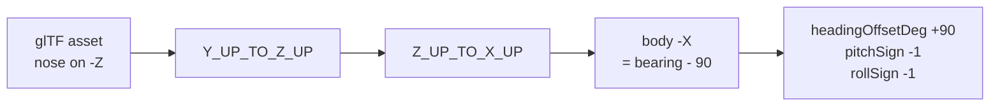
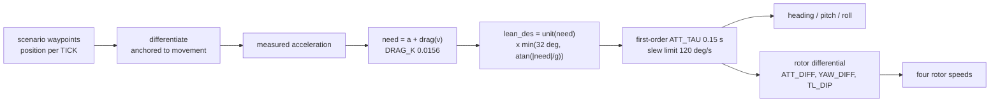

# 3D vehicle rendering: the conventions that cost days

Every number here was measured, either out of the GLB binary, out of
Cesium's own source in `node_modules`, or sampled from Cesium World
Terrain. None of it is inferred from how a model looks on screen, because
looking at one camera angle is exactly how the mistakes below happened.

Read this before placing, orienting, scaling or animating any model.

## 1. Altitude is above the ellipsoid, not above the ground

`Cesium.Cartesian3.fromDegrees(lon, lat, h)` treats `h` as a height above
the WGS84 ellipsoid. Cesium World Terrain also reports its heights above
the ellipsoid. So `h = 0` is **not the ground**.

Sampled with `sampleTerrainMostDetailed`:

| Place | Ellipsoidal height |
|---|---|
| Copenhagen 04R threshold | 38.03 m |
| 04R rollout end | 38.74 m |
| Sensor N15, Runway 04R Central | 42.42 m |
| Open sea 18 km out | 36.13 m |

Consequence: **every track in this app renders 38 m below its stated
altitude.** At 100 m above ground level nobody can see it. An airliner
told to touch down at `alt: 0` crosses the surface 600 m short of the
threshold and spends the whole rollout underground.

The correction is opt-in, via `terrainRelativeAlt: true` on a template,
and `cph_jet_friendly` is the only one that carries it. It is not applied
globally on purpose: the shared assignment feeds every scenario, and
those altitudes were authored and eyeballed against what is on screen
today, so a global 38 m lift would move every drone at once.

Two traps when correcting it:

- **`globe.getHeight()` reads the currently loaded tile**, so it steps as
  the level of detail refines and returns `undefined` before tiles
  stream. Smooth it, and only take the sample when it comes back
  positive, or the aircraft pops mid-approach.
- **A single constant does not track the surface.** The six rollout
  waypoints read 38.02, 38.88, 38.22, 38.08, 40.42, 38.74. A flat +38.0
  leaves the aircraft 2.4 m under the rendered runway. The draped
  orthophoto follows the terrain exactly, so the terrain surface *is* the
  visible runway.
- **Height above ground is still what the rest of the app wants.** The
  label, the persisted recording sample, `_updateContributingSensorsForPosition`
  and `_shouldAutoDetect` all read the waypoint altitude. Correct the
  rendered position only.

## 2. `minimumPixelSize` and `maximumScale` are map-symbol knobs

They exist so a 3 metre drone stays readable as a symbol. Applied to a
large aircraft they are ruinous, and Cesium's arithmetic
(`CesiumUnminified/index.cjs`) is:

```
scale          = minimumPixelSize * metresPerPixel / (2 * boundingSphereRadius)
_computedScale = min(maximumScale, scale)
```

The A320 had a 258 px floor against a 12x cap with a 26.06 m bounding
radius, which drew a 37.6 m aircraft **451 m long and 409 m in span** for
the first 15.8 km of an 18 km approach, then shrank it continuously to
life size over the last 2.3 km.

For anything that should read at true size: `minimumPixelSize: 0`,
`maximumScale: 1`. It becomes a small object beyond about 2 km, which is
what a real 18 km final looks like, and is what a camera move is for.

## 3. Nose-on-body-minus-X reverses pitch and roll as well as heading

The glTF convention is nose along +Z, and Cesium's axis correction
(`Y_UP_TO_Z_UP` then `Z_UP_TO_X_UP`) maps glTF +Z onto body +X. An asset
authored nose-reversed therefore lands with its nose on body -X, which
needs a further -90 on heading **and flips the pitch and roll axes
through the airframe**.



The Shahed's note in `main.js` already stated this rule. The A320 needed
the same +90 heading offset, so it was the same case, yet it carried
`pitchSign: 1` and no `rollSign` at all. The rule was written down and
not applied. Symptoms it produced:

- commanded pitch +10 put the nose 10 degrees **down**
- a -3 degree glideslope rendered as nose 3 degrees **above** the horizon,
  a 6 degree angle of attack, which is plausible enough to survive review
- a commanded right bank rolled the aircraft **left**

**"Pitch becomes roll" was a wrong diagnosis, not a real effect.** Probing
the transform directly: at heading 130 / pitch 10 / roll 0 the model's +X
axis stays at 0.000 elevation and the nose tilts; at heading 130 / pitch 0
/ roll 10 the nose stays at 0.000 and +X tilts. Pitch acts on the lateral
axis and roll on the longitudinal one, correctly. There is no axis leak to
compensate for. If a rotation appears on the wrong axis, suspect the signs
and the yaw, and measure before adding a compensation.

## 4. The 2D icon's bearing trim leaks into 3D attitude

`__isr_icon_tuning.bearingTrimDeg` defaults to **-2** and exists to align
a canvas icon's drawn apex with its computed course. It is written into
`state.stateHolder.headingRad`, which is the same field the 3D
orientation rigs read.

So **every model in this app crabs 2 degrees off its flight path.** On a
drone symbol that is invisible. On a 37.6 m airliner against runway edges
it is the nose visibly off the centreline, and it is what reads as
"tilted to the right compared with its trend line".

Stripped per airframe via `stripIconTrim: true`, which cancels it
(`-(true + trim) + trim`). Not fixed at the source: the trim is correct
for the icons it was tuned against, and changing the shared field would
silently re-aim the Shahed, the quadcopters and the Mi-24. The clean
version, if it is ever worth it, is a separate `courseRad` field that the
rigs read while the billboard keeps `headingRad`.

## 5. `runAnimations: true` means loop forever

Cesium's `ModelVisualizer` adds entity animations with
`loop: ModelAnimationLoop.REPEAT`, unconditionally, and exposes no clamp
through `ModelGraphics`:

```js
model.activeAnimations.addAll({ loop: ModelAnimationLoop_default.REPEAT })
```

A flat `true` therefore ran the A320's 28.17 s landing sequence **11
times** across a 302 s approach: gear retracting and re-extending twelve
times on final, and a 9.32 m jump at every loop boundary, because the
clip's root node (`Fuselage_02`) carries the descent.

`runAnimations` is read through `Property.getValueOrDefault`, so it can be
a `CallbackProperty`. Return `true` until the sequence has run its length,
then `false`, and Cesium calls `removeAll()`.

**Freezing on the rest pose is safe for this asset, by measurement.** Of
the animation's 248 channels, only 5 differ between the final frame and
the bind pose, and all 5 are spinning parts (both main wheels, the nose
wheel, the two engine fans) where the stopping angle is arbitrary. 79
channels differ at the **first** frame, which is the gear-up airborne
configuration. Check this per asset rather than assuming it:
compare each channel's last keyframe against the target node's own
translation, rotation and scale in the glTF JSON.

The timer starts on the property's first evaluation, which is the correct
instant by construction: `ModelVisualizer` only reads it inside
`if (model.ready)`, the same frame it calls `addAll()`. A 97 MB load
cannot desynchronise it.

One accepted wart: the animation advances on `viewer.clock`, not on
`monoNow()`, so it does not freeze when the simulation is paused.

## 5b. Texture budget: check it before blaming the geometry

A Sketchfab download is sized for a product render, not for a scene that
already holds terrain, imagery, buildings and a post-processing grade.
Uncompressed GPU cost is `width * height * 4 * 1.33` per image, and it is
independent of how large the model draws on screen.

The A320 made the map unusable: seconds per frame, ten seconds to pan.
The cause was not its geometry, which is only 75,815 vertices across 26
primitives. It was **sixteen 4096x4096 textures**, four materials with a
base colour, occlusion, normal and specular map each, for **1,431 MB of
GPU memory in one aircraft.**

Measured across the fleet:

| Model | File | GPU | Textures |
|---|---|---|---|
| a320_landing_config.glb (unused) | 93.8 MB | **1431 MB** | 16 at 4096 |
| airbus_a320_indonesian_presidential_livery.glb (source) | 97.1 MB | **1431 MB** | 16 at 4096 |
| boeing_787-9_qantas_centenary.glb | 16.3 MB | 240 MB | 10 at 4096 |
| a320_opt.glb (in use) | 12.8 MB | 123 MB | 16 at 2048 |
| f-35a_lightning_ii.glb | 19.5 MB | 111 MB | 25 at 1024 |
| airbus_a380.glb | 17.1 MB | 99 MB | 20 at 1024 |
| mh-60r_seahawk_crewed.glb | 6.2 MB | 34 MB | 6 at 1024 |

The A320 was the only outlier by an order of magnitude. Note that file
size does not predict it: the 787 Dreamliner is 40.2 MB on disk and only
21 MB on the GPU, while the A320 Qantas 787 is 16.3 MB on disk and 240 MB
on the GPU.

Size each map to what it contributes at the range the model is seen:

- **base colour** carries the livery, so 2048
- **normal** 1024
- **occlusion and specular** are low-frequency, so 512. These were the
  worst offenders here: three of them were 15 to 18 MB PNGs costing 89 MB
  of GPU each, for maps nobody can resolve on a landing aircraft.

`scripts/optimise_glb_textures.py` does this and rewrites the GLB. It
re-encodes to JPEG wherever an image has no meaningful alpha, which also
cut the file from 97 MB to 13 MB and removed the first-load stall.

**Verify a rewrite rather than trusting it.** Compare every non-image
bufferView byte-for-byte against the source, and check the animation
channel and skin joint counts. For a320_opt.glb: 9 of 9 bufferViews
identical, 248 channels, 142 joints.

## 6. Skinned and unskinned models are not interchangeable

`nodeTransformations` drives plain nodes. The Mi-24's rotors work that way
because it is unskinned.

On a **skinned** mesh the named nodes are skeleton joints and the mesh is
deformed by the joint hierarchy rather than drawn under it. Overriding a
subset of joints while the rest keep their defaults breaks the skin: the
A320 attempt overrode 83 of 248 joints and scattered wings, flaps and
gear around the fuselage.

A joint whose vertices are weighted **entirely** to it is the exception.
The two engine fans qualify: minimum dominant weight over all 3,166 fan
vertices is exactly 1.000000, and no other primitive has any weight on an
engine joint. So those two can be driven without touching the skin.

Also, `NodeTransformationProperty.getValue` falls back to
`Cartesian3.ZERO` for an unspecified `translation`, **not** to the node's
own value. A rotation-only transform teleports the part to the model
origin and swings it in an arc. Always set `translation` and `scale`
explicitly, as the Mi-24 block does. The existing gear nodes survived
this only because they genuinely have no translation.

## 6b. Wingtip vortices

`src/airliner_vortices.js`. Two condensation cores trailing the wingtips,
which is the read that says "heavy aircraft, high angle of attack, humid
air" in a second of footage.

Built on the mechanism already here, a polyline over a ring buffer fed
from the tick, so it freezes when the simulation freezes. It is NOT the
sheet of vapour that forms over the wing root: that is a volume sitting on
the wing rather than a trail behind it, only a particle system expresses
it, and a Cesium `ParticleSystem` advances on `viewer.clock` rather than
on `monoNow()`, so it would keep emitting while the simulation is paused.

The tip offsets are measured from the model's 75,815 vertices in bind
pose: X +/- 17.009, Y 4.298, Z 4.550, span 34.115 m against the real
A320's 34.1 m. The nose is on model -Z, so in body terms a wingtip is
4.55 m aft of the origin and 4.30 m above it. The body offset is rotated
by roll, then pitch, then heading, the same order that finally made the
helicopter's gun work, because a point 17 m outboard moves 4.4 m
vertically through a 15 degree bank.

Live: `window.__isr_vortex_tuning = { seconds, width, alpha, side, up,
forward, fadeFromAglM }`.

## 6c. A flat icon cannot always express a 3D direction

The track symbol is a billboard with `alignedAxis` set to the horizontal
heading vector. Cesium aligns the image's up direction with that vector
**projected into the screen plane**. That projection is well conditioned
from above and degenerate when the camera looks along the direction of
travel, where a small perpendicular component decides the whole result
and the nose can swing far from where it looks like it should point.

The file already records the same trap for `alignedAxis = up`, which is
degenerate from a horizontal viewpoint. It is the same failure in a
different axis.

So before tuning any constant for an icon that points the wrong way,
establish whether the error moves when the camera orbits. If it does, it
is this, and no constant fixes it. `window.__isr_iconDebug()` prints what
the icon is told to do, the true ground track, the error, and the camera
orientation.

## 7. Measurement beats eyes, and a box is not a position

Carried over from the gun-muzzle placement, which took about fifteen
rounds of testing:

- **A bounding box is not a part's position.** It lumps parts together.
  The "13.6 m flat panel" that looked unusable as an engine fan was the
  combined box of two correct 1.78 m discs sitting 11.81 m apart. Read
  the vertices.
- **A point bolted to an airframe must be rotated by the full attitude**,
  roll then pitch then heading. Heading alone is only correct for a level
  airframe. A point 1.8 m outboard moves 1.11 m vertically through a 30
  degree bank, which is why no fixed number survived two camera angles.
- **Symptoms that change with the camera are a transform bug**, not a
  constant that needs tuning. Stop adjusting numbers and check the maths.
- **A 2D check cannot confirm a 3D position.** Side-on, height is
  invisible.

## 8. Flight profiles: `interpolate()` is piecewise linear

`interpolate()` in `drones.js` is linear in latitude and longitude, so
ground speed is piecewise **constant** and steps at every waypoint. The
old airliner legs ran 62.5 then 74.8 m/s through the flare and 66.6 then
45.4 at the start of the rollout, both visible lurches. Generate times by
integrating one continuous speed profile instead of setting them by hand.

A flare is a curve, not a shallower straight line. The old final leg
*steepened* to -3.66 degrees and touched down at 490 fpm, which reads as
being driven into the tarmac. The current profile is a cubic Hermite from
the glideslope gradient at the threshold (50 ft) to 148 fpm at the
wheels, touching down 450 m in, inside the touchdown zone markings the
orthophoto shows.

## 8b. A heading derived from one frame cannot curve

The model's heading target is `-atan2(dLon, dLat)` across two
consecutive frames. On a straight segment that direction never changes,
so the heading is constant inside the segment and steps at the corner.
The airliner rig derives bank from the yaw rate it sees
(`coordinatedBank`, `atan(v omega / g)`), so a path of straight legs
makes the aircraft snap flat through a turn and then roll afterwards,
and a 24-point circle rolls in at every waypoint and levels out in
between while still turning.

Resolution is the fix, not smoothing. `cph_jet_hold_atc` generates its
path at 0.25 s a point (`_cphHoldPath` in `drones.js`), which puts each
heading step at about 0.19 degrees, below what the filter chain settles
in. Measured on the result: 0.000 deg/s down the approach, a flat 1.502
deg/s through the orbit.

Do not round generated coordinates. Six decimals is 0.11 m, which is six
per cent of the 1.9 m an airliner covers in a frame, and it showed up as
plus or minus a degree a second of yaw jitter on a turn asking for 1.73.

## 8c. Third-party liveries have to come off before anything ships

`a320_noskin.glb` arrived in Indonesian presidential livery: REPUBLIK
INDONESIA titles down both sides, two Garuda crests, the A-001
registration in four places, a gold star-and-wreath on each side of the
fin, and five flag patches. `scripts/strip_airliner_livery.py` removes
all of it and keeps the red and gold scheme, because a plain white
aircraft reads as a placeholder.

Two things in there are worth reusing:

- **Fill from paint, not from the adjacent pixel.** Taking the column
  either side of a region smeared a cabin window across the fuselage
  wherever a row happened to end on one. Take the median of a ring
  around the region, then have each row search outward for the nearest
  pixel close to it.
- **Pad the replacement to the original byte length.** Each cleaned PNG
  is smaller, so a `tEXt` chunk pads it to match exactly and it is
  written in place. Every `bufferView` offset stays valid and the file
  size does not change. The alternative is rebuilding the buffer and
  rewriting 1,394 accessor offsets.

Restore with `git checkout public/aircraft/a320_noskin.glb`.

## 8d. A marker that will not stay on its sensor, and a ring that will not draw

Three faults, routinely mistaken for one, and all three read as "the
coordinates are wrong" when the coordinates were never wrong.

**A clamped `point` is not a point. It is a billboard.** This is the one
fact that explains the whole afternoon, and it is in
`PointVisualizer.js`:

```js
if (heightReference !== HeightReference.NONE && !defined(billboard)) {
  if (defined(pointPrimitive)) { returnPrimitive(...); }
  billboard = cluster.getBillboard(entity);   // not a PointPrimitive
  ...
}
```

`PointPrimitiveCollection` has no terrain clamping, so any `point` with
a `heightReference` is quietly rendered as a `Billboard` whose image is
a canvas drawn by `createBillboardPointCallback`. A clamped `point` and
a clamped `billboard` are therefore the *same class*, clamped by the
*same* `Billboard._updateClamping` through the *same*
`scene.getHeight(position, heightReference)`. They cannot resolve to
different heights. An earlier version of this document claimed a point
resolved against the photogrammetry mesh and a billboard against
terrain, 38 m apart at CPH. That is not what the source says, and three
commits were spent acting on it.

**The ring rendered nothing because its texture key changed every
frame.** `PointVisualizer` caches the generated canvas in the
collection's texture atlas under

```js
textureId = JSON.stringify([cssColor, newPixelSize, cssOutlineColor, newOutlineWidth])
```

and regenerates it whenever any of those four changes. All four were
`CallbackProperty`s on the pulse ring, and `Color.toCssColorString()`
prints the raw float alpha (`rgba(77,210,255,0.5327148)`), so a pulsing
alpha minted a brand new key every frame. A new key is a cold atlas
entry: `TextureAtlas.addImage` returns a promise that cannot resolve
before that frame's `afterRender`, and the next frame overwrote the key
and cancelled the load (`if (this._id !== id) return`). So
`billboard.ready` stayed false forever, and an unready billboard is
written with its image dimensions at zero:

```js
const imageWidth  = Math.round(billboard.width ?? 0);   // width is undefined until LOADED
const imageHeight = billboard.height ?? 0;
```

which the vertex shader turns into `halfSize = imageSize * scale * 0.5`
= 0. A zero-area quad. No error, no warning, no ring, plus a fresh
canvas uploaded to the atlas every frame for every sensor in range.

The rule that falls out of this: **on a clamped `point`, fill colour,
outline colour, outline width and pixel size are texture inputs, not
animation inputs.** Animate any of them and the mark disappears. The
ring holds all four constant — two keys exist for the whole session,
cyan and amber — and pulses through `scaleByDistance` instead, which
`PointVisualizer` forwards straight to the billboard and which is not
part of the key. `nearValue` and `farValue` are set to the same number,
so it acts as a plain per-frame multiplier rather than a distance ramp.
The same economy the helicopter rotor already relies on: an atlas index,
never an upload.

A warm key resolves *synchronously* inside the visualizer pass, which is
why a ring rebuilt on every tick still draws on the tick that built it.

**`disableDepthTestDistance` must match between marks that must look
joined**, and for sensors it is Infinity on both. The dot was depth
tested while the ring was not, so the pair came apart at an oblique
angle for that reason alone, with no height disagreement involved.

Depth testing both was tried as the default and it hides the pulse. The
ring is a 26 px mark clamped to the surface, so its anchor depth is
level with the ground it is drawn on and the per-fragment depth test
discards it, while the 8 px dot is small enough to survive. Verified on
the map rather than argued. `__isr_sensorDepth(true)` turns it on for a
shot that wants it.

The cost of drawing on top is that a sensor behind a terminal shows
through it. For an operator that is the right failure: never losing
sight of a sensor beats a prettier oblique view.

The ring also reads its position off its own dot
(`dotEntity.position.getValue(...)`) rather than recomputing
lon/lat/0 beside it, because the dot's position does not stay where
`renderSite` put it: the boot terrain sweep rewrites it and
`__isr_pinSensors` replaces it. One authority for where a sensor is.

What the wrong answers cost, so nobody repeats them: measuring one
height for both and pinning it brought a tile storm at boot
(`sampleHeightMostDetailed` requests the finest tile under every point),
a pin frozen at coarse detail that put every marker under the ground
once depth testing was on, and a render pass on a timer
(`scene.sampleHeight` is a pick) that made the application crawl.
`__isr_pinSensors()` survives as a manual command and is not needed for
any of this.

The cost of the point is that it cannot be dashed, so a degraded sensor
is marked by colour alone, amber against cyan, which is what its dot
already does.

Switches, both live without a reload:

```js
__isr_ringAudit()            // pairs every dot with its own pulse
await __isr_pinSensors()     // re-measure and pin
__isr_pinSensors.off()       // back to clamping
__isr_sensorDepth(false)     // back to drawing on top
```

`npm run check:sensor-pulse` is the gate: it reads `src/main.js` and
fails if the dot and the ring stop being the same graphics type, stop
sharing a `heightReference` and `disableDepthTestDistance` expression,
or if any of the four texture inputs on the ring becomes a
`CallbackProperty` again.

**Measure before you change this code.** Four attempts at it in one
afternoon took the map down twice, once through a dead-zone read on
boot and once by putting the ring on the sensor entity, which silently
suppressed the sensor's own point. `__isr_ringAudit` exists because
nothing in the source tells you where a marker actually ended up.

## 9. Propeller spin and attitude, outside Cesium

`scripts/blender_drone_flight_demo.py` runs inside Blender headless and
turns any drone file (`.blend`, `.glb`, `.fbx`, `.obj`) into an animated
`.blend` plus an MP4 of the airframe flying hover, forward, a banked 180
degree turn, brake, backward, slide right, slide left, descend, climb.

Nothing is keyframed by hand and nothing is read backwards from the
path. The motion comes from a small flight-controller model, the loop a
DJI runs:

1. The plan commands a velocity (stick, or waypoint).
2. A velocity loop asks for an acceleration, capped at `A_MAX`
   (6.5 m/s^2). The cap never binds: with the tilt limit at 32 degrees
   the airframe cannot accelerate harder than g tan(32) = 6.13 m/s^2
   whatever `A_MAX` says, so raising it does nothing.
3. That plus quadratic drag gives the lean the thrust must have,
   `tan(lean) = |a + k v|v|| / g`, capped at `MAX_TILT` (32 degrees; DJI
   limits sport mode to about 35). `k` is derived from the airframe,
   `DRAG_K = g tan(MAX_TILT) / TOP_SPEED^2`, because top speed is not a
   free parameter: `v_max = sqrt(g tan(MAX_TILT) / DRAG_K)`. Since
   2026-10-18 the file carries 0.0068111/m, a 30 m/s reconnaissance
   multirotor, the airframe the map flies. It was 0.0156, a DJI Air 3
   at 19.8 m/s, and asking the plan for more than that ceiling only
   pinned the lean.
4. The attitude follows that demand with a 0.15 s lag and a 120 deg/s
   slew limit, because a body has inertia and rotors finite authority.
   This is what makes a real one tip into a move and roll out of it.
5. Acceleration is `g tan(lean)` minus drag, integrated to velocity and
   position. Vertical speed is throttle, with its own 0.6 s response.
   Yaw is a rate command with a 0.3 s response.

So: nose down to go forward, nose UP to brake or fly backward, roll into
a slide, roll into a turn from the centripetal term, level on vertical
legs. The plan is sized from the dynamics: 25 m/s runs (0 to 25 takes
about 6 s against the drag, 25 to 0 about 4 s), a SLOW leg to 8 m/s
before a 30 deg/s turn, because the same yaw rate entered at 25 m/s
would ask 13 m/s^2 of centripetal lean and pin it. Measured on the Air 3
at the phase midpoints: 32 degrees nose down through the run-up, 25 at
24.7 m/s still accelerating, 22 of bank through the turn at 7.6 m/s,
25 nose up braking from 16 m/s, under 1 degree on descend and climb,
peak slew 123 deg/s including noise, gimbal 0.00 degrees off level.

`src/drones.js` mirrors the table as `_DEMO_PLAN` and the map's
`cph_dji_flight_demo` flies it; the two are kept in step by hand, so a
change to one is a change to both. 46.5 s, about 400 m end to end.

On top of that, what a real one does and the old shortcut never did:

- **Rotor speed per rotor.** Thrust goes with the square of rotor
  speed, so the base rate scales with `sqrt(thrust / weight)`: up with
  lean and climb, down in descent. A 3 percent dip in slow forward
  flight for translational lift (arXiv 2109.04741 measures about 9
  percent less power than hover at the endurance-optimal speed, and
  power goes with the cube of speed). During a pitch or roll
  *acceleration* the four differ: to pitch nose down the front pair
  drops and the rear rises, and the opposite to stop the rotation; the
  rates are equal while the attitude slews at its limit. During a yaw
  acceleration the clockwise and anticlockwise pairs differ, and
  reaction torque opposes spin, so to yaw anticlockwise the
  **clockwise** rotors speed up. A small steady differential holds the
  yaw rate against air drag. In steady cruise the average barely moves;
  the transitions are where it changes, which is what the ear hears.
- **The camera gimbal stays level** while the body leans
  (`--gimbal-near x,y,z,r`, a sphere in file units; for the Air 3
  `0,0.94,-0.49,0.13` takes ten meshes). Verified at 0.00 degrees off
  level across the whole flight.
- **Hover is not still.** Sub-degree attitude noise at a few tenths of
  a Hertz to 1.7 Hz, 3 cm of height wander, half a degree of yaw. The
  gimbal cancels the attitude part, which is the most recognisable
  thing about a hovering DJI.
- **The pivot is the centre of mass**, rotor centroid in plan and body
  centre in height, not the bounding-box centre, which on the Air 3 sat
  2 cm aft and 4 cm low of it because of the gimbal and legs.

```
/Applications/Blender.app/Contents/MacOS/Blender -b \
  --python scripts/blender_drone_flight_demo.py -- IN.glb --out OUT_DIR \
  --forward +Y --size-m 0.5 --gimbal-near 0,0.94,-0.49,0.13 \
  --render --stills [--prop-rps 18] [--props REGEX]
```

- `--forward` is the nose axis in Blender space. glTF's +Z nose imports
  as -Y, which is the default; the DJI Air 3 export has its nose on +Y.
  If the nose leads on the BACKWARD leg, the axis is reversed.
- `--size-m` is the real length of the longest extent. The file is
  scaled to it so m/s and g mean what they say; without it a 4.7 unit
  Air 3 flew like a 4.7 m aircraft.
- `--prop-rps` defaults to 18, not the physical 92 an Air 3 hovers at.
  At 30 fps with motion blur, 92 is over a turn per frame and renders as
  a clear disc, which is what a camera sees and what a viewer reads as
  "the propellers are gone". 18 is a 65 degree blur arc per frame.
- Props are found by name (`prop|rotor|blade`) first, then by shape: a
  sheet, 15 to 35 percent of the airframe long, off the body axis, and
  then the largest set of near-identical such sheets, which is what
  separates eight blades from two arms. The pick is printed with what
  was dropped. `--props` overrides it with a regex.

Verified on `assault_drone_concept.glb` (named rotors) and on
`dji_air_3.glb` (polyman, Sketchfab, CC-BY-4.0, 341 unnamed meshes) by
reading rotor hub heights, per-rotor rates, gimbal level and blade
attachment at every frame, not by looking at one still.

Two lessons that cost a render each. Blades are reparented with explicit
matrices: a freshly made object's `matrix_world` is identity until the
depsgraph runs, and reading it back to build the parent inverse carried
the hub offset twice, so the blades drifted loose of the airframe as it
flew, and motion blur hid it until a frame was rendered without blur.
And any vector read out of `matrix_world` on a scaled rig must be
normalised before taking an angle from it, or every tilt reads 84
degrees.

The DJI Mavic 3 Pro listing by ikad2023/dika3d (Sketchfab, now Fab and
Superhive) is a paid asset at USD 60 and is not downloadable without
buying it. The Air 3 is the free stand-in.

### Rotor nodes for Cesium, when the blades are already nodes

`split_quad_rotors.py` cuts blades out of one merged mesh. The Air 3 is
the other case: every blade already a node, buried four levels deep in
hinge matrices under a 0.01 scale and two up-axis swaps.
`scripts/group_rotor_nodes.py` composes the full 4x4 chain and
re-parents each pair under a new `Rotor_N` translation node at the hub,
placed under the node whose frame has the disc thin in Z (checked, since
`_quadRotorTransforms` spins about local Z). `group_nodes.py` would not
do: it rewrites translations only, which is right for the door gunner
and wrong under rotated ancestors. Verified by point cloud, 161,553
points, none moved. `public/aircraft/dji_air_3.glb` is the result,
numbered so 1 and 4 share a diagonal.

Wiring note for whoever swaps it in: in the `root` node's frame the nose
is +Y, and `Sketchfab_model` maps that to glTF -Z, so the asset is
nose-reversed like the Shahed. Expect the extra -90 on heading and
`pitchSign`/`rollSign` at -1 (section 3). It is 311k triangles against
the assault drone's 18k; simplify with meshoptimizer as the Shahed was
if it costs frame time at swarm counts.

## 8e. A pixel floor with no ceiling, and a lead that had neither

Reported twice, in opposite directions, which is what pinned it down:
"drones scaling WAY TOO MUCH when you expand, why can't they stay the same size
no matter your POV", then after the first fix, "only one drone in the swarm is
present, and they are too small".

**`minimumPixelSize` means "never smaller than N pixels at ANY distance."** The
helicopter and the F-35 each bound that with a `maximumScale` of twelve times
life size. The swarm wingmen had the floor and no bound.

**The lead had neither.** `_droneEntitySpec.model` set no `minimumPixelSize` at
all, so a lead drew at true world scale while its four wingmen sat on a 14 px
floor. Four drones ballooning around one that did not is why it read as a
scaling bug rather than a size setting.

Removing the floor fixed the ballooning and produced the second report: at 480 m
a 1 m drone is 1.8 px, so the formation became five dots, and at the ranges the
WITHOUT ISR camera actually uses only the nearest was picked out at all.

**Both now carry the same floor and the same bound**, quads only:

| distance | life size | before: floor, no bound | now: floor + 12x bound |
|---|---|---|---|
| 250 m | 3.46 px | 14 px, 4x life | 14 px, 4x life |
| 480 m | 1.80 px | 14 px, 8x life | 14 px, 7.8x life |
| 740 m | 1.17 px | 14 px, 12x life | 14 px, the bound takes over |
| 3 km | 0.29 px | 14 px, 48x life | 3.46 px, 12x life |
| 20 km | 0.04 px | 14 px, **323x life** | 0.52 px, 12x life |

The floor governs up close, where the formation has to read as aircraft. The
bound governs beyond about 740 m, where the drone shrinks proportionally and
cannot run away. The airliner, the Mi-24 and the Shahed each carry their own
sizing and none of them was reported, so the block is skipped for them and the
Shahed keeps the 24 it was tuned at.

**The key is `swarmMinimumPixelSize`, not `minimumPixelSize`.** The shared
`__isr_quad_tuning` object is SEEDED with `minimumPixelSize: 14`, so a fallback
against that key is dead code; the key is always present. The shared key is also
read by the interceptor quad, a different vehicle that was not reported and must
not move. Both knobs are live:

```js
__isr_quad_tuning.swarmMinimumPixelSize = 20   // bigger up close
__isr_quad_tuning.swarmMaxExaggeration  = 8    // shrink harder at range
```

**Verified in a browser, not from the source.** The first attempt edited the
`?? 20` fallback at the spec and changed nothing at all, because of the seeded
key above. Reading the live entities is what caught it, and is how the final
state was confirmed:

```
entity           scale   minPx   maxScale
9001             0.5     14      6          <- the lead, which had none of this
9001-swarm-1     0.5     14      6
9001-swarm-2     0.5     14      6
9001-swarm-3     0.5     14      6
9001-swarm-4     0.5     14      6
```

## 8f. Altitude was linear in time, so the vertical rate was a staircase

Reported as the aircraft jumping up and down in the WITHOUT ISR run while being
stable in the WITH ISR hold. The two fly different path generators, and that is
the whole difference.

`_smoothPath` splined latitude and longitude with Catmull-Rom but left altitude
**linear in time** between the hand-written waypoints. Each segment then has its
own constant vertical speed and the speed STEPS at every corner. The attitude
rig derives pitch from the climb rate, so it snapped the nose at each one.
Measured on `cph_jet_goaround_early`:

```
 tSec    alt    rate m/s   change
  379     37      -3.39
  383     59      +4.78     +8.17   <- pull-up
  389    132     +13.27     +8.49
  445    857     +11.32     -3.29
  482   1157      +7.96     -3.36
```

The descent itself was harmless, 0.09 to 0.16 m/s per corner. The pull-up and
the climb-out were not.

The hold path never had this: `_cphHoldPath()` generates an analytic 3.0 degree
approach and a circular orbit sampled at 0.25 s, so its vertical rate is
continuous by construction. It also orbits over Køge Bugt, where the terrain
under a `terrainRelativeAlt` track is flat water.

**A plain spline on altitude is the wrong fix** and the original comment said
so: it overshoots at a level-off and would put the aircraft through its own
glidepath on the flare.

**A monotone cubic does both.** Fritsch-Carlson tangents force the derivative to
ZERO at a local extremum, so the curve cannot leave the interval its two
neighbouring waypoints bound. The pull-up at t=379 IS a local minimum, so the
rate passes through zero continuously instead of stepping 8.5 m/s, and the
altitude still cannot undershoot the 37 m the waypoint declares.

```
worst per-sample vertical rate jump   8.49 m/s  ->  1.04 m/s
minimum altitude on the resampled path            37.00 m, exactly the waypoint
```

Every waypoint altitude is still hit exactly. Only the shape BETWEEN waypoints
changed. Blast radius is `cph_jet_goaround_early` and `cph_jet_goaround_atc`,
the only two templates that call `_smoothPath`; the hold path does not.

**Still outstanding on that aircraft.** The go-around flies the approach over
the city with `terrainRelativeAlt: true`, so the sampled mesh height under it
varies building to building and moves the aircraft with it. The hold is over
water and never sees this. An airliner on an approach flies a geometric glide
path, not a terrain-following one, so the flag is arguably wrong for this
airframe, but changing it touches the landing visuals in the other scenarios
and has not been done.

## 8g. The landing jump was the terrain reference, sampled at 150 ms and followed in 100 ms

Reported as the aircraft jumping up and down when it is about to land, while
being clean for the rest of the flight.

A `terrainRelativeAlt` track's altitude is the sampled surface plus its own
height, so every step in the surface reference moves the aircraft. Below 80 m
the reference came from `scene.sampleHeight`, which reads the RENDERED surface,
re-sampled every 150 ms, and the offset eased toward each new sample at 0.12 per
frame: about a tenth of a second.

Over an airport that rendered surface is the photogrammetry mesh. Hangars,
fences, parked aircraft, and a level of detail that refines as the camera
approaches. Successive samples differ by metres, and the aircraft was on each
new one within a tenth of a second.

The 0.12 was tuned for the ROLLOUT, where the wheels are genuinely on a runway
that rises along its length and lagging it sinks them. 80 m is far too high a
threshold for that: an aircraft in the air is not following the ground, it is
flying a straight glide path to one runway. The WITHOUT ISR run breaks off at
37 m and never touches a runway, so it spent its last 26 seconds inside that
branch for no reason at all.

**Threshold moved to 10 m.** Below it the wheels really are about to be on the
surface. Above it, the slow 0.02 ease that already governs every approach above
80 m governs this part too, and the aircraft has never been reported twitching
up there.

The hold path in the WITH ISR run never showed this: it orbits over Køge Bugt,
where the surface under a terrain-relative track is flat water.

## 8h. Two quadcopter models, two axis conventions, one switch

The gun drone stays. `assault_drone_concept.glb` is the default and is what the
interceptor quad hardcodes, because the gun pod IS that airframe. Nothing about
the swap touches it.

`dji_air_3.glb` (CC-BY polyman, rotor nodes added in `da1bdbb`) is selectable:

```js
__isr_quad_tuning.model = 'dji_air_3'    // then launch a scenario
```

The uri is read when the entity is built, so it applies to the next spawn, not
to one already flying.

**Why the orientation lives with the model and not in the tuning object.**
`assault_drone_concept` is authored nose on body +X. `dji_air_3` is nose on
glTF -Z, reversed like the Shahed. One shared set of `headingOffsetDeg`,
`pitchSign` and `rollSign` cannot describe both, and the wrong one flies the
airframe sideways. So `_QUAD_MODELS` carries uri, scale and axis convention
together and `_quadModelSpec()` resolves it:

| | assault_drone_concept | dji_air_3 |
|---|---|---|
| longest axis, composed | 2.315 m | 4.672 m |
| scale | 0.5 | 0.248 |
| rendered size | 1.158 m | 1.158 m |
| headingOffsetDeg | 270 | 180 |
| pitchSign / rollSign | 1 / 1 | -1 / -1 |
| triangles | 24,896 | 311,072 |

Scale is chosen so both render at 1.158 m, which is what the map has always
drawn and what three signed-off scenarios were judged against. Both are
deliberately larger than life: a real Air 3 is about 0.25 m across and would be
a single pixel.

Sizes come from composing each asset's FULL node transform chain. The raw
accessor extents are meaningless for the Air 3, whose geometry sits under
folding-arm hinge matrices, a 0.01 scale and two up-axis swaps. Raw it reads
322 x 190 x 167; composed it is 4.672 x 1.050 x 4.010.

Rotor hub positions, composed the same way, confirm the diagonals the spin code
assumes (1 and 4 one way, 2 and 3 the other):

```
dji_air_3               assault_drone_concept
  Rotor_1  +X -Z          Rotor_1  -X +Z
  Rotor_2  +X +Z          Rotor_2  -X -Z
  Rotor_3  -X -Z          Rotor_3  +X +Z
  Rotor_4  -X +Z          Rotor_4  +X -Z
```

**The switch is read ONCE, at the drone's birth.** `_quadKey` is captured at
the top of `createDroneEntities` and every consumer takes it: the uri, both
scales, both bounds, and both attitude rigs.

That binding is the whole fix for the first live run of this feature, which
produced the old gun drone flying sideways. The uri is read once when the
entity is built; the orientation is read EVERY FRAME inside the attitude
callback. Reading the live switch in both places meant that flipping it while
drones were airborne left them wearing the old body with the new model's axis
convention, and they turned on the spot. One captured constant cannot disagree
with itself. Reproduced and confirmed fixed: flipping mid-flight now leaves the
model and the orientation alone, and the next spawn picks the new model up.

**Two things only a real GPU can settle,** which is why the default did not
change:
- Nose direction. 180 / -1 / -1 comes from the asset work, not from anyone's
  eyes. If the nose points wrong, `__isr_quad_tuning.modelOverride = { headingOffsetDeg: 90 }`
  and try 0, 90, 180, 270. That is the same workflow the Shahed and the quad
  tuning comments have always prescribed.
- 311k triangles against 24.9k, times five in a formation. Software rendering
  says nothing useful about frame time.

**`modelOverride` is a separate namespace on purpose.** `__isr_quad_tuning` is
SEEDED with the assault drone's `scale: 0.5`, `headingOffsetDeg: 270` and
`minimumPixelSize: 14`, so a `?? fallback` against any of those keys can never
reach another model's value: the key is always present. That trap has now
produced three no-op fixes in this file. `t.scale` still governs while the
default model is selected, because 0.5 IS its correct value and the knob is
documented; a selected model brings its own.

## 8i. The lead drone's propellers never turned

`nodeTransformations` was set in exactly three places: the interceptor quad, the
swarm WINGMEN, and the helicopter. Not on `_droneEntitySpec.model`. So a single
hostile quad's propellers stood still, and in a formation the four wingmen
turned while the lead did not.

The comment beside the wingmen read "same reasoning as the single-drone spec
above", which had stopped being true. `__isr_propCheck()` already carried a line
for this exact case, "nothing is driving its propellers", and it was never hit
because nobody ran it against a lead.

Fixed by giving the lead spec the same `_quadRotorTransforms` call, quads only:
the Shahed has no rotors, the Mi-24 drives its own main and tail rotor, and the
airliner runs the builder's animation clip.

Verified on the live entities rather than from the source:

```
before                              after
9001          rotors (none)         9001          Rotor_1..4
9001-swarm-1  Rotor_1..4            9001-swarm-1  Rotor_1..4
```

## 8j. The quadcopter flight model is the Blender one, running in the browser

Threat drones no longer use a smoothing rig. They run the airframe and
controller from `scripts/blender_drone_flight_demo.py`, ported to
`src/quad_flight_model.js`: same constants, same names, same values.



**What replaced what.** The old rig was eight cosmetic constants:
`headingSmoothing`, `pitchSmoothing`, `rollSmoothing`, `bankFactor`,
`forwardPitchDeg`, `cruiseMs`, `bankClampDeg`, `pitchClampDeg`. It smoothed the
heading toward the direction of travel, biased the pitch by speed, and set the
roll to yaw rate times a made-up factor. It described how an icon should look.
The model describes an aircraft. The eight survive for the INTERCEPTOR quad,
which has no flight model.

**The one difference from Blender, and it is structural.** In Blender the
controller owns the trajectory: a velocity plan goes in, the velocity loop makes
a lean, the lean makes an acceleration, and the acceleration is integrated into
a position. On the map the position is an INPUT and nothing may move a track off
its waypoints. So the chain is inverted. The position is differentiated to
velocity and again to acceleration, and from there the physics is identical: the
same question, what lean does an airframe need to produce this acceleration
against this drag, answered with the same equation.

**Two clocks, and both of them bit.**

The position advances on the simulation TICK. The model runs every render FRAME.
Dividing a tick's whole displacement by one frame's 16 ms reported a drone at
**309 m/s**, which demands an impossible lean and saturates the tilt. The
velocity is therefore anchored to MOVEMENT: the clock is the time since the
position last actually changed, the velocity is held between ticks, and only the
attitude loop runs per frame. This is the same trap that produced a 4.9 degree
bank instead of 18.8 on the airliner.

Then the integration step is clamped to 0.1 s, because integrating a half-second
gap through a 0.15 s time constant is a jump rather than a loop. Using that same
clamped value as the velocity clock reported **300 m/s again**, and as the
velocity filter's time constant it reported **7.3 m/s instead of 15**. So there
are two clocks on purpose: raw elapsed for anything measuring the world, clamped
for anything integrating state. Neither showed at 60 fps; both showed in a
throttled tab, which is what a headless browser is.

**Per airframe, not per formation.** Each swarm member owns its own model
instance, with the hover noise decorrelated by seed, because five drones flying
slightly different paths lean differently and should not breathe in unison.

**The rotors differentiate.** `_quadRotorTransforms` now accepts either a single
speed, which is what the interceptor still passes, or four. A quadcopter tilts
and yaws by driving its rotors apart, about 8 per cent at full attitude
acceleration, and that is visible on a close pass. Rotor geometry comes from the
composed hub positions in `_QUAD_ROTOR_HUBS`, where only the ratio between arms
matters so the model scale cancels.

**Gated.** `scripts/check-quad-flight.mjs`, in the build chain, reads every
constant out of the Python and fails if a pair has drifted, then flies the real
exported model and checks the physics:

```
speed is measured from MOVEMENT, not from frames
a steady cruise settles at the drag balance     atan(DRAG_K*15^2/g) = 19.7 deg
a cruise leans forward, not sideways
a throttled tab still reports the real speed
top speed does not exceed the tilt limit
a hover is nearly level, but not perfectly still
```

That drag-balance equality is the whole airframe in one line: thrust tilt
balancing quadratic drag, and the model holds 19.6 against a predicted 19.7.

**The default airframe is now `dji_air_3`.** The gun drone is still in the repo,
still what the interceptor quad hardcodes because the gun pod IS that airframe,
and still one word away:

```js
__isr_quad_tuning.model = 'assault_drone_concept'
```

**Still unverified by eye:** whether the Air 3's nose points the way it flies.
`headingOffsetDeg: 180` with pitch and roll at -1 comes from the asset work, not
from anyone looking at a render. If it is wrong,
`__isr_quad_tuning.modelOverride = { headingOffsetDeg: 90 }` and try 0, 90, 180,
270. And 311k triangles against 24.9k, times five: software rendering says
nothing useful about frame time.

## 8k. Three failures from the first real test, and what each one was

**1. Sideways.** The nose axis was right, the offset was wrong. Measured rather
than assumed: the gimbal camera cluster is the lowest geometry in the asset,
sits on the centreline at X 0.00, and centres at Z -0.8 to -0.98. A DJI camera
hangs below and in FRONT, so the nose is on -Z, confirming the asset work. The
assault drone's nose is on +X with an offset of 270, the two differ by 90
degrees, so the only candidates were 180 and 0. 180 flew sideways, so it is 0.
If it is still wrong it is one line and no rebuild:
`__isr_quad_tuning.modelOverride = { headingOffsetDeg: 90 }`.

**2. Jumping.** Acceleration was `(vNew - vFiltered) / frameDt`. Between ticks
`vNew` is held constant while `vFiltered` is still converging toward it, so the
numerator was the filter's own residual and the denominator was 16 ms. Half a
metre per second of residual over one frame is 31 m/s2, past A_MAX, so the lean
saturated at the 32 degree tilt limit and sat there jittering on every frame of
every flight. It is why every airframe read exactly 11.5 degrees of tilt no
matter what it was doing.

Acceleration is now measured across two VELOCITY SAMPLES, over the time between
them. There is no new velocity between ticks, so there is no new acceleration
either; it is held, exactly as the velocity is. A steady 15 m/s cruise then
settles at 19.1 degrees against a drag balance of 19.7, with 1.5 degrees of
peak-to-peak movement that is the hover noise and nothing else.

That is the THIRD distinct form of the same mistake in this model: a per-tick
quantity divided by a per-frame interval. The first was the velocity, the second
the velocity filter's time constant, the third the acceleration.

**3. Lagging.** 311k triangles times five is 1.5M. Cut to 100k with
`scripts/simplify_dji_air_3.sh`, verified to leave the geometry alone: composed
extent within 0.5 mm, all four rotor hub positions unmoved to four decimal
places. The hubs matter because the flight model reads them for the rotor
differential.

NOT `gltf-transform optimize`. That runs flatten and join, which merge the
meshes and destroy Rotor_1..4 — checked, it leaves five nodes and no rotors, and
the propellers stop turning. `weld` then `simplify` keeps the node tree.

## 8k2. Parity note from the Blender thread, 2026-10-18

Done as asked in the handoff. `DRAG_K` in the Blender file is now the
literal 0.0068111, which is 9.81 tan(32 deg) / 30^2 to the precision the
gate's regex reads, and `TOP_SPEED_MS = 30.0` sits beside it so it can be
gated too. Lock it. Three things to know when you do:

- **The gate compares with `===`.** `FM.DRAG_K` is computed as an
  expression and the Python literal is rounded, so an exact comparison
  will fail by 7e-11. Either compare with a tolerance or write the same
  literal on the JS side.
- **`_DEMO_PLAN` in `drones.js` is not gated**, and neither is the
  `DRAG_K` inside `_demoFlightPath`, which was still 0.0156 (the DJI
  value) and would have capped the demo at 19.8 m/s. Both are updated to
  match the Blender file in this commit. Worth a check of their own,
  since "if you change PLAN the scenario changes with it" is only true
  while someone remembers to copy the table.
- **`A_MAX` is moot.** g tan(32) is 6.13 m/s^2 and `A_MAX` is 6.5, so
  the tilt limit sets the acceleration, not the loop cap. 0 to 25 m/s
  takes about 6 s and that is the airframe, not a sluggish constant;
  raising `A_MAX` changes nothing. A faster run-up needs a higher tilt
  limit.

The plan now runs at 25 m/s with a SLOW leg before a 30 deg/s turn at
8 m/s (see section 9 for why), 46.5 s instead of 33, about 400 m end to
end over the apron. The scenario note and duration follow from the
generator.

### 8k3. The remaining 6 m, and it is the attitude loop

Reply to 1140dbf, from the Blender thread. Your gate passes here. The
trajectories are not yet the same, and the residual is now a single
known thing.

Measured on the same plan: Blender flies 390.3 m of ground, the
generator 384. Not the step size: the Blender loop re-run in plain
Python gives 390.3 at 1/30, 390.2 at 1/60, 390.1 at 1/240. Then, same
loop:

```
full model                      390.2 m   peak 24.71
without the slew limit          388.4 m
without lag and slew (instant)  384.6 m   peak 24.70   <- your generator
```

`_demoFlightPath` computes `tilt = min(MAX_TILT, atan(need / G))` and
applies it in the same step. The Blender model keeps a lean STATE that
follows that demand with `ATT_TAU` (0.15 s) and the `ATT_RATE_DPS` slew
(120 deg/s), so the airframe takes about 0.3 s to reach a 32 degree
lean, and the acceleration comes from the lean it HAS, not the one it
wants. The path is shorter without that because every brake also
starts 0.3 s sooner.

It matters more than 6 m suggests, because `quad_flight_model.js` DOES
apply the lag, to the attitude it derives from the path. So on the map
the airframe moves off on an instant-lean path while its body is still
leaning into it: for a third of a second at every transition it
accelerates before it has tilted, which is the one thing a quadcopter
cannot do.

The fix is the three lines the Blender `fly()` has between the demand
and the acceleration, in your frame:

```js
// state, outside the loop
let leanE = 0, leanN = 0;
const ATT_TAU = 0.15, SLEW = 120 * DEG * dt;
// per step, after lean_des (= unit(need) * tilt) is known
let sE = (desE - leanE) * (1 - Math.exp(-dt / ATT_TAU));
let sN = (desN - leanN) * (1 - Math.exp(-dt / ATT_TAU));
const sl = Math.hypot(sE, sN);
if (sl > SLEW) { sE *= SLEW / sl; sN *= SLEW / sl; }
leanE += sE; leanN += sN;
const ll = Math.hypot(leanE, leanN);
const thrust = G * Math.tan(ll);
aE = (ll > 1e-9 ? leanE / ll * thrust : 0) - dragE;
aN = (ll > 1e-9 ? leanN / ll * thrust : 0) - dragN;
```

With that in, the generator should read 390 m and the gate can pin it:
path length within 1 m of 390.2 is a sharper test than peak speed,
because the peak is set by the plan and the length by the dynamics.
Left for you rather than done here: it is your generator and your gate
expectations.

## 8l. The manoeuvre sequence is now flyable

`cph_dji_flight_demo`, in the threat picker as "DJI Air 3 flight demo". It flies
the PLAN from `scripts/blender_drone_flight_demo.py`: hover, forward, a
sustained 60 deg/s turn, forward, brake, reverse, slide right, slide left,
descend, climb, hover. 33 seconds over the central apron at 90 m.

The plan is a VELOCITY command, which a track cannot take directly because its
position comes from waypoints. So `_demoFlightPath` integrates the plan with the
same velocity loop and vertical response the Blender script uses and emits
ordinary waypoints; the flight model then measures that path and arrives at the
same attitudes, because it is the same aircraft following the same trajectory.

Flown live, read off `__isr_quadFlight()`:

```
 t+3s   speed 7.6   tilt 20.1   pitch  20.1   roll   0.2    rotors 13.1 13.0 13.1 13.0
 t+12s  speed 0     tilt 20.2   pitch  -8.6   roll -18.3    rotors 15.7 12.6 10.7 12.4
 t+21s  speed 2.2   tilt 23.4   pitch -16.0   roll  17.1    rotors 10.8 15.6 14.9 10.6
 t+33s  speed 0     tilt  0.7   pitch  -0.1   roll   0.7    rotors 11.9 11.9 11.9 11.9
```

Leaning forward on the run, banked 18 degrees through the turn with the rotors
5 rps apart, nose up 16 degrees on the brake, and settled to under a degree in
the hover with the four rotors back together. Nothing in that is scripted.
