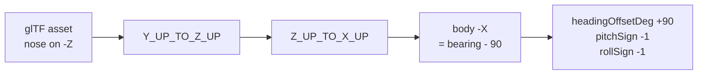

# 3D vehicle rendering: the conventions that cost days

Every number here was measured, either out of the GLB binary, out of
Cesium's own source in `node_modules`, or sampled from Cesium World
Terrain. None of it is inferred from how a model looks on screen, because
looking at one camera angle is exactly how the mistakes below happened.

Read this before placing, orienting, scaling or animating any model.

## 1. Altitude is above the ellipsoid, not above the ground

`Cesium.Cartesian3.fromDegrees(lon, lat, h)` treats `h` as a height above
the WGS84 ellipsoid. Cesium World Terrain also reports its heights above
the ellipsoid. So `h = 0` is **not the ground**.

Sampled with `sampleTerrainMostDetailed`:

| Place | Ellipsoidal height |
|---|---|
| Copenhagen 04R threshold | 38.03 m |
| 04R rollout end | 38.74 m |
| Sensor N15, Runway 04R Central | 42.42 m |
| Open sea 18 km out | 36.13 m |

Consequence: **every track in this app renders 38 m below its stated
altitude.** At 100 m above ground level nobody can see it. An airliner
told to touch down at `alt: 0` crosses the surface 600 m short of the
threshold and spends the whole rollout underground.

The correction is opt-in, via `terrainRelativeAlt: true` on a template,
and `cph_jet_friendly` is the only one that carries it. It is not applied
globally on purpose: the shared assignment feeds every scenario, and
those altitudes were authored and eyeballed against what is on screen
today, so a global 38 m lift would move every drone at once.

Two traps when correcting it:

- **`globe.getHeight()` reads the currently loaded tile**, so it steps as
  the level of detail refines and returns `undefined` before tiles
  stream. Smooth it, and only take the sample when it comes back
  positive, or the aircraft pops mid-approach.
- **A single constant does not track the surface.** The six rollout
  waypoints read 38.02, 38.88, 38.22, 38.08, 40.42, 38.74. A flat +38.0
  leaves the aircraft 2.4 m under the rendered runway. The draped
  orthophoto follows the terrain exactly, so the terrain surface *is* the
  visible runway.
- **Height above ground is still what the rest of the app wants.** The
  label, the persisted recording sample, `_updateContributingSensorsForPosition`
  and `_shouldAutoDetect` all read the waypoint altitude. Correct the
  rendered position only.

## 2. `minimumPixelSize` and `maximumScale` are map-symbol knobs

They exist so a 3 metre drone stays readable as a symbol. Applied to a
large aircraft they are ruinous, and Cesium's arithmetic
(`CesiumUnminified/index.cjs`) is:

```
scale          = minimumPixelSize * metresPerPixel / (2 * boundingSphereRadius)
_computedScale = min(maximumScale, scale)
```

The A320 had a 258 px floor against a 12x cap with a 26.06 m bounding
radius, which drew a 37.6 m aircraft **451 m long and 409 m in span** for
the first 15.8 km of an 18 km approach, then shrank it continuously to
life size over the last 2.3 km.

For anything that should read at true size: `minimumPixelSize: 0`,
`maximumScale: 1`. It becomes a small object beyond about 2 km, which is
what a real 18 km final looks like, and is what a camera move is for.

## 3. Nose-on-body-minus-X reverses pitch and roll as well as heading

The glTF convention is nose along +Z, and Cesium's axis correction
(`Y_UP_TO_Z_UP` then `Z_UP_TO_X_UP`) maps glTF +Z onto body +X. An asset
authored nose-reversed therefore lands with its nose on body -X, which
needs a further -90 on heading **and flips the pitch and roll axes
through the airframe**.



The Shahed's note in `main.js` already stated this rule. The A320 needed
the same +90 heading offset, so it was the same case, yet it carried
`pitchSign: 1` and no `rollSign` at all. The rule was written down and
not applied. Symptoms it produced:

- commanded pitch +10 put the nose 10 degrees **down**
- a -3 degree glideslope rendered as nose 3 degrees **above** the horizon,
  a 6 degree angle of attack, which is plausible enough to survive review
- a commanded right bank rolled the aircraft **left**

**"Pitch becomes roll" was a wrong diagnosis, not a real effect.** Probing
the transform directly: at heading 130 / pitch 10 / roll 0 the model's +X
axis stays at 0.000 elevation and the nose tilts; at heading 130 / pitch 0
/ roll 10 the nose stays at 0.000 and +X tilts. Pitch acts on the lateral
axis and roll on the longitudinal one, correctly. There is no axis leak to
compensate for. If a rotation appears on the wrong axis, suspect the signs
and the yaw, and measure before adding a compensation.

## 4. The 2D icon's bearing trim leaks into 3D attitude

`__isr_icon_tuning.bearingTrimDeg` defaults to **-2** and exists to align
a canvas icon's drawn apex with its computed course. It is written into
`state.stateHolder.headingRad`, which is the same field the 3D
orientation rigs read.

So **every model in this app crabs 2 degrees off its flight path.** On a
drone symbol that is invisible. On a 37.6 m airliner against runway edges
it is the nose visibly off the centreline, and it is what reads as
"tilted to the right compared with its trend line".

Stripped per airframe via `stripIconTrim: true`, which cancels it
(`-(true + trim) + trim`). Not fixed at the source: the trim is correct
for the icons it was tuned against, and changing the shared field would
silently re-aim the Shahed, the quadcopters and the Mi-24. The clean
version, if it is ever worth it, is a separate `courseRad` field that the
rigs read while the billboard keeps `headingRad`.

## 5. `runAnimations: true` means loop forever

Cesium's `ModelVisualizer` adds entity animations with
`loop: ModelAnimationLoop.REPEAT`, unconditionally, and exposes no clamp
through `ModelGraphics`:

```js
model.activeAnimations.addAll({ loop: ModelAnimationLoop_default.REPEAT })
```

A flat `true` therefore ran the A320's 28.17 s landing sequence **11
times** across a 302 s approach: gear retracting and re-extending twelve
times on final, and a 9.32 m jump at every loop boundary, because the
clip's root node (`Fuselage_02`) carries the descent.

`runAnimations` is read through `Property.getValueOrDefault`, so it can be
a `CallbackProperty`. Return `true` until the sequence has run its length,
then `false`, and Cesium calls `removeAll()`.

**Freezing on the rest pose is safe for this asset, by measurement.** Of
the animation's 248 channels, only 5 differ between the final frame and
the bind pose, and all 5 are spinning parts (both main wheels, the nose
wheel, the two engine fans) where the stopping angle is arbitrary. 79
channels differ at the **first** frame, which is the gear-up airborne
configuration. Check this per asset rather than assuming it:
compare each channel's last keyframe against the target node's own
translation, rotation and scale in the glTF JSON.

The timer starts on the property's first evaluation, which is the correct
instant by construction: `ModelVisualizer` only reads it inside
`if (model.ready)`, the same frame it calls `addAll()`. A 97 MB load
cannot desynchronise it.

One accepted wart: the animation advances on `viewer.clock`, not on
`monoNow()`, so it does not freeze when the simulation is paused.

## 5b. Texture budget: check it before blaming the geometry

A Sketchfab download is sized for a product render, not for a scene that
already holds terrain, imagery, buildings and a post-processing grade.
Uncompressed GPU cost is `width * height * 4 * 1.33` per image, and it is
independent of how large the model draws on screen.

The A320 made the map unusable: seconds per frame, ten seconds to pan.
The cause was not its geometry, which is only 75,815 vertices across 26
primitives. It was **sixteen 4096x4096 textures**, four materials with a
base colour, occlusion, normal and specular map each, for **1,431 MB of
GPU memory in one aircraft.**

Measured across the fleet:

| Model | File | GPU | Textures |
|---|---|---|---|
| a320_landing_config.glb (unused) | 93.8 MB | **1431 MB** | 16 at 4096 |
| airbus_a320_indonesian_presidential_livery.glb (source) | 97.1 MB | **1431 MB** | 16 at 4096 |
| boeing_787-9_qantas_centenary.glb | 16.3 MB | 240 MB | 10 at 4096 |
| a320_opt.glb (in use) | 12.8 MB | 123 MB | 16 at 2048 |
| f-35a_lightning_ii.glb | 19.5 MB | 111 MB | 25 at 1024 |
| airbus_a380.glb | 17.1 MB | 99 MB | 20 at 1024 |
| mh-60r_seahawk_crewed.glb | 6.2 MB | 34 MB | 6 at 1024 |

The A320 was the only outlier by an order of magnitude. Note that file
size does not predict it: the 787 Dreamliner is 40.2 MB on disk and only
21 MB on the GPU, while the A320 Qantas 787 is 16.3 MB on disk and 240 MB
on the GPU.

Size each map to what it contributes at the range the model is seen:

- **base colour** carries the livery, so 2048
- **normal** 1024
- **occlusion and specular** are low-frequency, so 512. These were the
  worst offenders here: three of them were 15 to 18 MB PNGs costing 89 MB
  of GPU each, for maps nobody can resolve on a landing aircraft.

`scripts/optimise_glb_textures.py` does this and rewrites the GLB. It
re-encodes to JPEG wherever an image has no meaningful alpha, which also
cut the file from 97 MB to 13 MB and removed the first-load stall.

**Verify a rewrite rather than trusting it.** Compare every non-image
bufferView byte-for-byte against the source, and check the animation
channel and skin joint counts. For a320_opt.glb: 9 of 9 bufferViews
identical, 248 channels, 142 joints.

## 6. Skinned and unskinned models are not interchangeable

`nodeTransformations` drives plain nodes. The Mi-24's rotors work that way
because it is unskinned.

On a **skinned** mesh the named nodes are skeleton joints and the mesh is
deformed by the joint hierarchy rather than drawn under it. Overriding a
subset of joints while the rest keep their defaults breaks the skin: the
A320 attempt overrode 83 of 248 joints and scattered wings, flaps and
gear around the fuselage.

A joint whose vertices are weighted **entirely** to it is the exception.
The two engine fans qualify: minimum dominant weight over all 3,166 fan
vertices is exactly 1.000000, and no other primitive has any weight on an
engine joint. So those two can be driven without touching the skin.

Also, `NodeTransformationProperty.getValue` falls back to
`Cartesian3.ZERO` for an unspecified `translation`, **not** to the node's
own value. A rotation-only transform teleports the part to the model
origin and swings it in an arc. Always set `translation` and `scale`
explicitly, as the Mi-24 block does. The existing gear nodes survived
this only because they genuinely have no translation.

## 7. Measurement beats eyes, and a box is not a position

Carried over from the gun-muzzle placement, which took about fifteen
rounds of testing:

- **A bounding box is not a part's position.** It lumps parts together.
  The "13.6 m flat panel" that looked unusable as an engine fan was the
  combined box of two correct 1.78 m discs sitting 11.81 m apart. Read
  the vertices.
- **A point bolted to an airframe must be rotated by the full attitude**,
  roll then pitch then heading. Heading alone is only correct for a level
  airframe. A point 1.8 m outboard moves 1.11 m vertically through a 30
  degree bank, which is why no fixed number survived two camera angles.
- **Symptoms that change with the camera are a transform bug**, not a
  constant that needs tuning. Stop adjusting numbers and check the maths.
- **A 2D check cannot confirm a 3D position.** Side-on, height is
  invisible.

## 8. Flight profiles: `interpolate()` is piecewise linear

`interpolate()` in `drones.js` is linear in latitude and longitude, so
ground speed is piecewise **constant** and steps at every waypoint. The
old airliner legs ran 62.5 then 74.8 m/s through the flare and 66.6 then
45.4 at the start of the rollout, both visible lurches. Generate times by
integrating one continuous speed profile instead of setting them by hand.

A flare is a curve, not a shallower straight line. The old final leg
*steepened* to -3.66 degrees and touched down at 490 fpm, which reads as
being driven into the tarmac. The current profile is a cubic Hermite from
the glideslope gradient at the threshold (50 ft) to 148 fpm at the
wheels, touching down 450 m in, inside the touchdown zone markings the
orthophoto shows.
