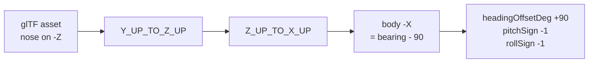

# 3D vehicle rendering: the conventions that cost days

Every number here was measured, either out of the GLB binary, out of
Cesium's own source in `node_modules`, or sampled from Cesium World
Terrain. None of it is inferred from how a model looks on screen, because
looking at one camera angle is exactly how the mistakes below happened.

Read this before placing, orienting, scaling or animating any model.

## 1. Altitude is above the ellipsoid, not above the ground

`Cesium.Cartesian3.fromDegrees(lon, lat, h)` treats `h` as a height above
the WGS84 ellipsoid. Cesium World Terrain also reports its heights above
the ellipsoid. So `h = 0` is **not the ground**.

Sampled with `sampleTerrainMostDetailed`:

| Place | Ellipsoidal height |
|---|---|
| Copenhagen 04R threshold | 38.03 m |
| 04R rollout end | 38.74 m |
| Sensor N15, Runway 04R Central | 42.42 m |
| Open sea 18 km out | 36.13 m |

Consequence: **every track in this app renders 38 m below its stated
altitude.** At 100 m above ground level nobody can see it. An airliner
told to touch down at `alt: 0` crosses the surface 600 m short of the
threshold and spends the whole rollout underground.

The correction is opt-in, via `terrainRelativeAlt: true` on a template,
and `cph_jet_friendly` is the only one that carries it. It is not applied
globally on purpose: the shared assignment feeds every scenario, and
those altitudes were authored and eyeballed against what is on screen
today, so a global 38 m lift would move every drone at once.

Two traps when correcting it:

- **`globe.getHeight()` reads the currently loaded tile**, so it steps as
  the level of detail refines and returns `undefined` before tiles
  stream. Smooth it, and only take the sample when it comes back
  positive, or the aircraft pops mid-approach.
- **A single constant does not track the surface.** The six rollout
  waypoints read 38.02, 38.88, 38.22, 38.08, 40.42, 38.74. A flat +38.0
  leaves the aircraft 2.4 m under the rendered runway. The draped
  orthophoto follows the terrain exactly, so the terrain surface *is* the
  visible runway.
- **Height above ground is still what the rest of the app wants.** The
  label, the persisted recording sample, `_updateContributingSensorsForPosition`
  and `_shouldAutoDetect` all read the waypoint altitude. Correct the
  rendered position only.

## 2. `minimumPixelSize` and `maximumScale` are map-symbol knobs

They exist so a 3 metre drone stays readable as a symbol. Applied to a
large aircraft they are ruinous, and Cesium's arithmetic
(`CesiumUnminified/index.cjs`) is:

```
scale          = minimumPixelSize * metresPerPixel / (2 * boundingSphereRadius)
_computedScale = min(maximumScale, scale)
```

The A320 had a 258 px floor against a 12x cap with a 26.06 m bounding
radius, which drew a 37.6 m aircraft **451 m long and 409 m in span** for
the first 15.8 km of an 18 km approach, then shrank it continuously to
life size over the last 2.3 km.

For anything that should read at true size: `minimumPixelSize: 0`,
`maximumScale: 1`. It becomes a small object beyond about 2 km, which is
what a real 18 km final looks like, and is what a camera move is for.

## 3. Nose-on-body-minus-X reverses pitch and roll as well as heading

The glTF convention is nose along +Z, and Cesium's axis correction
(`Y_UP_TO_Z_UP` then `Z_UP_TO_X_UP`) maps glTF +Z onto body +X. An asset
authored nose-reversed therefore lands with its nose on body -X, which
needs a further -90 on heading **and flips the pitch and roll axes
through the airframe**.



The Shahed's note in `main.js` already stated this rule. The A320 needed
the same +90 heading offset, so it was the same case, yet it carried
`pitchSign: 1` and no `rollSign` at all. The rule was written down and
not applied. Symptoms it produced:

- commanded pitch +10 put the nose 10 degrees **down**
- a -3 degree glideslope rendered as nose 3 degrees **above** the horizon,
  a 6 degree angle of attack, which is plausible enough to survive review
- a commanded right bank rolled the aircraft **left**

**"Pitch becomes roll" was a wrong diagnosis, not a real effect.** Probing
the transform directly: at heading 130 / pitch 10 / roll 0 the model's +X
axis stays at 0.000 elevation and the nose tilts; at heading 130 / pitch 0
/ roll 10 the nose stays at 0.000 and +X tilts. Pitch acts on the lateral
axis and roll on the longitudinal one, correctly. There is no axis leak to
compensate for. If a rotation appears on the wrong axis, suspect the signs
and the yaw, and measure before adding a compensation.

## 4. The 2D icon's bearing trim leaks into 3D attitude

`__isr_icon_tuning.bearingTrimDeg` defaults to **-2** and exists to align
a canvas icon's drawn apex with its computed course. It is written into
`state.stateHolder.headingRad`, which is the same field the 3D
orientation rigs read.

So **every model in this app crabs 2 degrees off its flight path.** On a
drone symbol that is invisible. On a 37.6 m airliner against runway edges
it is the nose visibly off the centreline, and it is what reads as
"tilted to the right compared with its trend line".

Stripped per airframe via `stripIconTrim: true`, which cancels it
(`-(true + trim) + trim`). Not fixed at the source: the trim is correct
for the icons it was tuned against, and changing the shared field would
silently re-aim the Shahed, the quadcopters and the Mi-24. The clean
version, if it is ever worth it, is a separate `courseRad` field that the
rigs read while the billboard keeps `headingRad`.

## 5. `runAnimations: true` means loop forever

Cesium's `ModelVisualizer` adds entity animations with
`loop: ModelAnimationLoop.REPEAT`, unconditionally, and exposes no clamp
through `ModelGraphics`:

```js
model.activeAnimations.addAll({ loop: ModelAnimationLoop_default.REPEAT })
```

A flat `true` therefore ran the A320's 28.17 s landing sequence **11
times** across a 302 s approach: gear retracting and re-extending twelve
times on final, and a 9.32 m jump at every loop boundary, because the
clip's root node (`Fuselage_02`) carries the descent.

`runAnimations` is read through `Property.getValueOrDefault`, so it can be
a `CallbackProperty`. Return `true` until the sequence has run its length,
then `false`, and Cesium calls `removeAll()`.

**Freezing on the rest pose is safe for this asset, by measurement.** Of
the animation's 248 channels, only 5 differ between the final frame and
the bind pose, and all 5 are spinning parts (both main wheels, the nose
wheel, the two engine fans) where the stopping angle is arbitrary. 79
channels differ at the **first** frame, which is the gear-up airborne
configuration. Check this per asset rather than assuming it:
compare each channel's last keyframe against the target node's own
translation, rotation and scale in the glTF JSON.

The timer starts on the property's first evaluation, which is the correct
instant by construction: `ModelVisualizer` only reads it inside
`if (model.ready)`, the same frame it calls `addAll()`. A 97 MB load
cannot desynchronise it.

One accepted wart: the animation advances on `viewer.clock`, not on
`monoNow()`, so it does not freeze when the simulation is paused.

## 5b. Texture budget: check it before blaming the geometry

A Sketchfab download is sized for a product render, not for a scene that
already holds terrain, imagery, buildings and a post-processing grade.
Uncompressed GPU cost is `width * height * 4 * 1.33` per image, and it is
independent of how large the model draws on screen.

The A320 made the map unusable: seconds per frame, ten seconds to pan.
The cause was not its geometry, which is only 75,815 vertices across 26
primitives. It was **sixteen 4096x4096 textures**, four materials with a
base colour, occlusion, normal and specular map each, for **1,431 MB of
GPU memory in one aircraft.**

Measured across the fleet:

| Model | File | GPU | Textures |
|---|---|---|---|
| a320_landing_config.glb (unused) | 93.8 MB | **1431 MB** | 16 at 4096 |
| airbus_a320_indonesian_presidential_livery.glb (source) | 97.1 MB | **1431 MB** | 16 at 4096 |
| boeing_787-9_qantas_centenary.glb | 16.3 MB | 240 MB | 10 at 4096 |
| a320_opt.glb (in use) | 12.8 MB | 123 MB | 16 at 2048 |
| f-35a_lightning_ii.glb | 19.5 MB | 111 MB | 25 at 1024 |
| airbus_a380.glb | 17.1 MB | 99 MB | 20 at 1024 |
| mh-60r_seahawk_crewed.glb | 6.2 MB | 34 MB | 6 at 1024 |

The A320 was the only outlier by an order of magnitude. Note that file
size does not predict it: the 787 Dreamliner is 40.2 MB on disk and only
21 MB on the GPU, while the A320 Qantas 787 is 16.3 MB on disk and 240 MB
on the GPU.

Size each map to what it contributes at the range the model is seen:

- **base colour** carries the livery, so 2048
- **normal** 1024
- **occlusion and specular** are low-frequency, so 512. These were the
  worst offenders here: three of them were 15 to 18 MB PNGs costing 89 MB
  of GPU each, for maps nobody can resolve on a landing aircraft.

`scripts/optimise_glb_textures.py` does this and rewrites the GLB. It
re-encodes to JPEG wherever an image has no meaningful alpha, which also
cut the file from 97 MB to 13 MB and removed the first-load stall.

**Verify a rewrite rather than trusting it.** Compare every non-image
bufferView byte-for-byte against the source, and check the animation
channel and skin joint counts. For a320_opt.glb: 9 of 9 bufferViews
identical, 248 channels, 142 joints.

## 6. Skinned and unskinned models are not interchangeable

`nodeTransformations` drives plain nodes. The Mi-24's rotors work that way
because it is unskinned.

On a **skinned** mesh the named nodes are skeleton joints and the mesh is
deformed by the joint hierarchy rather than drawn under it. Overriding a
subset of joints while the rest keep their defaults breaks the skin: the
A320 attempt overrode 83 of 248 joints and scattered wings, flaps and
gear around the fuselage.

A joint whose vertices are weighted **entirely** to it is the exception.
The two engine fans qualify: minimum dominant weight over all 3,166 fan
vertices is exactly 1.000000, and no other primitive has any weight on an
engine joint. So those two can be driven without touching the skin.

Also, `NodeTransformationProperty.getValue` falls back to
`Cartesian3.ZERO` for an unspecified `translation`, **not** to the node's
own value. A rotation-only transform teleports the part to the model
origin and swings it in an arc. Always set `translation` and `scale`
explicitly, as the Mi-24 block does. The existing gear nodes survived
this only because they genuinely have no translation.

## 6b. Wingtip vortices

`src/airliner_vortices.js`. Two condensation cores trailing the wingtips,
which is the read that says "heavy aircraft, high angle of attack, humid
air" in a second of footage.

Built on the mechanism already here, a polyline over a ring buffer fed
from the tick, so it freezes when the simulation freezes. It is NOT the
sheet of vapour that forms over the wing root: that is a volume sitting on
the wing rather than a trail behind it, only a particle system expresses
it, and a Cesium `ParticleSystem` advances on `viewer.clock` rather than
on `monoNow()`, so it would keep emitting while the simulation is paused.

The tip offsets are measured from the model's 75,815 vertices in bind
pose: X +/- 17.009, Y 4.298, Z 4.550, span 34.115 m against the real
A320's 34.1 m. The nose is on model -Z, so in body terms a wingtip is
4.55 m aft of the origin and 4.30 m above it. The body offset is rotated
by roll, then pitch, then heading, the same order that finally made the
helicopter's gun work, because a point 17 m outboard moves 4.4 m
vertically through a 15 degree bank.

Live: `window.__isr_vortex_tuning = { seconds, width, alpha, side, up,
forward, fadeFromAglM }`.

## 6c. A flat icon cannot always express a 3D direction

The track symbol is a billboard with `alignedAxis` set to the horizontal
heading vector. Cesium aligns the image's up direction with that vector
**projected into the screen plane**. That projection is well conditioned
from above and degenerate when the camera looks along the direction of
travel, where a small perpendicular component decides the whole result
and the nose can swing far from where it looks like it should point.

The file already records the same trap for `alignedAxis = up`, which is
degenerate from a horizontal viewpoint. It is the same failure in a
different axis.

So before tuning any constant for an icon that points the wrong way,
establish whether the error moves when the camera orbits. If it does, it
is this, and no constant fixes it. `window.__isr_iconDebug()` prints what
the icon is told to do, the true ground track, the error, and the camera
orientation.

## 7. Measurement beats eyes, and a box is not a position

Carried over from the gun-muzzle placement, which took about fifteen
rounds of testing:

- **A bounding box is not a part's position.** It lumps parts together.
  The "13.6 m flat panel" that looked unusable as an engine fan was the
  combined box of two correct 1.78 m discs sitting 11.81 m apart. Read
  the vertices.
- **A point bolted to an airframe must be rotated by the full attitude**,
  roll then pitch then heading. Heading alone is only correct for a level
  airframe. A point 1.8 m outboard moves 1.11 m vertically through a 30
  degree bank, which is why no fixed number survived two camera angles.
- **Symptoms that change with the camera are a transform bug**, not a
  constant that needs tuning. Stop adjusting numbers and check the maths.
- **A 2D check cannot confirm a 3D position.** Side-on, height is
  invisible.

## 8. Flight profiles: `interpolate()` is piecewise linear

`interpolate()` in `drones.js` is linear in latitude and longitude, so
ground speed is piecewise **constant** and steps at every waypoint. The
old airliner legs ran 62.5 then 74.8 m/s through the flare and 66.6 then
45.4 at the start of the rollout, both visible lurches. Generate times by
integrating one continuous speed profile instead of setting them by hand.

A flare is a curve, not a shallower straight line. The old final leg
*steepened* to -3.66 degrees and touched down at 490 fpm, which reads as
being driven into the tarmac. The current profile is a cubic Hermite from
the glideslope gradient at the threshold (50 ft) to 148 fpm at the
wheels, touching down 450 m in, inside the touchdown zone markings the
orthophoto shows.

## 8b. A heading derived from one frame cannot curve

The model's heading target is `-atan2(dLon, dLat)` across two
consecutive frames. On a straight segment that direction never changes,
so the heading is constant inside the segment and steps at the corner.
The airliner rig derives bank from the yaw rate it sees
(`coordinatedBank`, `atan(v omega / g)`), so a path of straight legs
makes the aircraft snap flat through a turn and then roll afterwards,
and a 24-point circle rolls in at every waypoint and levels out in
between while still turning.

Resolution is the fix, not smoothing. `cph_jet_hold_atc` generates its
path at 0.25 s a point (`_cphHoldPath` in `drones.js`), which puts each
heading step at about 0.19 degrees, below what the filter chain settles
in. Measured on the result: 0.000 deg/s down the approach, a flat 1.502
deg/s through the orbit.

Do not round generated coordinates. Six decimals is 0.11 m, which is six
per cent of the 1.9 m an airliner covers in a frame, and it showed up as
plus or minus a degree a second of yaw jitter on a turn asking for 1.73.

## 8c. Third-party liveries have to come off before anything ships

`a320_noskin.glb` arrived in Indonesian presidential livery: REPUBLIK
INDONESIA titles down both sides, two Garuda crests, the A-001
registration in four places, a gold star-and-wreath on each side of the
fin, and five flag patches. `scripts/strip_airliner_livery.py` removes
all of it and keeps the red and gold scheme, because a plain white
aircraft reads as a placeholder.

Two things in there are worth reusing:

- **Fill from paint, not from the adjacent pixel.** Taking the column
  either side of a region smeared a cabin window across the fuselage
  wherever a row happened to end on one. Take the median of a ring
  around the region, then have each row search outward for the nearest
  pixel close to it.
- **Pad the replacement to the original byte length.** Each cleaned PNG
  is smaller, so a `tEXt` chunk pads it to match exactly and it is
  written in place. Every `bufferView` offset stays valid and the file
  size does not change. The alternative is rebuilding the buffer and
  rewriting 1,394 accessor offsets.

Restore with `git checkout public/aircraft/a320_noskin.glb`.

## 8d. A marker that will not stay on its sensor, and a ring that will not draw

Three faults, routinely mistaken for one, and all three read as "the
coordinates are wrong" when the coordinates were never wrong.

**A clamped `point` is not a point. It is a billboard.** This is the one
fact that explains the whole afternoon, and it is in
`PointVisualizer.js`:

```js
if (heightReference !== HeightReference.NONE && !defined(billboard)) {
  if (defined(pointPrimitive)) { returnPrimitive(...); }
  billboard = cluster.getBillboard(entity);   // not a PointPrimitive
  ...
}
```

`PointPrimitiveCollection` has no terrain clamping, so any `point` with
a `heightReference` is quietly rendered as a `Billboard` whose image is
a canvas drawn by `createBillboardPointCallback`. A clamped `point` and
a clamped `billboard` are therefore the *same class*, clamped by the
*same* `Billboard._updateClamping` through the *same*
`scene.getHeight(position, heightReference)`. They cannot resolve to
different heights. An earlier version of this document claimed a point
resolved against the photogrammetry mesh and a billboard against
terrain, 38 m apart at CPH. That is not what the source says, and three
commits were spent acting on it.

**The ring rendered nothing because its texture key changed every
frame.** `PointVisualizer` caches the generated canvas in the
collection's texture atlas under

```js
textureId = JSON.stringify([cssColor, newPixelSize, cssOutlineColor, newOutlineWidth])
```

and regenerates it whenever any of those four changes. All four were
`CallbackProperty`s on the pulse ring, and `Color.toCssColorString()`
prints the raw float alpha (`rgba(77,210,255,0.5327148)`), so a pulsing
alpha minted a brand new key every frame. A new key is a cold atlas
entry: `TextureAtlas.addImage` returns a promise that cannot resolve
before that frame's `afterRender`, and the next frame overwrote the key
and cancelled the load (`if (this._id !== id) return`). So
`billboard.ready` stayed false forever, and an unready billboard is
written with its image dimensions at zero:

```js
const imageWidth  = Math.round(billboard.width ?? 0);   // width is undefined until LOADED
const imageHeight = billboard.height ?? 0;
```

which the vertex shader turns into `halfSize = imageSize * scale * 0.5`
= 0. A zero-area quad. No error, no warning, no ring, plus a fresh
canvas uploaded to the atlas every frame for every sensor in range.

The rule that falls out of this: **on a clamped `point`, fill colour,
outline colour, outline width and pixel size are texture inputs, not
animation inputs.** Animate any of them and the mark disappears. The
ring holds all four constant — two keys exist for the whole session,
cyan and amber — and pulses through `scaleByDistance` instead, which
`PointVisualizer` forwards straight to the billboard and which is not
part of the key. `nearValue` and `farValue` are set to the same number,
so it acts as a plain per-frame multiplier rather than a distance ramp.
The same economy the helicopter rotor already relies on: an atlas index,
never an upload.

A warm key resolves *synchronously* inside the visualizer pass, which is
why a ring rebuilt on every tick still draws on the tick that built it.

**`disableDepthTestDistance` must match between marks that must look
joined**, and for sensors it is Infinity on both. The dot was depth
tested while the ring was not, so the pair came apart at an oblique
angle for that reason alone, with no height disagreement involved.

Depth testing both was tried as the default and it hides the pulse. The
ring is a 26 px mark clamped to the surface, so its anchor depth is
level with the ground it is drawn on and the per-fragment depth test
discards it, while the 8 px dot is small enough to survive. Verified on
the map rather than argued. `__isr_sensorDepth(true)` turns it on for a
shot that wants it.

The cost of drawing on top is that a sensor behind a terminal shows
through it. For an operator that is the right failure: never losing
sight of a sensor beats a prettier oblique view.

The ring also reads its position off its own dot
(`dotEntity.position.getValue(...)`) rather than recomputing
lon/lat/0 beside it, because the dot's position does not stay where
`renderSite` put it: the boot terrain sweep rewrites it and
`__isr_pinSensors` replaces it. One authority for where a sensor is.

What the wrong answers cost, so nobody repeats them: measuring one
height for both and pinning it brought a tile storm at boot
(`sampleHeightMostDetailed` requests the finest tile under every point),
a pin frozen at coarse detail that put every marker under the ground
once depth testing was on, and a render pass on a timer
(`scene.sampleHeight` is a pick) that made the application crawl.
`__isr_pinSensors()` survives as a manual command and is not needed for
any of this.

The cost of the point is that it cannot be dashed, so a degraded sensor
is marked by colour alone, amber against cyan, which is what its dot
already does.

Switches, both live without a reload:

```js
__isr_ringAudit()            // pairs every dot with its own pulse
await __isr_pinSensors()     // re-measure and pin
__isr_pinSensors.off()       // back to clamping
__isr_sensorDepth(false)     // back to drawing on top
```

`npm run check:sensor-pulse` is the gate: it reads `src/main.js` and
fails if the dot and the ring stop being the same graphics type, stop
sharing a `heightReference` and `disableDepthTestDistance` expression,
or if any of the four texture inputs on the ring becomes a
`CallbackProperty` again.

**Measure before you change this code.** Four attempts at it in one
afternoon took the map down twice, once through a dead-zone read on
boot and once by putting the ring on the sensor entity, which silently
suppressed the sensor's own point. `__isr_ringAudit` exists because
nothing in the source tells you where a marker actually ended up.

## 9. Propeller spin and attitude, outside Cesium

`scripts/blender_drone_flight_demo.py` runs inside Blender headless and
turns any drone file (`.blend`, `.glb`, `.fbx`, `.obj`) into an animated
`.blend` plus an MP4 of the airframe flying hover, forward, a banked 180
degree turn, brake, backward, slide right, slide left, descend, climb.

Nothing is keyframed by hand and nothing is read backwards from the
path. The motion comes from a small flight-controller model, the loop a
DJI runs:

1. The plan commands a velocity (stick, or waypoint).
2. A velocity loop asks for an acceleration, capped at `A_MAX`
   (6.5 m/s^2: 0 to 21 m/s in about 3.5 s, as an Air 3 does).
3. That plus quadratic drag gives the lean the thrust must have,
   `tan(lean) = |a + k v|v|| / g`, capped at `MAX_TILT` (32 degrees; DJI
   limits sport mode to about 35). `k` is 0.0156/m from the top-speed
   balance, 21 m/s at 35 degrees.
4. The attitude follows that demand with a 0.15 s lag and a 120 deg/s
   slew limit, because a body has inertia and rotors finite authority.
   This is what makes a real one tip into a move and roll out of it.
5. Acceleration is `g tan(lean)` minus drag, integrated to velocity and
   position. Vertical speed is throttle, with its own 0.6 s response.
   Yaw is a rate command with a 0.3 s response.

So: nose down to go forward, nose UP to brake or fly backward, roll into
a slide, roll into a turn from the centripetal term, level on vertical
legs. Measured on the Air 3 at the phase midpoints: 30 degrees nose down
at peak acceleration, 20 in the accelerating cruise, 6 to 9 at a steady
10 m/s, 29 nose up braking, 12 nose up at 6 m/s backward, 25 to 29 of
roll at the start of each slide, under 1 degree on descend and climb.
Peak slew 123 deg/s including noise.

On top of that, what a real one does and the old shortcut never did:

- **Rotor speed per rotor.** Thrust goes with the square of rotor
  speed, so the base rate scales with `sqrt(thrust / weight)`: up with
  lean and climb, down in descent. A 3 percent dip in slow forward
  flight for translational lift (arXiv 2109.04741 measures about 9
  percent less power than hover at the endurance-optimal speed, and
  power goes with the cube of speed). During a pitch or roll
  *acceleration* the four differ: to pitch nose down the front pair
  drops and the rear rises, and the opposite to stop the rotation; the
  rates are equal while the attitude slews at its limit. During a yaw
  acceleration the clockwise and anticlockwise pairs differ, and
  reaction torque opposes spin, so to yaw anticlockwise the
  **clockwise** rotors speed up. A small steady differential holds the
  yaw rate against air drag. In steady cruise the average barely moves;
  the transitions are where it changes, which is what the ear hears.
- **The camera gimbal stays level** while the body leans
  (`--gimbal-near x,y,z,r`, a sphere in file units; for the Air 3
  `0,0.94,-0.49,0.13` takes ten meshes). Verified at 0.00 degrees off
  level across the whole flight.
- **Hover is not still.** Sub-degree attitude noise at a few tenths of
  a Hertz to 1.7 Hz, 3 cm of height wander, half a degree of yaw. The
  gimbal cancels the attitude part, which is the most recognisable
  thing about a hovering DJI.
- **The pivot is the centre of mass**, rotor centroid in plan and body
  centre in height, not the bounding-box centre, which on the Air 3 sat
  2 cm aft and 4 cm low of it because of the gimbal and legs.

```
/Applications/Blender.app/Contents/MacOS/Blender -b \
  --python scripts/blender_drone_flight_demo.py -- IN.glb --out OUT_DIR \
  --forward +Y --size-m 0.5 --gimbal-near 0,0.94,-0.49,0.13 \
  --render --stills [--prop-rps 18] [--props REGEX]
```

- `--forward` is the nose axis in Blender space. glTF's +Z nose imports
  as -Y, which is the default; the DJI Air 3 export has its nose on +Y.
  If the nose leads on the BACKWARD leg, the axis is reversed.
- `--size-m` is the real length of the longest extent. The file is
  scaled to it so m/s and g mean what they say; without it a 4.7 unit
  Air 3 flew like a 4.7 m aircraft.
- `--prop-rps` defaults to 18, not the physical 92 an Air 3 hovers at.
  At 30 fps with motion blur, 92 is over a turn per frame and renders as
  a clear disc, which is what a camera sees and what a viewer reads as
  "the propellers are gone". 18 is a 65 degree blur arc per frame.
- Props are found by name (`prop|rotor|blade`) first, then by shape: a
  sheet, 15 to 35 percent of the airframe long, off the body axis, and
  then the largest set of near-identical such sheets, which is what
  separates eight blades from two arms. The pick is printed with what
  was dropped. `--props` overrides it with a regex.

Verified on `assault_drone_concept.glb` (named rotors) and on
`dji_air_3.glb` (polyman, Sketchfab, CC-BY-4.0, 341 unnamed meshes) by
reading rotor hub heights, per-rotor rates, gimbal level and blade
attachment at every frame, not by looking at one still.

Two lessons that cost a render each. Blades are reparented with explicit
matrices: a freshly made object's `matrix_world` is identity until the
depsgraph runs, and reading it back to build the parent inverse carried
the hub offset twice, so the blades drifted loose of the airframe as it
flew, and motion blur hid it until a frame was rendered without blur.
And any vector read out of `matrix_world` on a scaled rig must be
normalised before taking an angle from it, or every tilt reads 84
degrees.

The DJI Mavic 3 Pro listing by ikad2023/dika3d (Sketchfab, now Fab and
Superhive) is a paid asset at USD 60 and is not downloadable without
buying it. The Air 3 is the free stand-in.
