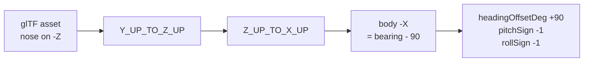
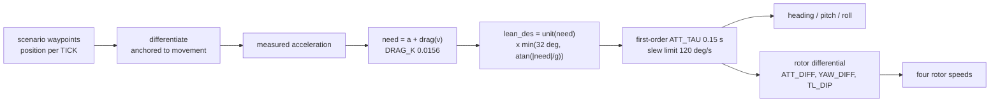

# 3D vehicle rendering: the conventions that cost days

Every number here was measured, either out of the GLB binary, out of
Cesium's own source in `node_modules`, or sampled from Cesium World
Terrain. None of it is inferred from how a model looks on screen, because
looking at one camera angle is exactly how the mistakes below happened.

Read this before placing, orienting, scaling or animating any model.

## 1. Altitude is above the ellipsoid, not above the ground

`Cesium.Cartesian3.fromDegrees(lon, lat, h)` treats `h` as a height above
the WGS84 ellipsoid. Cesium World Terrain also reports its heights above
the ellipsoid. So `h = 0` is **not the ground**.

Sampled with `sampleTerrainMostDetailed`:

| Place | Ellipsoidal height |
|---|---|
| Copenhagen 04R threshold | 38.03 m |
| 04R rollout end | 38.74 m |
| Sensor N15, Runway 04R Central | 42.42 m |
| Open sea 18 km out | 36.13 m |

Consequence: **every track in this app renders 38 m below its stated
altitude.** At 100 m above ground level nobody can see it. An airliner
told to touch down at `alt: 0` crosses the surface 600 m short of the
threshold and spends the whole rollout underground.

The correction is opt-in, via `terrainRelativeAlt: true` on a template,
and `cph_jet_friendly` is the only one that carries it. It is not applied
globally on purpose: the shared assignment feeds every scenario, and
those altitudes were authored and eyeballed against what is on screen
today, so a global 38 m lift would move every drone at once.

Two traps when correcting it:

- **`globe.getHeight()` reads the currently loaded tile**, so it steps as
  the level of detail refines and returns `undefined` before tiles
  stream. Smooth it, and only take the sample when it comes back
  positive, or the aircraft pops mid-approach.
- **A single constant does not track the surface.** The six rollout
  waypoints read 38.02, 38.88, 38.22, 38.08, 40.42, 38.74. A flat +38.0
  leaves the aircraft 2.4 m under the rendered runway. The draped
  orthophoto follows the terrain exactly, so the terrain surface *is* the
  visible runway.
- **Height above ground is still what the rest of the app wants.** The
  label, the persisted recording sample, `_updateContributingSensorsForPosition`
  and `_shouldAutoDetect` all read the waypoint altitude. Correct the
  rendered position only.

## 2. `minimumPixelSize` and `maximumScale` are map-symbol knobs

They exist so a 3 metre drone stays readable as a symbol. Applied to a
large aircraft they are ruinous, and Cesium's arithmetic
(`CesiumUnminified/index.cjs`) is:

```
scale          = minimumPixelSize * metresPerPixel / (2 * boundingSphereRadius)
_computedScale = min(maximumScale, scale)
```

The A320 had a 258 px floor against a 12x cap with a 26.06 m bounding
radius, which drew a 37.6 m aircraft **451 m long and 409 m in span** for
the first 15.8 km of an 18 km approach, then shrank it continuously to
life size over the last 2.3 km.

For anything that should read at true size: `minimumPixelSize: 0`,
`maximumScale: 1`. It becomes a small object beyond about 2 km, which is
what a real 18 km final looks like, and is what a camera move is for.

## 3. Nose-on-body-minus-X reverses pitch and roll as well as heading

The glTF convention is nose along +Z, and Cesium's axis correction
(`Y_UP_TO_Z_UP` then `Z_UP_TO_X_UP`) maps glTF +Z onto body +X. An asset
authored nose-reversed therefore lands with its nose on body -X, which
needs a further -90 on heading **and flips the pitch and roll axes
through the airframe**.



The Shahed's note in `main.js` already stated this rule. The A320 needed
the same +90 heading offset, so it was the same case, yet it carried
`pitchSign: 1` and no `rollSign` at all. The rule was written down and
not applied. Symptoms it produced:

- commanded pitch +10 put the nose 10 degrees **down**
- a -3 degree glideslope rendered as nose 3 degrees **above** the horizon,
  a 6 degree angle of attack, which is plausible enough to survive review
- a commanded right bank rolled the aircraft **left**

**"Pitch becomes roll" was a wrong diagnosis, not a real effect.** Probing
the transform directly: at heading 130 / pitch 10 / roll 0 the model's +X
axis stays at 0.000 elevation and the nose tilts; at heading 130 / pitch 0
/ roll 10 the nose stays at 0.000 and +X tilts. Pitch acts on the lateral
axis and roll on the longitudinal one, correctly. There is no axis leak to
compensate for. If a rotation appears on the wrong axis, suspect the signs
and the yaw, and measure before adding a compensation.

## 4. The 2D icon's bearing trim leaks into 3D attitude

`__isr_icon_tuning.bearingTrimDeg` defaults to **-2** and exists to align
a canvas icon's drawn apex with its computed course. It is written into
`state.stateHolder.headingRad`, which is the same field the 3D
orientation rigs read.

So **every model in this app crabs 2 degrees off its flight path.** On a
drone symbol that is invisible. On a 37.6 m airliner against runway edges
it is the nose visibly off the centreline, and it is what reads as
"tilted to the right compared with its trend line".

Stripped per airframe via `stripIconTrim: true`, which cancels it
(`-(true + trim) + trim`). Not fixed at the source: the trim is correct
for the icons it was tuned against, and changing the shared field would
silently re-aim the Shahed, the quadcopters and the Mi-24. The clean
version, if it is ever worth it, is a separate `courseRad` field that the
rigs read while the billboard keeps `headingRad`.

## 5. `runAnimations: true` means loop forever

Cesium's `ModelVisualizer` adds entity animations with
`loop: ModelAnimationLoop.REPEAT`, unconditionally, and exposes no clamp
through `ModelGraphics`:

```js
model.activeAnimations.addAll({ loop: ModelAnimationLoop_default.REPEAT })
```

A flat `true` therefore ran the A320's 28.17 s landing sequence **11
times** across a 302 s approach: gear retracting and re-extending twelve
times on final, and a 9.32 m jump at every loop boundary, because the
clip's root node (`Fuselage_02`) carries the descent.

`runAnimations` is read through `Property.getValueOrDefault`, so it can be
a `CallbackProperty`. Return `true` until the sequence has run its length,
then `false`, and Cesium calls `removeAll()`.

**Freezing on the rest pose is safe for this asset, by measurement.** Of
the animation's 248 channels, only 5 differ between the final frame and
the bind pose, and all 5 are spinning parts (both main wheels, the nose
wheel, the two engine fans) where the stopping angle is arbitrary. 79
channels differ at the **first** frame, which is the gear-up airborne
configuration. Check this per asset rather than assuming it:
compare each channel's last keyframe against the target node's own
translation, rotation and scale in the glTF JSON.

The timer starts on the property's first evaluation, which is the correct
instant by construction: `ModelVisualizer` only reads it inside
`if (model.ready)`, the same frame it calls `addAll()`. A 97 MB load
cannot desynchronise it.

One accepted wart: the animation advances on `viewer.clock`, not on
`monoNow()`, so it does not freeze when the simulation is paused.

## 5b. Texture budget: check it before blaming the geometry

A Sketchfab download is sized for a product render, not for a scene that
already holds terrain, imagery, buildings and a post-processing grade.
Uncompressed GPU cost is `width * height * 4 * 1.33` per image, and it is
independent of how large the model draws on screen.

The A320 made the map unusable: seconds per frame, ten seconds to pan.
The cause was not its geometry, which is only 75,815 vertices across 26
primitives. It was **sixteen 4096x4096 textures**, four materials with a
base colour, occlusion, normal and specular map each, for **1,431 MB of
GPU memory in one aircraft.**

Measured across the fleet:

| Model | File | GPU | Textures |
|---|---|---|---|
| a320_landing_config.glb (unused) | 93.8 MB | **1431 MB** | 16 at 4096 |
| airbus_a320_indonesian_presidential_livery.glb (source) | 97.1 MB | **1431 MB** | 16 at 4096 |
| boeing_787-9_qantas_centenary.glb | 16.3 MB | 240 MB | 10 at 4096 |
| a320_opt.glb (in use) | 12.8 MB | 123 MB | 16 at 2048 |
| f-35a_lightning_ii.glb | 19.5 MB | 111 MB | 25 at 1024 |
| airbus_a380.glb | 17.1 MB | 99 MB | 20 at 1024 |
| mh-60r_seahawk_crewed.glb | 6.2 MB | 34 MB | 6 at 1024 |

The A320 was the only outlier by an order of magnitude. Note that file
size does not predict it: the 787 Dreamliner is 40.2 MB on disk and only
21 MB on the GPU, while the A320 Qantas 787 is 16.3 MB on disk and 240 MB
on the GPU.

Size each map to what it contributes at the range the model is seen:

- **base colour** carries the livery, so 2048
- **normal** 1024
- **occlusion and specular** are low-frequency, so 512. These were the
  worst offenders here: three of them were 15 to 18 MB PNGs costing 89 MB
  of GPU each, for maps nobody can resolve on a landing aircraft.

`scripts/optimise_glb_textures.py` does this and rewrites the GLB. It
re-encodes to JPEG wherever an image has no meaningful alpha, which also
cut the file from 97 MB to 13 MB and removed the first-load stall.

**Verify a rewrite rather than trusting it.** Compare every non-image
bufferView byte-for-byte against the source, and check the animation
channel and skin joint counts. For a320_opt.glb: 9 of 9 bufferViews
identical, 248 channels, 142 joints.

## 6. Skinned and unskinned models are not interchangeable

`nodeTransformations` drives plain nodes. The Mi-24's rotors work that way
because it is unskinned.

On a **skinned** mesh the named nodes are skeleton joints and the mesh is
deformed by the joint hierarchy rather than drawn under it. Overriding a
subset of joints while the rest keep their defaults breaks the skin: the
A320 attempt overrode 83 of 248 joints and scattered wings, flaps and
gear around the fuselage.

A joint whose vertices are weighted **entirely** to it is the exception.
The two engine fans qualify: minimum dominant weight over all 3,166 fan
vertices is exactly 1.000000, and no other primitive has any weight on an
engine joint. So those two can be driven without touching the skin.

Also, `NodeTransformationProperty.getValue` falls back to
`Cartesian3.ZERO` for an unspecified `translation`, **not** to the node's
own value. A rotation-only transform teleports the part to the model
origin and swings it in an arc. Always set `translation` and `scale`
explicitly, as the Mi-24 block does. The existing gear nodes survived
this only because they genuinely have no translation.

## 6b. Wingtip vortices

`src/airliner_vortices.js`. Two condensation cores trailing the wingtips,
which is the read that says "heavy aircraft, high angle of attack, humid
air" in a second of footage.

Built on the mechanism already here, a polyline over a ring buffer fed
from the tick, so it freezes when the simulation freezes. It is NOT the
sheet of vapour that forms over the wing root: that is a volume sitting on
the wing rather than a trail behind it, only a particle system expresses
it, and a Cesium `ParticleSystem` advances on `viewer.clock` rather than
on `monoNow()`, so it would keep emitting while the simulation is paused.

The tip offsets are measured from the model's 75,815 vertices in bind
pose: X +/- 17.009, Y 4.298, Z 4.550, span 34.115 m against the real
A320's 34.1 m. The nose is on model -Z, so in body terms a wingtip is
4.55 m aft of the origin and 4.30 m above it. The body offset is rotated
by roll, then pitch, then heading, the same order that finally made the
helicopter's gun work, because a point 17 m outboard moves 4.4 m
vertically through a 15 degree bank.

Live: `window.__isr_vortex_tuning = { seconds, width, alpha, side, up,
forward, fadeFromAglM }`.

## 6c. A flat icon cannot always express a 3D direction

The track symbol is a billboard with `alignedAxis` set to the horizontal
heading vector. Cesium aligns the image's up direction with that vector
**projected into the screen plane**. That projection is well conditioned
from above and degenerate when the camera looks along the direction of
travel, where a small perpendicular component decides the whole result
and the nose can swing far from where it looks like it should point.

The file already records the same trap for `alignedAxis = up`, which is
degenerate from a horizontal viewpoint. It is the same failure in a
different axis.

So before tuning any constant for an icon that points the wrong way,
establish whether the error moves when the camera orbits. If it does, it
is this, and no constant fixes it. `window.__isr_iconDebug()` prints what
the icon is told to do, the true ground track, the error, and the camera
orientation.

## 7. Measurement beats eyes, and a box is not a position

Carried over from the gun-muzzle placement, which took about fifteen
rounds of testing:

- **A bounding box is not a part's position.** It lumps parts together.
  The "13.6 m flat panel" that looked unusable as an engine fan was the
  combined box of two correct 1.78 m discs sitting 11.81 m apart. Read
  the vertices.
- **A point bolted to an airframe must be rotated by the full attitude**,
  roll then pitch then heading. Heading alone is only correct for a level
  airframe. A point 1.8 m outboard moves 1.11 m vertically through a 30
  degree bank, which is why no fixed number survived two camera angles.
- **Symptoms that change with the camera are a transform bug**, not a
  constant that needs tuning. Stop adjusting numbers and check the maths.
- **A 2D check cannot confirm a 3D position.** Side-on, height is
  invisible.

## 8. Flight profiles: `interpolate()` is piecewise linear

`interpolate()` in `drones.js` is linear in latitude and longitude, so
ground speed is piecewise **constant** and steps at every waypoint. The
old airliner legs ran 62.5 then 74.8 m/s through the flare and 66.6 then
45.4 at the start of the rollout, both visible lurches. Generate times by
integrating one continuous speed profile instead of setting them by hand.

A flare is a curve, not a shallower straight line. The old final leg
*steepened* to -3.66 degrees and touched down at 490 fpm, which reads as
being driven into the tarmac. The current profile is a cubic Hermite from
the glideslope gradient at the threshold (50 ft) to 148 fpm at the
wheels, touching down 450 m in, inside the touchdown zone markings the
orthophoto shows.

## 8b. A heading derived from one frame cannot curve

The model's heading target is `-atan2(dLon, dLat)` across two
consecutive frames. On a straight segment that direction never changes,
so the heading is constant inside the segment and steps at the corner.
The airliner rig derives bank from the yaw rate it sees
(`coordinatedBank`, `atan(v omega / g)`), so a path of straight legs
makes the aircraft snap flat through a turn and then roll afterwards,
and a 24-point circle rolls in at every waypoint and levels out in
between while still turning.

Resolution is the fix, not smoothing. `cph_jet_hold_atc` generates its
path at 0.25 s a point (`_cphHoldPath` in `drones.js`), which puts each
heading step at about 0.19 degrees, below what the filter chain settles
in. Measured on the result: 0.000 deg/s down the approach, a flat 1.502
deg/s through the orbit.

Do not round generated coordinates. Six decimals is 0.11 m, which is six
per cent of the 1.9 m an airliner covers in a frame, and it showed up as
plus or minus a degree a second of yaw jitter on a turn asking for 1.73.

## 8c. Third-party liveries have to come off before anything ships

`a320_noskin.glb` arrived in Indonesian presidential livery: REPUBLIK
INDONESIA titles down both sides, two Garuda crests, the A-001
registration in four places, a gold star-and-wreath on each side of the
fin, and five flag patches. `scripts/strip_airliner_livery.py` removes
all of it and keeps the red and gold scheme, because a plain white
aircraft reads as a placeholder.

Two things in there are worth reusing:

- **Fill from paint, not from the adjacent pixel.** Taking the column
  either side of a region smeared a cabin window across the fuselage
  wherever a row happened to end on one. Take the median of a ring
  around the region, then have each row search outward for the nearest
  pixel close to it.
- **Pad the replacement to the original byte length.** Each cleaned PNG
  is smaller, so a `tEXt` chunk pads it to match exactly and it is
  written in place. Every `bufferView` offset stays valid and the file
  size does not change. The alternative is rebuilding the buffer and
  rewriting 1,394 accessor offsets.

Restore with `git checkout public/aircraft/a320_noskin.glb`.

## 8d. A marker that will not stay on its sensor, and a ring that will not draw

Three faults, routinely mistaken for one, and all three read as "the
coordinates are wrong" when the coordinates were never wrong.

**A clamped `point` is not a point. It is a billboard.** This is the one
fact that explains the whole afternoon, and it is in
`PointVisualizer.js`:

```js
if (heightReference !== HeightReference.NONE && !defined(billboard)) {
  if (defined(pointPrimitive)) { returnPrimitive(...); }
  billboard = cluster.getBillboard(entity);   // not a PointPrimitive
  ...
}
```

`PointPrimitiveCollection` has no terrain clamping, so any `point` with
a `heightReference` is quietly rendered as a `Billboard` whose image is
a canvas drawn by `createBillboardPointCallback`. A clamped `point` and
a clamped `billboard` are therefore the *same class*, clamped by the
*same* `Billboard._updateClamping` through the *same*
`scene.getHeight(position, heightReference)`. They cannot resolve to
different heights. An earlier version of this document claimed a point
resolved against the photogrammetry mesh and a billboard against
terrain, 38 m apart at CPH. That is not what the source says, and three
commits were spent acting on it.

**The ring rendered nothing because its texture key changed every
frame.** `PointVisualizer` caches the generated canvas in the
collection's texture atlas under

```js
textureId = JSON.stringify([cssColor, newPixelSize, cssOutlineColor, newOutlineWidth])
```

and regenerates it whenever any of those four changes. All four were
`CallbackProperty`s on the pulse ring, and `Color.toCssColorString()`
prints the raw float alpha (`rgba(77,210,255,0.5327148)`), so a pulsing
alpha minted a brand new key every frame. A new key is a cold atlas
entry: `TextureAtlas.addImage` returns a promise that cannot resolve
before that frame's `afterRender`, and the next frame overwrote the key
and cancelled the load (`if (this._id !== id) return`). So
`billboard.ready` stayed false forever, and an unready billboard is
written with its image dimensions at zero:

```js
const imageWidth  = Math.round(billboard.width ?? 0);   // width is undefined until LOADED
const imageHeight = billboard.height ?? 0;
```

which the vertex shader turns into `halfSize = imageSize * scale * 0.5`
= 0. A zero-area quad. No error, no warning, no ring, plus a fresh
canvas uploaded to the atlas every frame for every sensor in range.

The rule that falls out of this: **on a clamped `point`, fill colour,
outline colour, outline width and pixel size are texture inputs, not
animation inputs.** Animate any of them and the mark disappears. The
ring holds all four constant — two keys exist for the whole session,
cyan and amber — and pulses through `scaleByDistance` instead, which
`PointVisualizer` forwards straight to the billboard and which is not
part of the key. `nearValue` and `farValue` are set to the same number,
so it acts as a plain per-frame multiplier rather than a distance ramp.
The same economy the helicopter rotor already relies on: an atlas index,
never an upload.

A warm key resolves *synchronously* inside the visualizer pass, which is
why a ring rebuilt on every tick still draws on the tick that built it.

**`disableDepthTestDistance` must match between marks that must look
joined**, and for sensors it is Infinity on both. The dot was depth
tested while the ring was not, so the pair came apart at an oblique
angle for that reason alone, with no height disagreement involved.

Depth testing both was tried as the default and it hides the pulse. The
ring is a 26 px mark clamped to the surface, so its anchor depth is
level with the ground it is drawn on and the per-fragment depth test
discards it, while the 8 px dot is small enough to survive. Verified on
the map rather than argued. `__isr_sensorDepth(true)` turns it on for a
shot that wants it.

The cost of drawing on top is that a sensor behind a terminal shows
through it. For an operator that is the right failure: never losing
sight of a sensor beats a prettier oblique view.

The ring also reads its position off its own dot
(`dotEntity.position.getValue(...)`) rather than recomputing
lon/lat/0 beside it, because the dot's position does not stay where
`renderSite` put it: the boot terrain sweep rewrites it and
`__isr_pinSensors` replaces it. One authority for where a sensor is.

What the wrong answers cost, so nobody repeats them: measuring one
height for both and pinning it brought a tile storm at boot
(`sampleHeightMostDetailed` requests the finest tile under every point),
a pin frozen at coarse detail that put every marker under the ground
once depth testing was on, and a render pass on a timer
(`scene.sampleHeight` is a pick) that made the application crawl.
`__isr_pinSensors()` survives as a manual command and is not needed for
any of this.

The cost of the point is that it cannot be dashed, so a degraded sensor
is marked by colour alone, amber against cyan, which is what its dot
already does.

Switches, both live without a reload:

```js
__isr_ringAudit()            // pairs every dot with its own pulse
await __isr_pinSensors()     // re-measure and pin
__isr_pinSensors.off()       // back to clamping
__isr_sensorDepth(false)     // back to drawing on top
```

`npm run check:sensor-pulse` is the gate: it reads `src/main.js` and
fails if the dot and the ring stop being the same graphics type, stop
sharing a `heightReference` and `disableDepthTestDistance` expression,
or if any of the four texture inputs on the ring becomes a
`CallbackProperty` again.

**Measure before you change this code.** Four attempts at it in one
afternoon took the map down twice, once through a dead-zone read on
boot and once by putting the ring on the sensor entity, which silently
suppressed the sensor's own point. `__isr_ringAudit` exists because
nothing in the source tells you where a marker actually ended up.

## 9. Propeller spin and attitude, outside Cesium

`scripts/blender_drone_flight_demo.py` runs inside Blender headless and
turns any drone file (`.blend`, `.glb`, `.fbx`, `.obj`) into an animated
`.blend` plus an MP4 of the airframe flying hover, forward, a banked 180
degree turn, brake, backward, slide right, slide left, descend, climb.

Nothing is keyframed by hand and nothing is read backwards from the
path. The motion comes from a small flight-controller model, the loop a
DJI runs:

1. The plan commands a velocity (stick, or waypoint).
2. A velocity loop asks for an acceleration, capped at `A_MAX`
   (6.5 m/s^2). The cap never binds: with the tilt limit at 32 degrees
   the airframe cannot accelerate harder than g tan(32) = 6.13 m/s^2
   whatever `A_MAX` says, so raising it does nothing.
3. That plus quadratic drag gives the lean the thrust must have,
   `tan(lean) = |a + k v|v|| / g`, capped at `MAX_TILT` (32 degrees; DJI
   limits sport mode to about 35). `k` is derived from the airframe,
   `DRAG_K = g tan(MAX_TILT) / TOP_SPEED^2`, because top speed is not a
   free parameter: `v_max = sqrt(g tan(MAX_TILT) / DRAG_K)`. Since
   2026-10-18 the file carries 0.0068111/m, a 30 m/s reconnaissance
   multirotor, the airframe the map flies. It was 0.0156, a DJI Air 3
   at 19.8 m/s, and asking the plan for more than that ceiling only
   pinned the lean.
4. The attitude follows that demand with a 0.15 s lag and a 120 deg/s
   slew limit, because a body has inertia and rotors finite authority.
   This is what makes a real one tip into a move and roll out of it.
5. Acceleration is `g tan(lean)` minus drag, integrated to velocity and
   position. Vertical speed is throttle, with its own 0.6 s response.
   Yaw is a rate command with a 0.3 s response.

So: nose down to go forward, nose UP to brake or fly backward, roll into
a slide, roll into a turn from the centripetal term, level on vertical
legs. The plan is sized from the dynamics: 25 m/s runs (0 to 25 takes
about 6 s against the drag, 25 to 0 about 4 s), a SLOW leg to 8 m/s
before a 30 deg/s turn, because the same yaw rate entered at 25 m/s
would ask 13 m/s^2 of centripetal lean and pin it. Measured on the Air 3
at the phase midpoints: 32 degrees nose down through the run-up, 25 at
24.7 m/s still accelerating, 22 of bank through the turn at 7.6 m/s,
25 nose up braking from 16 m/s, under 1 degree on descend and climb,
peak slew 123 deg/s including noise, gimbal 0.00 degrees off level.

`src/drones.js` mirrors the table as `_DEMO_PLAN` and the map's
`cph_dji_flight_demo` flies it; the two are kept in step by hand, so a
change to one is a change to both. 46.5 s, about 400 m end to end.

On top of that, what a real one does and the old shortcut never did:

- **Rotor speed per rotor.** Thrust goes with the square of rotor
  speed, so the base rate scales with `sqrt(thrust / weight)`: up with
  lean and climb, down in descent. A 3 percent dip in slow forward
  flight for translational lift (arXiv 2109.04741 measures about 9
  percent less power than hover at the endurance-optimal speed, and
  power goes with the cube of speed). During a pitch or roll
  *acceleration* the four differ: to pitch nose down the front pair
  drops and the rear rises, and the opposite to stop the rotation; the
  rates are equal while the attitude slews at its limit. During a yaw
  acceleration the clockwise and anticlockwise pairs differ, and
  reaction torque opposes spin, so to yaw anticlockwise the
  **clockwise** rotors speed up. A small steady differential holds the
  yaw rate against air drag. In steady cruise the average barely moves;
  the transitions are where it changes, which is what the ear hears.
- **The camera gimbal stays level** while the body leans
  (`--gimbal-near x,y,z,r`, a sphere in file units; for the Air 3
  `0,0.94,-0.49,0.13` takes ten meshes). Verified at 0.00 degrees off
  level across the whole flight.
- **Hover is not still.** Sub-degree attitude noise at a few tenths of
  a Hertz to 1.7 Hz, 3 cm of height wander, half a degree of yaw. The
  gimbal cancels the attitude part, which is the most recognisable
  thing about a hovering DJI.
- **The pivot is the centre of mass**, rotor centroid in plan and body
  centre in height, not the bounding-box centre, which on the Air 3 sat
  2 cm aft and 4 cm low of it because of the gimbal and legs.

```
/Applications/Blender.app/Contents/MacOS/Blender -b \
  --python scripts/blender_drone_flight_demo.py -- IN.glb --out OUT_DIR \
  --forward +Y --size-m 0.5 --gimbal-near 0,0.94,-0.49,0.13 \
  --render --stills [--prop-rps 18] [--props REGEX]
```

- `--forward` is the nose axis in Blender space. glTF's +Z nose imports
  as -Y, which is the default; the DJI Air 3 export has its nose on +Y.
  If the nose leads on the BACKWARD leg, the axis is reversed.
- `--size-m` is the real length of the longest extent. The file is
  scaled to it so m/s and g mean what they say; without it a 4.7 unit
  Air 3 flew like a 4.7 m aircraft.
- `--prop-rps` defaults to 18, not the physical 92 an Air 3 hovers at.
  At 30 fps with motion blur, 92 is over a turn per frame and renders as
  a clear disc, which is what a camera sees and what a viewer reads as
  "the propellers are gone". 18 is a 65 degree blur arc per frame.
- Props are found by name (`prop|rotor|blade`) first, then by shape: a
  sheet, 15 to 35 percent of the airframe long, off the body axis, and
  then the largest set of near-identical such sheets, which is what
  separates eight blades from two arms. The pick is printed with what
  was dropped. `--props` overrides it with a regex.

Verified on `assault_drone_concept.glb` (named rotors) and on
`dji_air_3.glb` (polyman, Sketchfab, CC-BY-4.0, 341 unnamed meshes) by
reading rotor hub heights, per-rotor rates, gimbal level and blade
attachment at every frame, not by looking at one still.

Two lessons that cost a render each. Blades are reparented with explicit
matrices: a freshly made object's `matrix_world` is identity until the
depsgraph runs, and reading it back to build the parent inverse carried
the hub offset twice, so the blades drifted loose of the airframe as it
flew, and motion blur hid it until a frame was rendered without blur.
And any vector read out of `matrix_world` on a scaled rig must be
normalised before taking an angle from it, or every tilt reads 84
degrees.

The DJI Mavic 3 Pro listing by ikad2023/dika3d (Sketchfab, now Fab and
Superhive) is a paid asset at USD 60 and is not downloadable without
buying it. The Air 3 is the free stand-in.

### Rotor nodes for Cesium, when the blades are already nodes

`split_quad_rotors.py` cuts blades out of one merged mesh. The Air 3 is
the other case: every blade already a node, buried four levels deep in
hinge matrices under a 0.01 scale and two up-axis swaps.
`scripts/group_rotor_nodes.py` composes the full 4x4 chain and
re-parents each pair under a new `Rotor_N` translation node at the hub,
placed under the node whose frame has the disc thin in Z (checked, since
`_quadRotorTransforms` spins about local Z). `group_nodes.py` would not
do: it rewrites translations only, which is right for the door gunner
and wrong under rotated ancestors. Verified by point cloud, 161,553
points, none moved. `public/aircraft/dji_air_3.glb` is the result,
numbered so 1 and 4 share a diagonal.

Wiring note for whoever swaps it in: in the `root` node's frame the nose
is +Y, and `Sketchfab_model` maps that to glTF -Z, so the asset is
nose-reversed like the Shahed. Expect the extra -90 on heading and
`pitchSign`/`rollSign` at -1 (section 3). It is 311k triangles against
the assault drone's 18k; simplify with meshoptimizer as the Shahed was
if it costs frame time at swarm counts.

## 8e. A pixel floor with no ceiling, and a lead that had neither

Reported twice, in opposite directions, which is what pinned it down:
"drones scaling WAY TOO MUCH when you expand, why can't they stay the same size
no matter your POV", then after the first fix, "only one drone in the swarm is
present, and they are too small".

**`minimumPixelSize` means "never smaller than N pixels at ANY distance."** The
helicopter and the F-35 each bound that with a `maximumScale` of twelve times
life size. The swarm wingmen had the floor and no bound.

**The lead had neither.** `_droneEntitySpec.model` set no `minimumPixelSize` at
all, so a lead drew at true world scale while its four wingmen sat on a 14 px
floor. Four drones ballooning around one that did not is why it read as a
scaling bug rather than a size setting.

Removing the floor fixed the ballooning and produced the second report: at 480 m
a 1 m drone is 1.8 px, so the formation became five dots, and at the ranges the
WITHOUT ISR camera actually uses only the nearest was picked out at all.

**Both now carry the same floor and the same bound**, quads only:

| distance | life size | before: floor, no bound | now: floor + 12x bound |
|---|---|---|---|
| 250 m | 3.46 px | 14 px, 4x life | 14 px, 4x life |
| 480 m | 1.80 px | 14 px, 8x life | 14 px, 7.8x life |
| 740 m | 1.17 px | 14 px, 12x life | 14 px, the bound takes over |
| 3 km | 0.29 px | 14 px, 48x life | 3.46 px, 12x life |
| 20 km | 0.04 px | 14 px, **323x life** | 0.52 px, 12x life |

The floor governs up close, where the formation has to read as aircraft. The
bound governs beyond about 740 m, where the drone shrinks proportionally and
cannot run away. The airliner, the Mi-24 and the Shahed each carry their own
sizing and none of them was reported, so the block is skipped for them and the
Shahed keeps the 24 it was tuned at.

**The key is `swarmMinimumPixelSize`, not `minimumPixelSize`.** The shared
`__isr_quad_tuning` object is SEEDED with `minimumPixelSize: 14`, so a fallback
against that key is dead code; the key is always present. The shared key is also
read by the interceptor quad, a different vehicle that was not reported and must
not move. Both knobs are live:

```js
__isr_quad_tuning.swarmMinimumPixelSize = 20   // bigger up close
__isr_quad_tuning.swarmMaxExaggeration  = 8    // shrink harder at range
```

**Verified in a browser, not from the source.** The first attempt edited the
`?? 20` fallback at the spec and changed nothing at all, because of the seeded
key above. Reading the live entities is what caught it, and is how the final
state was confirmed:

```
entity           scale   minPx   maxScale
9001             0.5     14      6          <- the lead, which had none of this
9001-swarm-1     0.5     14      6
9001-swarm-2     0.5     14      6
9001-swarm-3     0.5     14      6
9001-swarm-4     0.5     14      6
```

## 8f. Altitude was linear in time, so the vertical rate was a staircase

Reported as the aircraft jumping up and down in the WITHOUT ISR run while being
stable in the WITH ISR hold. The two fly different path generators, and that is
the whole difference.

`_smoothPath` splined latitude and longitude with Catmull-Rom but left altitude
**linear in time** between the hand-written waypoints. Each segment then has its
own constant vertical speed and the speed STEPS at every corner. The attitude
rig derives pitch from the climb rate, so it snapped the nose at each one.
Measured on `cph_jet_goaround_early`:

```
 tSec    alt    rate m/s   change
  379     37      -3.39
  383     59      +4.78     +8.17   <- pull-up
  389    132     +13.27     +8.49
  445    857     +11.32     -3.29
  482   1157      +7.96     -3.36
```

The descent itself was harmless, 0.09 to 0.16 m/s per corner. The pull-up and
the climb-out were not.

The hold path never had this: `_cphHoldPath()` generates an analytic 3.0 degree
approach and a circular orbit sampled at 0.25 s, so its vertical rate is
continuous by construction. It also orbits over Køge Bugt, where the terrain
under a `terrainRelativeAlt` track is flat water.

**A plain spline on altitude is the wrong fix** and the original comment said
so: it overshoots at a level-off and would put the aircraft through its own
glidepath on the flare.

**A monotone cubic does both.** Fritsch-Carlson tangents force the derivative to
ZERO at a local extremum, so the curve cannot leave the interval its two
neighbouring waypoints bound. The pull-up at t=379 IS a local minimum, so the
rate passes through zero continuously instead of stepping 8.5 m/s, and the
altitude still cannot undershoot the 37 m the waypoint declares.

```
worst per-sample vertical rate jump   8.49 m/s  ->  1.04 m/s
minimum altitude on the resampled path            37.00 m, exactly the waypoint
```

Every waypoint altitude is still hit exactly. Only the shape BETWEEN waypoints
changed. Blast radius is `cph_jet_goaround_early` and `cph_jet_goaround_atc`,
the only two templates that call `_smoothPath`; the hold path does not.

**Still outstanding on that aircraft.** The go-around flies the approach over
the city with `terrainRelativeAlt: true`, so the sampled mesh height under it
varies building to building and moves the aircraft with it. The hold is over
water and never sees this. An airliner on an approach flies a geometric glide
path, not a terrain-following one, so the flag is arguably wrong for this
airframe, but changing it touches the landing visuals in the other scenarios
and has not been done.

## 8g. The landing jump was the terrain reference, sampled at 150 ms and followed in 100 ms

Reported as the aircraft jumping up and down when it is about to land, while
being clean for the rest of the flight.

A `terrainRelativeAlt` track's altitude is the sampled surface plus its own
height, so every step in the surface reference moves the aircraft. Below 80 m
the reference came from `scene.sampleHeight`, which reads the RENDERED surface,
re-sampled every 150 ms, and the offset eased toward each new sample at 0.12 per
frame: about a tenth of a second.

Over an airport that rendered surface is the photogrammetry mesh. Hangars,
fences, parked aircraft, and a level of detail that refines as the camera
approaches. Successive samples differ by metres, and the aircraft was on each
new one within a tenth of a second.

The 0.12 was tuned for the ROLLOUT, where the wheels are genuinely on a runway
that rises along its length and lagging it sinks them. 80 m is far too high a
threshold for that: an aircraft in the air is not following the ground, it is
flying a straight glide path to one runway. The WITHOUT ISR run breaks off at
37 m and never touches a runway, so it spent its last 26 seconds inside that
branch for no reason at all.

**Threshold moved to 10 m.** Below it the wheels really are about to be on the
surface. Above it, the slow 0.02 ease that already governs every approach above
80 m governs this part too, and the aircraft has never been reported twitching
up there.

The hold path in the WITH ISR run never showed this: it orbits over Køge Bugt,
where the surface under a terrain-relative track is flat water.

## 8h. Two quadcopter models, two axis conventions, one switch

The gun drone stays. `assault_drone_concept.glb` is the default and is what the
interceptor quad hardcodes, because the gun pod IS that airframe. Nothing about
the swap touches it.

`dji_air_3.glb` (CC-BY polyman, rotor nodes added in `da1bdbb`) is selectable:

```js
__isr_quad_tuning.model = 'dji_air_3'    // then launch a scenario
```

The uri is read when the entity is built, so it applies to the next spawn, not
to one already flying.

**Why the orientation lives with the model and not in the tuning object.**
`assault_drone_concept` is authored nose on body +X. `dji_air_3` is nose on
glTF -Z, reversed like the Shahed. One shared set of `headingOffsetDeg`,
`pitchSign` and `rollSign` cannot describe both, and the wrong one flies the
airframe sideways. So `_QUAD_MODELS` carries uri, scale and axis convention
together and `_quadModelSpec()` resolves it:

| | assault_drone_concept | dji_air_3 |
|---|---|---|
| longest axis, composed | 2.315 m | 4.672 m |
| scale | 0.5 | 0.248 |
| rendered size | 1.158 m | 1.158 m |
| headingOffsetDeg | 270 | 180 |
| pitchSign / rollSign | 1 / 1 | -1 / -1 |
| triangles | 24,896 | 311,072 |

Scale is chosen so both render at 1.158 m, which is what the map has always
drawn and what three signed-off scenarios were judged against. Both are
deliberately larger than life: a real Air 3 is about 0.25 m across and would be
a single pixel.

Sizes come from composing each asset's FULL node transform chain. The raw
accessor extents are meaningless for the Air 3, whose geometry sits under
folding-arm hinge matrices, a 0.01 scale and two up-axis swaps. Raw it reads
322 x 190 x 167; composed it is 4.672 x 1.050 x 4.010.

Rotor hub positions, composed the same way, confirm the diagonals the spin code
assumes (1 and 4 one way, 2 and 3 the other):

```
dji_air_3               assault_drone_concept
  Rotor_1  +X -Z          Rotor_1  -X +Z
  Rotor_2  +X +Z          Rotor_2  -X -Z
  Rotor_3  -X -Z          Rotor_3  +X +Z
  Rotor_4  -X +Z          Rotor_4  +X -Z
```

**The switch is read ONCE, at the drone's birth.** `_quadKey` is captured at
the top of `createDroneEntities` and every consumer takes it: the uri, both
scales, both bounds, and both attitude rigs.

That binding is the whole fix for the first live run of this feature, which
produced the old gun drone flying sideways. The uri is read once when the
entity is built; the orientation is read EVERY FRAME inside the attitude
callback. Reading the live switch in both places meant that flipping it while
drones were airborne left them wearing the old body with the new model's axis
convention, and they turned on the spot. One captured constant cannot disagree
with itself. Reproduced and confirmed fixed: flipping mid-flight now leaves the
model and the orientation alone, and the next spawn picks the new model up.

**Two things only a real GPU can settle,** which is why the default did not
change:
- Nose direction. 180 / -1 / -1 comes from the asset work, not from anyone's
  eyes. If the nose points wrong, `__isr_quad_tuning.modelOverride = { headingOffsetDeg: 90 }`
  and try 0, 90, 180, 270. That is the same workflow the Shahed and the quad
  tuning comments have always prescribed.
- 311k triangles against 24.9k, times five in a formation. Software rendering
  says nothing useful about frame time.

**`modelOverride` is a separate namespace on purpose.** `__isr_quad_tuning` is
SEEDED with the assault drone's `scale: 0.5`, `headingOffsetDeg: 270` and
`minimumPixelSize: 14`, so a `?? fallback` against any of those keys can never
reach another model's value: the key is always present. That trap has now
produced three no-op fixes in this file. `t.scale` still governs while the
default model is selected, because 0.5 IS its correct value and the knob is
documented; a selected model brings its own.

## 8i. The lead drone's propellers never turned

`nodeTransformations` was set in exactly three places: the interceptor quad, the
swarm WINGMEN, and the helicopter. Not on `_droneEntitySpec.model`. So a single
hostile quad's propellers stood still, and in a formation the four wingmen
turned while the lead did not.

The comment beside the wingmen read "same reasoning as the single-drone spec
above", which had stopped being true. `__isr_propCheck()` already carried a line
for this exact case, "nothing is driving its propellers", and it was never hit
because nobody ran it against a lead.

Fixed by giving the lead spec the same `_quadRotorTransforms` call, quads only:
the Shahed has no rotors, the Mi-24 drives its own main and tail rotor, and the
airliner runs the builder's animation clip.

Verified on the live entities rather than from the source:

```
before                              after
9001          rotors (none)         9001          Rotor_1..4
9001-swarm-1  Rotor_1..4            9001-swarm-1  Rotor_1..4
```

## 8j. The quadcopter flight model is the Blender one, running in the browser

Threat drones no longer use a smoothing rig. They run the airframe and
controller from `scripts/blender_drone_flight_demo.py`, ported to
`src/quad_flight_model.js`: same constants, same names, same values.



**What replaced what.** The old rig was eight cosmetic constants:
`headingSmoothing`, `pitchSmoothing`, `rollSmoothing`, `bankFactor`,
`forwardPitchDeg`, `cruiseMs`, `bankClampDeg`, `pitchClampDeg`. It smoothed the
heading toward the direction of travel, biased the pitch by speed, and set the
roll to yaw rate times a made-up factor. It described how an icon should look.
The model describes an aircraft. The eight survive for the INTERCEPTOR quad,
which has no flight model.

**The one difference from Blender, and it is structural.** In Blender the
controller owns the trajectory: a velocity plan goes in, the velocity loop makes
a lean, the lean makes an acceleration, and the acceleration is integrated into
a position. On the map the position is an INPUT and nothing may move a track off
its waypoints. So the chain is inverted. The position is differentiated to
velocity and again to acceleration, and from there the physics is identical: the
same question, what lean does an airframe need to produce this acceleration
against this drag, answered with the same equation.

**Two clocks, and both of them bit.**

The position advances on the simulation TICK. The model runs every render FRAME.
Dividing a tick's whole displacement by one frame's 16 ms reported a drone at
**309 m/s**, which demands an impossible lean and saturates the tilt. The
velocity is therefore anchored to MOVEMENT: the clock is the time since the
position last actually changed, the velocity is held between ticks, and only the
attitude loop runs per frame. This is the same trap that produced a 4.9 degree
bank instead of 18.8 on the airliner.

Then the integration step is clamped to 0.1 s, because integrating a half-second
gap through a 0.15 s time constant is a jump rather than a loop. Using that same
clamped value as the velocity clock reported **300 m/s again**, and as the
velocity filter's time constant it reported **7.3 m/s instead of 15**. So there
are two clocks on purpose: raw elapsed for anything measuring the world, clamped
for anything integrating state. Neither showed at 60 fps; both showed in a
throttled tab, which is what a headless browser is.

**Per airframe, not per formation.** Each swarm member owns its own model
instance, with the hover noise decorrelated by seed, because five drones flying
slightly different paths lean differently and should not breathe in unison.

**The rotors differentiate.** `_quadRotorTransforms` now accepts either a single
speed, which is what the interceptor still passes, or four. A quadcopter tilts
and yaws by driving its rotors apart, about 8 per cent at full attitude
acceleration, and that is visible on a close pass. Rotor geometry comes from the
composed hub positions in `_QUAD_ROTOR_HUBS`, where only the ratio between arms
matters so the model scale cancels.

**Gated.** `scripts/check-quad-flight.mjs`, in the build chain, reads every
constant out of the Python and fails if a pair has drifted, then flies the real
exported model and checks the physics:

```
speed is measured from MOVEMENT, not from frames
a steady cruise settles at the drag balance     atan(DRAG_K*15^2/g) = 19.7 deg
a cruise leans forward, not sideways
a throttled tab still reports the real speed
top speed does not exceed the tilt limit
a hover is nearly level, but not perfectly still
```

That drag-balance equality is the whole airframe in one line: thrust tilt
balancing quadratic drag, and the model holds 19.6 against a predicted 19.7.

**The default airframe is now `dji_air_3`.** The gun drone is still in the repo,
still what the interceptor quad hardcodes because the gun pod IS that airframe,
and still one word away:

```js
__isr_quad_tuning.model = 'assault_drone_concept'
```

**Still unverified by eye:** whether the Air 3's nose points the way it flies.
`headingOffsetDeg: 180` with pitch and roll at -1 comes from the asset work, not
from anyone looking at a render. If it is wrong,
`__isr_quad_tuning.modelOverride = { headingOffsetDeg: 90 }` and try 0, 90, 180,
270. And 311k triangles against 24.9k, times five: software rendering says
nothing useful about frame time.

## 8k. Three failures from the first real test, and what each one was

**1. Sideways.** The nose axis was right, the offset was wrong. Measured rather
than assumed: the gimbal camera cluster is the lowest geometry in the asset,
sits on the centreline at X 0.00, and centres at Z -0.8 to -0.98. A DJI camera
hangs below and in FRONT, so the nose is on -Z, confirming the asset work. The
assault drone's nose is on +X with an offset of 270, the two differ by 90
degrees, so the only candidates were 180 and 0. 180 flew sideways, so it is 0.
If it is still wrong it is one line and no rebuild:
`__isr_quad_tuning.modelOverride = { headingOffsetDeg: 90 }`.

**2. Jumping.** Acceleration was `(vNew - vFiltered) / frameDt`. Between ticks
`vNew` is held constant while `vFiltered` is still converging toward it, so the
numerator was the filter's own residual and the denominator was 16 ms. Half a
metre per second of residual over one frame is 31 m/s2, past A_MAX, so the lean
saturated at the 32 degree tilt limit and sat there jittering on every frame of
every flight. It is why every airframe read exactly 11.5 degrees of tilt no
matter what it was doing.

Acceleration is now measured across two VELOCITY SAMPLES, over the time between
them. There is no new velocity between ticks, so there is no new acceleration
either; it is held, exactly as the velocity is. A steady 15 m/s cruise then
settles at 19.1 degrees against a drag balance of 19.7, with 1.5 degrees of
peak-to-peak movement that is the hover noise and nothing else.

That is the THIRD distinct form of the same mistake in this model: a per-tick
quantity divided by a per-frame interval. The first was the velocity, the second
the velocity filter's time constant, the third the acceleration.

**3. Lagging.** 311k triangles times five is 1.5M. Cut to 100k with
`scripts/simplify_dji_air_3.sh`, verified to leave the geometry alone: composed
extent within 0.5 mm, all four rotor hub positions unmoved to four decimal
places. The hubs matter because the flight model reads them for the rotor
differential.

NOT `gltf-transform optimize`. That runs flatten and join, which merge the
meshes and destroy Rotor_1..4 — checked, it leaves five nodes and no rotors, and
the propellers stop turning. `weld` then `simplify` keeps the node tree.

## 8k2. Parity note from the Blender thread, 2026-10-18

Done as asked in the handoff. `DRAG_K` in the Blender file is now the
literal 0.0068111, which is 9.81 tan(32 deg) / 30^2 to the precision the
gate's regex reads, and `TOP_SPEED_MS = 30.0` sits beside it so it can be
gated too. Lock it. Three things to know when you do:

- **The gate compares with `===`.** `FM.DRAG_K` is computed as an
  expression and the Python literal is rounded, so an exact comparison
  will fail by 7e-11. Either compare with a tolerance or write the same
  literal on the JS side.
- **`_DEMO_PLAN` in `drones.js` is not gated**, and neither is the
  `DRAG_K` inside `_demoFlightPath`, which was still 0.0156 (the DJI
  value) and would have capped the demo at 19.8 m/s. Both are updated to
  match the Blender file in this commit. Worth a check of their own,
  since "if you change PLAN the scenario changes with it" is only true
  while someone remembers to copy the table.
- **`A_MAX` is moot.** g tan(32) is 6.13 m/s^2 and `A_MAX` is 6.5, so
  the tilt limit sets the acceleration, not the loop cap. 0 to 25 m/s
  takes about 6 s and that is the airframe, not a sluggish constant;
  raising `A_MAX` changes nothing. A faster run-up needs a higher tilt
  limit.

The plan now runs at 25 m/s with a SLOW leg before a 30 deg/s turn at
8 m/s (see section 9 for why), 46.5 s instead of 33, about 400 m end to
end over the apron. The scenario note and duration follow from the
generator.

### 8k3. The remaining 6 m, and it is the attitude loop

Reply to 1140dbf, from the Blender thread. Your gate passes here. The
trajectories are not yet the same, and the residual is now a single
known thing.

Measured on the same plan: Blender flies 390.3 m of ground, the
generator 384. Not the step size: the Blender loop re-run in plain
Python gives 390.3 at 1/30, 390.2 at 1/60, 390.1 at 1/240. Then, same
loop:

```
full model                      390.2 m   peak 24.71
without the slew limit          388.4 m
without lag and slew (instant)  384.6 m   peak 24.70   <- your generator
```

`_demoFlightPath` computes `tilt = min(MAX_TILT, atan(need / G))` and
applies it in the same step. The Blender model keeps a lean STATE that
follows that demand with `ATT_TAU` (0.15 s) and the `ATT_RATE_DPS` slew
(120 deg/s), so the airframe takes about 0.3 s to reach a 32 degree
lean, and the acceleration comes from the lean it HAS, not the one it
wants. The path is shorter without that because every brake also
starts 0.3 s sooner.

It matters more than 6 m suggests, because `quad_flight_model.js` DOES
apply the lag, to the attitude it derives from the path. So on the map
the airframe moves off on an instant-lean path while its body is still
leaning into it: for a third of a second at every transition it
accelerates before it has tilted, which is the one thing a quadcopter
cannot do.

The fix is the three lines the Blender `fly()` has between the demand
and the acceleration, in your frame:

```js
// state, outside the loop
let leanE = 0, leanN = 0;
const ATT_TAU = 0.15, SLEW = 120 * DEG * dt;
// per step, after lean_des (= unit(need) * tilt) is known
let sE = (desE - leanE) * (1 - Math.exp(-dt / ATT_TAU));
let sN = (desN - leanN) * (1 - Math.exp(-dt / ATT_TAU));
const sl = Math.hypot(sE, sN);
if (sl > SLEW) { sE *= SLEW / sl; sN *= SLEW / sl; }
leanE += sE; leanN += sN;
const ll = Math.hypot(leanE, leanN);
const thrust = G * Math.tan(ll);
aE = (ll > 1e-9 ? leanE / ll * thrust : 0) - dragE;
aN = (ll > 1e-9 ? leanN / ll * thrust : 0) - dragN;
```

With that in, the generator should read 390 m and the gate can pin it:
path length within 1 m of 390.2 is a sharper test than peak speed,
because the peak is set by the plan and the length by the dynamics.
Left for you rather than done here: it is your generator and your gate
expectations.

## 8l. The manoeuvre sequence is now flyable

`cph_dji_flight_demo`, in the threat picker as "DJI Air 3 flight demo". It flies
the PLAN from `scripts/blender_drone_flight_demo.py`: hover, forward, a
sustained 60 deg/s turn, forward, brake, reverse, slide right, slide left,
descend, climb, hover. 33 seconds over the central apron at 90 m.

The plan is a VELOCITY command, which a track cannot take directly because its
position comes from waypoints. So `_demoFlightPath` integrates the plan with the
same velocity loop and vertical response the Blender script uses and emits
ordinary waypoints; the flight model then measures that path and arrives at the
same attitudes, because it is the same aircraft following the same trajectory.

Flown live, read off `__isr_quadFlight()`:

```
 t+3s   speed 7.6   tilt 20.1   pitch  20.1   roll   0.2    rotors 13.1 13.0 13.1 13.0
 t+12s  speed 0     tilt 20.2   pitch  -8.6   roll -18.3    rotors 15.7 12.6 10.7 12.4
 t+21s  speed 2.2   tilt 23.4   pitch -16.0   roll  17.1    rotors 10.8 15.6 14.9 10.6
 t+33s  speed 0     tilt  0.7   pitch  -0.1   roll   0.7    rotors 11.9 11.9 11.9 11.9
```

Leaning forward on the run, banked 18 degrees through the turn with the rotors
5 rps apart, nose up 16 degrees on the brake, and settled to under a degree in
the hover with the four rotors back together. Nothing in that is scripted.

## 8m. The asset was 702 nodes, and that was the whole performance story

The drone was replaced in the picker and the platform got slower. Four
rounds of flight-model work followed, all of which fixed real bugs and none
of which was the cause. The cause was in the file:

```
                 dji_air_3.glb   assault_drone_concept.glb
nodes                      702                          10
meshes                     341                           6
primitives                 341                           6
triangles               60,305                      24,896
```

Triangles were never the problem, which is why cutting 311k to 60k barely
moved the frame time. **Node count is**, and it is a per-frame CPU cost paid
whether or not the GPU is busy. `Model.updateSceneGraph` takes the
`updateModelMatrix` branch unconditionally for any model with a
`minimumPixelSize`, which every drone here has. That marks the root dirty,
and `ModelMatrixUpdateStage` recurses the whole subtree, allocating a fresh
`Matrix4` per node per frame and doing a matrix multiply plus a determinant
per primitive.

Five drones in a formation, before and after:

```
          node recursions   Matrix4 allocations   draw commands
before              3,510                 3,510           1,705
after                  30                    30              55
```

`scripts/merge_dji_air_3.mjs` bakes node transforms into vertices and
concatenates primitives by material. Nothing is simplified, decimated or
re-textured: same triangles, same materials, same textures, in fewer
buckets. 702 nodes to 6, 341 primitives to 11, 3.27 MB to 2.10 MB.

**The thing that nearly went wrong, and what now catches it.** The first
plan said "collapse to 5 nodes": one body and four rotors at the scene
root. That drops `Sketchfab_model`, whose −90 degree rotation about X is
the only thing giving each `Rotor_n` its local frame. `main.js` spins the
rotors about their local Z; under that root, local Z is world up. Without
it, local Z becomes world Z, which is the nose axis, and the propellers
would cartwheel edge-over-edge vertically through the airframe.

Every obvious check passes on that broken asset: hub positions unchanged,
nose axis unchanged, extents unchanged, a still frame correct. It is wrong
only while spinning. `scripts/check-dji-air-3.mjs` asserts the spin axis in
world space and sweeps the blades through a full turn checking they stay in
their own plane, which is the only test that sees it.

**Three more traps the same review found.**

- An extent check would have produced a FALSE failure. The documented
  4.669 × 1.050 × 4.009 is an eight-corner over-estimate; after baking, the
  identical script returns the tight 4.215 with not one vertex moved. The
  gate asserts a point-set identity instead, nearest-neighbour within
  1e-5 m, which is method-independent. Worst actual movement: 7.8e-8 m,
  pure float32 rounding.
- Cesium's bounding sphere transforms only two corners per primitive, so a
  merge changes it and `minimumPixelSize` changes apparent size with it.
  Measured 3.0246 to 2.9487, so the drone renders 2.6 percent LARGER. On a
  14 px floor that is 0.36 of a pixel, so no compensation. The radius is
  gated so a future change has to be deliberate.
- `KHR_texture_transform` carries a full-tile UV offset on two materials
  and is silently dropped on write unless the tool registers it, because an
  unregistered extension is only a warning. `ALL_EXTENSIONS` is registered
  and the gate asserts `extensionsUsed` survives.

**Left deliberately alone:** the three `GLASS.001` primitives. Cesium
depth-sorts translucent commands, and merging them replaces that with fixed
index order. Two draw calls out of 341 is not worth an irreversible change
to how the canopy blends.

**Also fixed:** `check-quad-flight.mjs` held the rotor hubs as a literal
copy and never opened the GLB, so it validated its own data and would have
passed a broken asset. `check-dji-air-3.mjs` reads the real table out of
`src/main.js` and compares it to the real file.

## 8n. The paths are not flyable, and the nose rate is bounded until they are

Reported as the drone going "forward, jump upwards, forward, jump upwards" on a
recon swarm, on a single-site account, with no airliner in the scene. Traced on
that exact scenario:

```
t=23.00   speed 209.4 m/s   pitch +19.9
t=25.25   speed 152.0       pitch  -7.5
t=25.50   speed 114.3       pitch -15.5
t=28.00   speed  43.0       pitch  +3.3
```

**209 m/s is 754 km/h.** The path demands losing 167 m/s at a waypoint, and the
model pitches hard nose-up, which is what any aircraft must do to decelerate.
Then it settles, flies the next leg, and repeats. Five of the twelve quadcopter
paths do this:

```
esbjerg_quad_hostile      77 m/s median, 122 peak
cph_quad_hostile          58 m/s,  89 peak
billund_quad_hostile      55 m/s,  81 peak
billund_swarm_recon       46 m/s, 102 peak
swarm_recon_cph_amk       33 m/s, 209 peak on one 25 s leg
```

These were authored as waypoint lists for an ICON that slides along a line. The
old cosmetic rig never showed it because it never asked what the path demanded:
it leaned a fixed amount by speed and banked on turns, clamped. A faithful model
cannot do that.

**Why more tilt is not the answer.** A multirotor has no wing, so forward motion
comes entirely from tilting the airframe. Top speed is where the forward
component balances drag:

```
tilt    top speed    thrust to hold altitude
32 deg     30 m/s          1.18x hover
45 deg     38 m/s          1.41x
60 deg     50 m/s          2.00x
76 deg     77 m/s          4.13x
```

77 m/s needs 76 degrees of nose-down and four times hover thrust. No multirotor
has that margin, and it would read as a thrown dart. A fixed-wing or a loitering
munition flies those speeds near level, because a wing makes the lift.

**What was done, and what it is not.** `ATT_RATE_DPS` is bounded to 20 deg/s
against Blender's 120. That limits how fast the NOSE can move and nothing else:
speed, route, waypoints, duration and timing are untouched, which is the point,
because retiming the paths was tried and correctly rejected for moving signed-off
choreography.

```
template                      peak nose rate      pitch range
                              120 -> 20 deg/s
swarm_recon_cph_amk             123 -> 24           -16 to 33
cph_swarm_runway_incursion       97 -> 21             8 to 28
cph_quad_hostile                122 -> 23           -13 to 31
cph_dji_flight_demo              70 -> 45           -31 to 32
```

The runway incursion, which drives both combined scenarios, no longer goes
nose-up at all. The flight demo barely moves, because its path is flyable and
never demands more than the airframe can give; the gate asserts its brake still
pitches past 25 degrees, so the showcase keeps matching the render.

**This is a symptom fix and is gated as one.** `check:quad-flight` asserts the
deviation from Blender deliberately and explains why, so if it ever reads 120
again either the paths were fixed or someone removed the bound without reading.
The real answer is to give those five scenarios an airframe that can fly them.
Both families are already in the taxonomy with models shipped. That changes
`platform` and nothing about timing.

## 8o. The counter-drone team crossing the map, and three unbounded clocks

Reported as the three-drone counter-UAS response flying at 500 km/h or more in
patches, against a profile that says 120 km/h.

Four places integrated a dispatch unit's position as `speed x elapsed` with
elapsed bounded BELOW and not above:

```
en_route    const dtSec = (now - d.lastFrameTs) / 1000;  if (dtSec <= 0) return;
rtb         same
return      same
engage      Math.max(0.001, (now - (d._engageLastFrameTs || d.engageStartTs)) / 1000)
```

A frame hitch, a backgrounded tab, or a state change that forgot to stamp the
clock, and one frame moves the unit by whatever that gap implies.
`lastFrameTs` initialises to `0`, so a unit reaching `en_route` before being
stamped would step from the Unix epoch.

The engage path is the likely culprit for what was seen: it is the chase phase,
it is allowed 1.6x cruise so an interceptor can close, and it falls back to
`engageStartTs` on its first frame. 1.6 x 120 km/h x a few seconds is a unit
crossing the map between two frames.

All four are clamped to 0.1 s, which is six frames at 60 Hz. A longer gap means
the tab was not rendering, and a unit should not teleport to catch up on time
nobody watched.

**This is the same bug shape as three others fixed the same day**: the flight
model's velocity, its filter time constant, and its acceleration all divided a
per-tick quantity by a per-frame interval or integrated an unbounded step. The
rule that keeps falling out: raw elapsed for anything MEASURING the world,
clamped elapsed for anything INTEGRATING state.

The replay scrubber at `_replayState` is deliberately NOT clamped. It advances a
playback clock rather than a position, and is bounded by the recording's own
duration; a long frame there should advance time, or playback drifts behind the
wall clock.

## 8p. Three hostile routes trimmed instead of slowed

`cph_quad_hostile`, `esbjerg_quad_hostile` and `billund_quad_hostile` flew at 55
to 77 m/s, which is 200 to 280 km/h, named as DJI Matrice airframes. A
multirotor tops out near 30 because it has no wing.

Three levers, and only one costs nothing that was signed off:

```
slow the clock       duration doubles. Tried, reverted, moved choreography.
change the airframe  stops being a DJI, and the Geran scenarios already exist
                     separately and fly their real speeds.
shorten the route    duration, timing, name and destination all survive.
```

The route is scaled about its FINAL waypoint, so the target area, the final
approach geometry and the altitude profile are untouched and only the run-in
shortens. Altitudes are not scaled, so the climb rate against the clock is
unchanged and only the climb angle steepens.

```
template                route        median speed    duration
cph_quad_hostile        5.6 -> 2.3 km   58 -> 24 m/s    90s, unchanged
esbjerg_quad_hostile    6.9 -> 2.1 km   77 -> 23 m/s    80s, unchanged
billund_quad_hostile    4.2 -> 2.1 km   55 -> 27 m/s    80s, unchanged
```

Checked before doing it: all three already START INSIDE sensor coverage, 127 to
669 m from the nearest sensor against a 1000 m radius, so there is no
"approaches from outside the grid" beat to lose. They are detected from the
first second, before and after.

The nose-rate bound stays in. Even on the fixed paths it halves the peak nose
rate, 122 to 23 deg/s, because the remaining templates still contain direction
changes a polyline makes instantaneous.

## 8q. The hum was hover noise running at 120 km/h

The reported symptom, three times across two days: "it lags and hums like
mini jumping up and down while flying forward", still present after the
model port, after the acceleration fix, and on a recon swarm with no
airliner and no sites rendered.

It was never the plumbing and never the frame rate. It was one constant
block doing exactly what it says on the tin, in a flight regime it was
never written for.

```
NOISE_LEAN_DEG = [0.45, 0.30, 0.20]
NOISE_LEAN_HZ  = [0.37, 0.91, 1.70]
```

Three sines, up to 1.9 degrees peak to peak, at about one to two Hertz.
Measured on a dead-straight constant-speed leg, where a correct airframe
holds ONE pitch angle for the whole leg:

| | pitch rms | peak to peak | oscillations/s |
|---|---|---|---|
| as shipped | 0.408 deg | 1.87 deg | 3.04 |
| hover noise off | **0.000 deg** | **0.00 deg** | **0.00** |

The model is exact. The hum was 100% the noise.

**Why it reads as life in Blender and as a defect on the map.** The
Blender script's own comment calls it: "Hover is not still." Its demo
plan is HOVER, FORWARD, SLOW, TURN, FORWARD, BRAKE, BACKWARD, STOP,
SLIDE RIGHT, SLIDE LEFT, STOP, DESCEND, CLIMB, HOVER. It tops out at 25
m/s and sits near zero for most of its 47 seconds, and something is
always happening. A scenario drone holds a straight leg at 25 to 35 m/s
for twenty seconds at a stretch with a constant lean, so the noise is
the only thing on the airframe that moves.

**The fix is the physics the name already implies.** This noise is the
controller fighting its own downwash to hold a station. In translational
flight the airframe has left its downwash behind, the induced flow
attaches, and a multirotor is markedly steadier. That transition is
around 5 to 8 m/s:

```
gain *= 1 / (1 + (speed / NOISE_FADE_MS)^2)      NOISE_FADE_MS = 6.0

hover  1.00     6 m/s  0.50     12 m/s  0.20     25 m/s  0.055     30 m/s  0.038
```

At hover the model is bit-identical to Blender's, which is the case the
constants were tuned for and the case the gate asserts (1.882 deg before,
1.882 after). At cruise 1.9 degrees becomes 0.06, below a pixel. Mean
pitch is unchanged at every speed, so no physics moved.

To see the old behaviour without a rebuild: `__isr_quad_tuning.noiseFadeMs = 1e9`.

**Why the existing wobble gate could not catch it.** There was already a
"steady forward flight does not wobble more than the hover noise" check.
It flies `cph_dji_flight_demo`, whose median is 6.5 m/s, where the fade
barely applies and the noise was always acceptable. A gate on a slow path
cannot see a fast-path defect. The new gate flies a straight 30 m/s leg
and requires under 0.05 deg rms.

## 8r. The CPH recon swarm had two waypoints no airframe could fly

`swarm_recon_cph_amk`, the template actually being tested, was the only
quadcopter template in the repo with waypoints demanding more than the
airframe's `A_MAX` of 6.5 m/s². Both were on transit legs the comments
themselves label off-screen, and neither had ever been timed.

The template's own header said "~5 min total, 25 m/s average, ~7.5 km
path". The waypoints had drifted to **20.4 km**. The recon pass is fine,
5.7 km at 30 to 33 m/s; the other 14.4 km is an ingress and an egress
that were drawn and never clocked.

```
ingress   5,235 m in 25 s   209 m/s   then braking to 42      a = -9.9 m/s2
egress    5,025 m in 20 s    84 -> 251 m/s                     a = +8.0 m/s2
```

CPH coverage begins 835 m before waypoint 1, so the scenario opened with
21 seconds of empty map and then a formation materialising at 209 m/s. A
faithful model pitches hard nose-up to shed that and nose-down again: a
48 degree pitch swing, which is the "forward, jump upwards, forward, jump
upwards" in the original report.

Both legs trimmed to what their own allotted time affords. What is
deliberately untouched: `durationSec`, every named apron and pier
waypoint and its `tSec`, the OVERLAP SLIVER position, and
`secondEvent.triggerAtSec`.

```
                          before      after
path                      20.4 km     8.6 km
worst accel demand        9.9 m/s2    1.8 m/s2   (A_MAX 6.5)
peak leg speed            251 m/s     35 m/s
steady-cruise pitch wobble 0.42 deg   0.025 deg rms   (with 8q)
```

Four `tSec` values moved, all on off-screen or intermediate waypoints:
wp1 25→20, wp10 160→164, wp11 168→179, wp14 250→235, wp15 280→256. The
`_CRUISE_TARGET_MS` retiming mechanism stays empty; this is a targeted
edit to one template, not a global clock stretch.

The ingress now starts 177 m INSIDE the ring instead of 4.4 km outside
it, so the formation is on screen from t=0. That is not a loss: the 21
seconds it replaces rendered nothing, and the 4 seconds that did render
was the slam.

**Pre-existing and raised, not taken.** `secondEvent.triggerAtSec` is
115, and the lead is inside the Amager Koblingsstation ring from t=160 to
t=245. At t=115 it is 2,343 m from the nearest Amager sensor against a
1,000 m ring. On the pre-trim waypoints the window was t=158 to t=230 and
the distance at t=115 was the same 2,343 m, so the trim did not move it.
Changing 115 to 160 is a one-character fix that makes the Amager event
fire when the formation is over Amager, which is what the line above it
claims, but it is event timing rather than rendering and it is Lucas's
call.

**A new gate covers the class, not the instance:** no quadcopter template
may demand more than `A_MAX` at any waypoint. Trim the leg, do not bound
the model.

## 8s. The last of it was the formation jitter, and only the wingmen had it

After the hover-noise fade (8q) and the path trim (8r), the report came back
as "slightly flattening movement, so the pure forward motion is not
consistent, but the adjusting is smaller and less frequent than before".

The answer was already in the `__isr_quadFlight()` table from that same run:

```
airframe          speed m/s   tilt deg   pitch deg
9001                   25.0       23.4       23.4     <- lead
9001-swarm-1           27.9       25.5       25.2
9001-swarm-2           27.5       30.1       29.5
9001-swarm-3           23.2       20.9       19.4
9001-swarm-4           27.8       29.4       27.7
```

The lead reads 23.4 degrees at 25.0 m/s, which is `atan(DRAG_K * 25^2 / g)`
to the decimal: the exact drag balance. The four wingmen spread over 9
degrees and their SPEEDS spread over 4.7 m/s, on a path whose legs are a
constant 25 m/s.

Only members get `_formationJitter`. The lead carries none.

**Why a cosmetic wobble became a 15 degree lean.** Position is an INPUT to
the flight model; it differentiates it for velocity and the lean follows the
drag at that velocity. A sinusoidal jitter contributes `amplitude x omega`
to the measured speed:

```
8 m x 2*PI/14 = 3.59 m/s   on a 25 m/s cruise = +-14% of airspeed
```

Fourteen per cent of airspeed, cycling every 14 seconds, and a faithful
model leans for every bit of it. Measured on a straight 25 m/s leg:

| | pitch swing | peak rate | mean rate |
|---|---|---|---|
| lead, no jitter | 0.1 deg | 0.27 deg/s | 0.093 deg/s |
| member at 14 s | 15.6 deg | 3.48 deg/s | **1.727 deg/s** |
| member at 60 s | 2.5 deg | 0.37 deg/s | **0.109 deg/s** |

Eighteen times the lead's rate. That is why the lead always looked right.

**The fix changes the period, not the amplitude.** The amplitude is the
visual that was signed off, so 8 m lateral and 4 m vertical stay exactly as
they were and the formation, the trails and the recordings are unchanged in
any still frame. Only the rate drops, to the lead's own.

60 s is also the honest number. 8 m over 14 s is 0.57 m/s of drift, which is
manoeuvring. Over 60 s it is 0.13 m/s, which is a GPS-held airframe holding
station.

**The general rule, third time it has bitten.** Anything that writes to a
drone's POSITION is feeding the flight model an acceleration, whether or not
it was meant to. The hover noise, the untimed transit legs and the formation
jitter were all authored for an icon that had no physics behind it. A gate
now bounds `amplitude x omega` under 1 m/s, and the same question should be
asked of anything else that nudges a position: what lean does this imply?

### The three causes, and what each one looked like

```
8q  hover noise at cruise     1.9 deg at 1-3 Hz     a fast hum, everything
8r  untimed transit legs      48 deg swing          a slam at the start
8s  formation jitter          15.6 deg at 14 s      slow flatten, wingmen only
```

All three were the same mistake in different clothing: a cosmetic device
written before the flight model existed, left in place once the model
started reading it as physics.

## 8t. Why it was fine at range and not zoomed in: the sample clock

With the attitude finally correct (`__isr_quadFlight()` reading pitch equal
to tilt on all five airframes, speeds within 1 m/s, rotor spread under
0.6%), one symptom was left, and it came with its own diagnosis attached:
**"it still does it when you zoom in"**, and **"it should simply be fully
smooth as it is with literally all others."**

Both halves of that sentence are the answer.

**Camera-dependent means a sub-pixel error, magnified.** Nothing in the
attitude chain is camera-dependent. A position error of a few centimetres is
thousandths of a pixel at a kilometre and tens of pixels when the airframe
fills the screen.

**"As it is with literally all others" names the mechanism.** Every other
vehicle in the app computes its position inside a render-time
`CallbackProperty`:

```js
position: new Cesium.CallbackProperty(() => Cesium.Cartesian3.fromDegrees(
  _friendlyMissile.curLon, _friendlyMissile.curLat, ...))
```

A callback is evaluated at a fixed point inside Cesium's render, so its
sample times are as evenly spaced as the frames are, for free. The drones
are the one class that writes a position FROM THE TICK:

```js
state.billboard.position = state._cartNow;        // the lead
sw.billboard.position = Cesium.Cartesian3.fromDegrees(...);   // each member
```

and the tick sampled its time with `monoNow()`, which is
`performance.now()`, which answers "what time is it at the instant you
asked".

**The tick asks late, by a varying amount.** `drones.js` drives itself with
`requestAnimationFrame`, and so does Cesium. Cesium registers first, so
every frame runs Cesium's entire render and THEN the drone tick. The render
takes 8 to 15 ms depending on tiles streaming, labels relaying out and five
models updating. So the position was sampled at `frameTime + renderDuration`
while the frames themselves are at a clean 16.7 ms.

Measured at 25 m/s over 600 frames with the render duration wandering 8 to
15 ms:

| | step | spread | rms | zoomed in | at 1 km |
|---|---|---|---|---|---|
| sampled at `now` | 0.417 m | 0.205 m | 0.056 m | **3.8 px rms, 14 px worst** | 0.19 px |
| sampled at the frame | 0.417 m | 0.000 m | 0.000 m | **0 px** | 0 px |

0.19 px at range. 14 px up close. That is the entire symptom, and it is why
four earlier fixes each helped and none finished the job.

**The fix.** `requestAnimationFrame` hands every callback in a frame the
same timestamp, on the same timebase as `performance.now()`, and those are
evenly spaced. `monoAt(ts)` in `sim_clock.js` applies the simulation's pause
offset to a caller-supplied timestamp instead of reading the clock, and
`_tickBody(frameTs)` uses it. The frame-aligned instant is published on
every update as `frameMs`, because `main.js` derives each swarm MEMBER's
`tSec` separately: reading the clock again there would have left the lead
smooth and the four wingmen juddering.

```js
function _tick(frameTs) { _tickBody(frameTs); ... }
const frameMs = monoAt(frameTs);
const elapsed = (frameMs - live.startTime) / 1000;
const nowMs = p.frameMs ?? monoNow();        // main.js, the swarm loop
```

**The better long-term shape** is to make the drone position a render-time
`CallbackProperty` like every other vehicle, since `interpolate()` is pure
and cheap. That was not done here: the position is read by the trails, the
roster, the recording, per-site markers, detection and the orientation rig,
and converting it is a blast radius that does not belong in a judder fix.
`monoAt` buys the same evenly-spaced sampling for three lines.

### All four causes

```
8q  hover noise at cruise     1.9 deg at 1-3 Hz    a fast hum, every drone
8r  untimed transit legs      48 deg swing         a slam at the start
8s  formation jitter          15.6 deg at 14 s     slow flatten, wingmen only
8t  position sampled at "now" 14 px zoomed in      only visible up close
```

Four independent causes of one reported symptom, which is why each fix was
real progress and none of them was the end of it. The first three were
cosmetic devices written when the drone was an icon with no physics behind
it. The fourth is the one piece of genuinely shared plumbing, and it only
ever showed on the drones because they are the only vehicle that writes its
position from the tick, and the only one anybody zooms in on.

## 8u. The body was never the problem by the end. It was the propellers.

Measured, not guessed, from Lucas's 2026-10-19 screen recording: 609
frames, every frame's cost readable because the capture ran on a 120 Hz
clock.

**First, what the recording ruled OUT.** Eight consecutive frames cropped
tight on the airframe show the fuselage rock steady. Mean frame-to-frame
change over 31 consecutive frames:

| region | change |
|---|---|
| static water (control) | 0.25 |
| fuselage | 2.28 |
| **propeller** | **4.61** |

The body was steady. The props were doing all of it.

**The arithmetic.** A frame is a snapshot. A two-blade propeller looks
identical every 180 degrees, so all a viewer can see is where the blade
landed this frame against last. At 12 rps and 60 fps:

```
12 rps x 360 deg / 60 fps = 72 deg per frame
```

Inside a 180 degree symmetry the blade lands at 72, 144, 36, 108, 0, and
repeats every five frames. That is not rotation, it is a 12 Hz strobe,
and whenever the blade lands edge-on it nearly vanishes for that frame.
Zoomed out the props are a few pixels and none of it shows. Zoomed in
they are the largest moving thing on screen, which is why this symptom
was camera-dependent too, and why it survived every fix to the body.

**The app already contained the proof.** The Seahawk's rotor has run at
4.5 rps through the same `_rotorSpin` since it was built, steps 27 deg a
frame, and has never once been reported as juddering.

**There is no rps that is both fast and smooth without motion blur.**
Blender integrates the blade across the shutter and gets a disc, which is
exactly why the rendered demo looks right and a real-time frame cannot.
The honest real-time options are a slow blade or a blurred disc. A
strobing blade is not one of them.

**The fix caps what is RENDERED, not what is modelled.** The flight model
still reports true per-rotor rps, `__isr_quadFlight()` still reads out the
real numbers, and the yaw differential still rides on top as a ratio:

```js
const k = peak > cap ? cap / peak : 1;     // scale, never clamp
```

Clamping would flatten the four rotors onto one number and throw away the
differential that IS the quadcopter turning. Scaling keeps every ratio
between them and only slows the picture.

```
                    physical      rendered
60 fps              75 deg/frame  30 deg/frame
120 fps             38            15
40 fps             113            45
Seahawk reference                 27 deg/frame
```

`_QUAD_RENDER_RPS_MAX = 5`, tunable live with
`__isr_quad_tuning.renderRpsMax`. Quad-only: this helper is reached by the
hostile lead, the swarm members and the counter-drone interceptors, while
the helicopter drives `_rotorSpin` directly and is untouched.

**The proper fix, when it matters more than this does:** a translucent
blur disc above a speed threshold, which is what every flight sim does and
what a camera actually records. That is model and material work and it is
not what a judder fix should drag in.

### What the frame timing said, and what it did not

The same recording showed 77% of frames landing on 2 display refreshes,
12.3% on 3 and 2.1% on 4 — 8 hitches a second. That looked like the answer
and was not. A later `__isr_perf()` on a correctly-scoped account read
**median 9.9 ms, p95 11.7 ms** with 331 entities, which is comfortably
inside one 16.7 ms slot. The hitches in the recording were the screen
recorder's own load, plus a session that had every site rendered rather
than only CPH.

The A/B also closed off every remaining suspect. Against a 9.9 ms baseline:

```
sensor dots   n=103   saves 1.4 ms
coverage      n= 34   saves 1.0 ms
pulse rings   n= 34   saves 0.1 ms
trails        n=  6   saves -0.3 ms     (noise)
drones        n= 14   saves -0.2 ms     (noise)
3D tiles      n=  3   saves 1.6 ms
```

**The drones and their trails cost nothing measurable.** There was no
performance problem to fix, which is worth recording because two rounds
were spent assuming there was.

### All five causes, finally

```
8q  hover noise at cruise      1.9 deg at 1-3 Hz    fast hum, every drone
8r  untimed transit legs       48 deg swing         a slam at the start
8s  formation jitter          15.6 deg at 14 s      slow flatten, wingmen
8t  position sampled at "now"  14 px zoomed in      only visible up close
8u  propeller aliasing         72 deg/frame         the last of it, at zoom
```

Five independent causes of one reported symptom. Four were in the
simulation and one was never in it at all. The lesson that would have cut
this short: **when a symptom is camera-dependent, work out the pixel size
of each candidate at both camera distances before touching anything.** The
props were always the biggest moving object on screen at zoom and the
smallest at range, and that alone named them.

## 8v. Two clocks in one quotient, and this one was mine

Reported after five fixes as "still the bugging/humming back and forth",
with `renderRpsMax = 7` making no visible difference — which was itself
evidence that 8u was not the live cause.

The in-browser capture settled where to look:

```
frames 600  dt median 12.5ms  p95 32.5  max 135
SCREEN px: med 0.083  p95 0.910   WORLD m: med 0.205   CAMERA m: med 0.000
CAM DIST : median 2185 m          trackedEntity: drone-DET-20261019-9001
```

Two things fell out of that immediately.

**`WORLD m: med 0.205` is not a position defect.** A second difference
assumes equal time steps. With constant velocity and unequal ones it is
exactly `v x (dt2 - dt1)`:

```
25 m/s x 8 ms = 0.20 m        observed 0.205 m
```

So the position is a correct function of time and the FRAMES are uneven.

**`trackedEntity` is set**, so the camera is welded to the drone, the
drone is pinned at screen centre and the whole world moves past it.

That ruled the position out, and the Cesium tracking source ruled the
camera out: `EntityView.updateTransform` estimates velocity by sampling
the position property at `time` and `time + 0.001`. A
`ConstantPositionProperty` returns the same value for both, the VVLH
branch is skipped, `hasBasis` stays false and it falls back to
east-north-up. Stable, every frame.

Which left the attitude, and a clock mismatch left behind by 8t.

```js
const now = performance.now();          // RENDER time
const dt = (now - _qPrevTime) / 1000;
```

8t moved the POSITION onto the frame clock. This divides it by a gap
measured from the wall clock, read partway through a render whose length
varies. **A speed is dPosition/dt, so the clock that advanced the position
has to be the clock that divides it.** A dt a few ms off a 12.5 ms frame
is a speed tens of per cent off, and the lean follows the drag at that
speed:

```
25 m/s -> 23.4 deg      32 m/s -> 32 deg (pinned)      17 m/s -> 12 deg
```

Measured on a dead-straight 25 m/s leg using the real frame timing from
the capture, where a correct airframe holds one pitch angle:

| dt source | pitch range | swing | rms |
|---|---|---|---|
| wall clock, as shipped | −24.9 .. −21.3 | **3.6 deg** | 0.49 |
| the position's frame clock | −23.5 .. −23.4 | **0.1 deg** | 0.02 |

A continuous 3.6 degree lean oscillation at frame rate. That is the
"flattening back and forth", and it rode on top of every earlier fix
because every earlier fix was somewhere else.

`lastFrameMs()` in `drones.js` publishes the instant the positions belong
to; both rigs, lead and swarm member, now difference that. A dt of zero
means the callback ran twice inside one frame, so there is no new
information and the attitude is held rather than integrated against
nothing.

**The rule, now gated:** anything that differentiates a drone position
must divide by the clock that advanced it. Three separate bugs have now
come from mixing a per-tick quantity with a per-frame interval, and this
is the fourth variation: a per-frame quantity divided by a per-render one.

### What 8u was, in hindsight

The propeller aliasing in 8u is real — 72 deg a frame is a strobe and the
arithmetic does not change. But `renderRpsMax = 7` producing no visible
difference says it was not what was being reported by then. It stays in
because it is correct; it was not the live cause.

### All six

```
8q  hover noise at cruise      1.9 deg at 1-3 Hz    fast hum, every drone
8r  untimed transit legs       48 deg swing         a slam at the start
8s  formation jitter          15.6 deg at 14 s      slow flatten, wingmen
8t  position sampled at "now"  14 px zoomed in      only visible up close
8u  propeller aliasing         72 deg/frame         real, not the live cause
8v  attitude dt on the wall    3.6 deg at frame rate the flattening itself
```

**What should have been done first.** Instrument the renderer before
changing the simulation. The capture that found 8v took ten minutes and
could have been written on day one; instead five rounds were spent picking
the next suspect from a description. When a symptom survives a fix that
measurably worked, that is the signal to go and measure the output, not to
pick the next candidate.

## 8x. Giving the controller its job back

"WHY cant we completely replicate the designed movements from our OWN
file?" Because we only ported half of it.

In Blender the controller OWNS the trajectory: a velocity plan goes in
and it integrates lean, drag and thrust into a position. **The path is
the output.** Nothing can demand a turn the airframe cannot fly, because
the airframe is what draws the line. That is the whole reason the render
looks right.

Scenario tracks never got that. Their paths are hand-authored polylines
and the position is an INPUT, so the controller is left reporting what
attitude an impossible movement implies. On the WITH ISR scenario's swarm:

```
cph_swarm_runway_incursion   44 waypoints over 492 s = one every 11 s
turn at each waypoint:       median 19.8 deg, worst 62, INSTANT
```

Two different faults, in one template:

| waypoints | fault |
|---|---|
| 6 to 29 | a 181 m loiter orbit sampled at 20 deg a step. The geometry is a circle, flyable at 12.7 deg of bank; it renders as a 24-sided polygon |
| 3, 5, 31 | genuine corners of −56, −62 and −33 deg with no arc at all |

**Subdividing the polyline fixes neither.** More points on a line with a
corner is more points sitting on a corner; the turn still happens in one
step at the vertex. The path has to be FLOWN. Only integration bends.

`src/flight_path.js` does that. The guidance is the simplest thing that
keeps the schedule:

```
desired velocity = (target - position) / time remaining to ITS tSec
```

which decelerates into a waypoint, accelerates out of it and curves
between them without anyone choosing a radius. The target time is never
moved, so a corner swung wide is made up on the next leg rather than by
arriving late.

**Result on the template, with its waypoints completely unchanged:**

| | turn/step median | worst | points | duration |
|---|---|---|---|---|
| authored | 19.8 deg | 62 | 44 | 492 s |
| flown | **0.00** | **1.05** | 9,841 | 492 s |

**And it is still the authored route.** Miss distance from each waypoint:

```
wp0..wp33   0.0 m        including all three sharp corners
wp6..wp29   0.3 m median, 0.6 worst, through the whole orbit
wp34..wp41  2 to 50 m    the template asks 34 m/s
wp42, wp43  225, 772 m   the template asks 45 m/s
```

It only drifts where the template demands more than the airframe has, and
the gate asserts exactly that: any waypoint more than 80 m off must sit on
a leg that exceeds top speed. Drift without that excuse is a guidance bug.

Sensor coverage entry moves from 8.0 s to 10.0 s, exit from 464 to 476.

**Emit rate.** 20 Hz, not the demo's 60. The path is already smooth, so
the only thing the rate must beat is the model's `ACC_TAU` of 0.12 s:

```
60 Hz  29,521 points  3.3 MB  worst 0.35 deg/step
20 Hz   9,841 points  1.1 MB  worst 1.05
 4 Hz   1,969 points  0.2 MB  worst 5.06
```

**Blast radius is one template.** `flyPath: true` opts a template in;
everything without it behaves exactly as before. The path is generated
once at spawn and emitted in the existing waypoint shape, so
`interpolate`, detection, coverage, markers and recordings all read what
they always read. Swarm members get the offset applied to the AUTHORED
waypoints first and then fly their own list, so a wingman is a separate
airframe solving the same route rather than the lead's line shifted
sideways.

**Still open:** waypoints 42 and 43 ask 45 m/s of a 30 m/s airframe, so
the formation ends 772 m short of its off-screen exit. Trimming that leg
is a template change and has not been made.

## 10. Fixed-wing flight, outside Cesium

`scripts/blender_fixedwing_flight_demo.py` is the fixed-wing sibling of
the quadcopter demo. It imports that file's loading, propeller
detection, parenting and staging, and replaces the thrust-lean loop with
a light-aircraft autopilot. Nothing is keyframed by hand: the plan
commands speed, climb rate and turn rate, and the attitude is whatever
produces them.

- **Coordinated turns.** The bank needed for a commanded turn rate is
  `atan(V w / g)`; the aircraft rolls toward it at 40 deg/s with a
  0.35 s lag; and the turn rate it gets is `g tan(bank) / V` from the
  bank it has. Measured: a 10 deg/s command at 36 m/s gives 32.6
  degrees of bank and exactly 10.0 deg/s once established, 7.2 deg/s a
  second into the roll.
- **Pitch leads the flight path.** The nose slews toward flight-path
  angle plus angle of attack at 6 deg/s; the flight path follows the
  nose with a 1.2 s lag. A 4 m/s climb reads 10.2 degrees of pitch at
  3.98 m/s of climb, which is 6.4 of path and 3.8 of angle of attack.
- **Angle of attack** grows with `(V_cruise / V)^2` and the load factor
  `1 / cos(bank)`: 3.7 degrees at 36 m/s level, 2.1 at 50, 5.2 at 28.6.
- **Speed** is capped at 1.2 m/s^2 accelerating and 1.8 decelerating,
  which is what 100 hp on 600 kg allows, so the fast and slow legs are
  13 and 14 s long because the physics needs them to be. Throttle is
  inferred from speed held, acceleration asked and climb, and drives the
  propeller: 15.6 rps in cruise, 18.0 on the climb and the fast pass,
  12.7 in the descent, 12.2 on the slow leg.
- **Turbulence** of a quarter to half a degree at a few tenths of a Hertz.

The airframe numbers are TB2-class and named as assumptions in the
file. The asset they were flown on is **Baykar's Sivrisinek**, not a
TB2: its own metadata says so, and Janes and Baykar describe it as a
catapult-launched loitering munition first shown in April 2026 with no
published performance. Ozcan Ozaltin, Sketchfab, CC-BY-4.0, 802k
triangles, nose on glTF +Z (the convention, so `--forward -Y`), a
single pusher propeller on its own node with a 22-frame spin clip that
the script discards in favour of its own hub. Pivot at the wing's
centre. Not in `public/aircraft/`; the renders live in the scratchpad.

```
/Applications/Blender.app/Contents/MacOS/Blender -b \
  --python scripts/blender_fixedwing_flight_demo.py -- IN.glb --out OUT_DIR \
  --render --stills [--forward -Y] [--size-m 4.25] [--prop-rps 18] [--pivot x,y,z]
```

Verified at every frame from the rig's rotation matrix (normalised,
section 9's lesson), not from stills: bank, pitch, heading rate,
climb rate, speed and prop rate per phase, and the propeller fixed to
its hub.

## 8y. The airframe showcase, over open water

A single drone flying the whole envelope in one 4.5 minute pass, so the
airframe can be judged without paying for photogrammetry over the city.
In the scenario list as **AIRFRAME · DJI Air 3 flight envelope (over the
Øresund)**.

**The constraint that shaped it, and the two wrong answers before the
right one.**

A drone renders only within 1 km of a sensor. That rule is deliberate and
not negotiable, so the first two attempts both tried to fit the sequence
inside the CPH rings — which means hugging a coastline with the city
behind it.

*Attempt one* chose a square box inside the covered water. The water
there is a strip, not a box, so the western edge landed at lon 12.6791,
about 90 m off the beach and on top of a marina. Rejected: **"Nothing
happens, as in completely frozen, AND its inland."**

*Attempt two* reshaped it narrow and tall and got 443 m offshore. Still
wrong, and the reason is worth keeping: **"I am saying OUT in the sea,
not where the land 3d buildings renders."** 443 m is offshore; it is not
out at sea. The whole point is nothing in frame but the airframe.

*The right answer was to stop fitting the drone around the sensors and
give it sensors of its own.* `sites/oresund_range.yaml` is a four-node
range in the middle of the strait. Closest the drone ever gets to
anything that renders:

```
Øresund Bridge   3.34 km      Malmö coast    5.7 km
Peberholm        4.2 km       Amager coast  11.3 km
Saltholm         5.5 km
```

It works because `_anySensorSeesPoint` reads **every** site in `SITES`,
not only the sites the active account renders. So the range makes the
airspace observable while its own markers stay out of a customer's view,
and the coverage rule itself is untouched. Its tenant is ISR's own, which
`check:tenant-stamping` then required an operator for — correctly, since
a site whose tenant nobody owns would render events nobody can see.

The template keeps `siteId: 'cph'`, so the event still belongs to the
account watching it.

*Frozen*: it opened with an eight second hover. An airframe correctly
doing nothing is indistinguishable from a simulation that has not
started, and a quadcopter needs about two more seconds to reach 14 m/s
from rest at `A_MAX`. Ten seconds of an apparently dead screen. It now
opens on the acceleration; the hover is still in the sequence, after the
brake, where it reads as a pause rather than a failure.

**The sequence**, every item flyable by construction:

```
accelerate · 24 m/s cruise · brake to walking pace · hover
180 at 80 m radius (18.1 deg of bank) · cruise back · 180 the other way
climb 70 m · descend 70 m
full orbit at 70 m, then the same the other way: a figure eight
28 m/s run · brake · hover
```

```
117 authored targets -> 3,829 flown points over 191 s
3.34 km from the nearest structure, 310 m from a range node at the worst
460 m across by 916 long
```

**Two real defects fell out of building it**, which is the point of a
showcase.

**The vertical demand had no clamp.** Guidance divides by the time
remaining, and that goes to zero. Horizontal was bounded by the top speed
the tilt limit enforces anyway; vertical had nothing, so
`(targetAlt - alt) / timeLeft` spiked, the first-order loop overshot, and
the next waypoint demanded a correction the other way. Measured before
the fix: **40 m/s of descent inside a figure eight that is meant to be
level**, and 51 m/s total on a 30 m/s airframe. `MAX_CLIMB_MS = 8` now
bounds it, and a gate asserts it. A DJI Air 3 does 10 each way.

**The A_MAX gate was checking the wrong thing for a flown template.** A
`flyPath` template's waypoints are TARGETS; the airframe integrates its
own way between them. Gating the targets would forbid writing "hover,
then run at 24 m/s", which is exactly the instruction the generator
exists to take. It now skips `flyPath` templates, which
`check:flight-path` covers properly instead.

**A measurement artefact, worth recording.** The turn-per-step gate read
180 degrees. Below a walking pace the direction of travel is noise: two
points a millimetre apart have a meaningless bearing, so a hover reads as
a flip every step. The flight model already applies that rule before it
moves the yaw (`speed > 0.5`), and the gate now does too.

**Not in the showcase: true sideways and backwards flight.** A quadcopter
has no wing, so it can fly with its nose anywhere, and that is most of
what separates it from a fixed-wing. `flyWaypoints` already accepts
`holdHeadingDeg` to express it, but the attitude rig in `main.js` derives
yaw from the direction of travel, so a slide would still render as a
turn. Wiring a commanded heading through to the rig is a separate change
and has not been made.

**A third measurement artefact, and the floor that fixed it.** The
turn-per-step gate first read 180 degrees, from a hover. Excluding
anything under a walking pace was not enough: an airframe repositioning
at 1.2 m/s still swings its track bearing 13.9 degrees between samples
while barely moving. Worst turn per step on the showcase, by floor:

```
1 m/s  13.85 deg      3 m/s  1.57
2 m/s   3.67          5 m/s  1.33
```

None of it renders anyway, because the model rate-limits yaw to
`YAW_RATE_MAX_DPS` and the nose cannot follow a bearing that spins like
that. 3 m/s is where the track bearing starts being the thing on screen.
`cph_swarm_runway_incursion` reads 1.05 at every floor, because it never
slows down enough for this to matter.

## 8z. The attitude axes, and why they get hunted rather than derived

Reported on the 3D model, not the icon: "when you look from above it, the
nose turns relative to your angled pov."

A model's orientation is a world-space quaternion, so a camera cannot
rotate it. What a camera CAN do is reveal that the airframe is leaning
about the wrong axis: a drone that is BANKED 23 degrees when it should be
PITCHED 23 presents a different apparent nose direction from every angle,
and looks fine only from the one viewpoint it was checked from.

**The mechanism is real.** Cesium composes
`Rz(heading) . Ry(pitch) . Rx(roll)` and applies it to an asset whose own
axes may be rotated relative to that frame. Both quad assets need a 90 or
270 degree heading offset, which is the signature of exactly that. When
the nose sits on the frame's Y axis, the PITCH slot rotates the airframe
about its own nose, which is roll, and the ROLL slot pitches it. **A sign
flip cannot turn pitch into roll.** Only swapping the slots can.

**And deriving which combination is right was already tried, and was
wrong.** The derivation assumed Cesium's glTF Y-up to Z-up conversion is
`(x, y, z) -> (x, -z, y)`, solved all 32 combinations against that, and
shipped the one that scored zero error. It flew the airframe permanently
sideways and was reverted within the minute. The model of the conversion
did not match the asset.

So this is not derived any more. `__isr_quadAxes(n)` applies each of the
eight combinations live, with no relaunch, the same four-value hunt that
found the nose offset of 90 in the field after 0 and 180 were both tried
and both flew sideways.

```
__isr_quadAxes()      show the table and what is active
__isr_quadAxes(3)     try combination 3
__isr_quadAxes(null)  back to the shipped values
```

```
combo  swapPitchRoll  pitchSign  rollSign
  0        false         -1         -1      <- shipped
  1..3     false        the four sign pairs
  4..7     true         the four sign pairs
```

**The test is two observations, and the second is the one that matters.**
On a straight leg the nose must be DOWN and the wings LEVEL — and then
turning the camera around the airframe must not change either. A wrong
axis passes the first test from one viewpoint and fails the second from
every other, which is precisely why it survived this long.

`swapPitchRoll` defaults to absent on both assets, so nothing changes
until someone sets it. The rigs read `_quadModelSpec` every frame, so the
override takes effect on the airframe already in the air.

### 9b. Three more things the quadcopter demo learned from the Inspire 2

`dji_inspire_2_with_zenmuse_x5s` (geoffreycouppey, Sketchfab) is
**CC-BY-NC**, so it is a render for the laptop and an internal test,
never the platform, a prospect demo or a customer sim. It taught the
script three things anyway, all flags now:

- `--drop REGEX` deletes meshes before anything is measured. The file
  ships a 6 x 6 unit landing pad (`PISTE`) that would otherwise set the
  airframe's size and its scale.
- `--pose-frame N` evaluates the file's own clip at frame N and bakes
  that pose before the clip is discarded. The Inspire's 560-frame clip
  is a take-off: the rest pose has the gear down and the arms low, and
  frame 300 has them raised with the body level, which is how it flies.
  Found by scrubbing the clip, not by guessing: frames 210 to 280 also
  have the gear up but the body banked by the animator.
- `--rotor-radius` in file units, and `--gimbal-names REGEX`. The
  Inspire's props are one mesh each and 1.34 units long against a 1.6
  unit motor spacing, so the 1.6-blade-length rule merged all four into
  one hub; 0.3 separates them. Its gimbal is five named meshes, and a
  sphere in file units is useless once the pose comes from a clip
  frame.

`group_rotor_nodes.py` no longer needs a Z-up parent: each hub node is
oriented so its own local Z is the disc normal (a quarter turn about X
for an asset authored Y-up all the way down, as this one is), and the
blades' matrices absorb the inverse. Point cloud verified unchanged.

### 10a. Porting the fixed-wing model to the map

For whoever wires it, the same way `quad_flight_model.js` was built from
the quadcopter script. The constants are at the top of
`scripts/blender_fixedwing_flight_demo.py`, named, and should be gated
the same way.

**The map inverts the chain, as before.** Blender commands speed, climb
and turn rate and integrates a path. The map has the path and must
derive the attitude. The derivation is the same three relations run
backwards:

- bank from the measured turn rate: `bank = atan(V * w / g)`, then the
  roll loop (`ROLL_RATE_DPS` slew, `ROLL_TAU` lag) so the wings go over
  at a finite rate instead of snapping;
- pitch from the measured flight-path angle: `theta = gamma + alpha`,
  through the pitch loop (`PITCH_RATE_DPS`, `PITCH_TAU`), with
  `alpha = ALPHA_CRUISE * (V_CRUISE / V)^2 / cos(bank)` clamped to
  `ALPHA_MAX`. Measure `gamma` from the path's vertical rate, not from
  the waypoint altitude difference over one frame (section 1 and the
  300 m/s lesson apply);
- propeller rate from inferred throttle, `0.55 * (V/V_CRUISE)^2 +
  0.25 * dV/A_LONG + 0.6 * sin(gamma) * V / 4 + 0.15`, clamped to
  `[THR_IDLE, 1]`, then `rps * (0.55 + 0.45 * thr)`.

The existing airliner rig (`_bankedOrientation`) already derives bank
from yaw rate; this replaces its made-up factor with the physical one
and adds the two loops. The Shahed is a fixed-wing too and could share
it.

**What this model deliberately leaves out**, so nobody mistakes an
omission for a bug: no sideslip or adverse yaw, no wind, no stall (the
plan never goes below `V_MIN`), and the propeller rate is a fixed-pitch
model. A governed variable-pitch propeller holds rpm nearly constant in
flight; if the airframe has one, pin the rate and let only the descent
and idle move it.

**The asset.** `baykar_bayraktar_sivrisinek_iha_-_tactical_uav.glb`,
Ozcan Ozaltin, CC-BY-4.0, so it needs an ATTRIBUTION.md entry if it
enters `public/aircraft/`. Nose on glTF +Z, the convention, so the
assault drone's 270 heading offset and +1/+1 signs apply, not the
Air 3's. The propeller is already its own node,
`SivriSinekIhaV2_Pervane`, at the tail, and spins about its own local
Y, the fuselage axis, so `_quadRotorTransforms`'s assumption of four
Z-axis rotors does not fit; it wants one node, one axis, one rate. The
file carries a 22-frame propeller clip, which Cesium would try to play
under `runAnimations: true`; leave that false and drive the node. 802k
triangles: simplify with weld + simplify as the Air 3 was, never
`gltf-transform optimize`, and verify the propeller node survives.

**The map copy** is `public/aircraft/baykar_sivrisinek.glb`, 77,780
triangles and 3.1 MB from 802k and 46.8 MB, made by
`scripts/simplify_baykar_sivrisinek.sh`. The one thing that recipe does
that the Air 3's did not: the twelve bolt-row nodes lose their mesh
(`scripts/strip_meshes.py`), because 650k of the triangles were bolts
and a simplifier cannot take a bolt island below a few dozen
triangles; at any error bound the file floored at 220k. The nodes stay,
so the tree is the same 34 nodes, with the propeller node and its clip
and all three material extensions intact. The composed extent is 6 mm
narrower in X, which is the bolt heads that stood proud of the
wingtips, verified by measuring the bolt-free file before
simplification. `scripts/verify_glb_simplify.py` checks all of that
and is told to allow 7 mm for this file only.

**Numbers to expect**, from the render, for the gate: 10 deg/s at
36 m/s gives 32.6 deg of bank; a 4 m/s climb at 36 m/s gives 10.2 deg
of pitch; 50 m/s level gives 2.1 deg, 28 m/s gives 5.2.

## 8aa. The Baykar flew every turn flat, and the gate could not see it

Lucas, twice: *"its turning motion is horrible, like literally horrible.
You are changing the nose 10 degrees every 0.5 seconds... Its staying
flat while your ugly turning motion is mechanically jumping 10 degrees
to the right."* Then: *"Mate the drone also has to use the ACTUAL
FILE'S TURNING MOTION"*, and *"Why cant you just use the file?????"*

Two separate faults, and the second one was me about to rebuild
something the asset already contained.

### The bank: one line, in the wrong order

`fixedwing_flight_model.js` measures turn rate off the flown path and
banks the aircraft to match, `bank = -atan(V·w/g)`. The shipped line was

```js
turnRate = ease(turnRate, clamp(wRaw, -wCap, wCap), TURN_TAU, dt);
```

which clamps the measurement and then filters it. That is backwards, and
it is backwards for a reason specific to how the path is sampled.

`interpolate()` is piecewise-linear between waypoints 0.25 s apart. The
direction of travel is therefore **constant inside a cell and changes
only at a waypoint**: the measured heading is a staircase, and its
derivative is not a steady 11.8 deg/s but a spike of roughly 180 deg/s
one frame in fifteen with zero in between. Clamping that spike to 20
before the filter throws away the area under it, and the average that
reaches the physics is a tenth of the truth.

The filter's job is to average the staircase back into the real rate,
which it does correctly **when it is given the spikes**. The clamp is
only a backstop against a genuinely impossible demand, so it belongs
after the averaging:

```js
turnRate = ease(turnRate, wRaw, TURN_TAU, dt);
turnRate = clamp(turnRate, -wCap, wCap);
```

Measured by driving the real model along the real 792-waypoint route
through the real interpolator at 60 fps:

| turn-rate order | peak \|bank\| | mean \|bank\| |
|---|---|---|
| clamp then filter | 5.1 deg | 1.5 deg |
| filter then clamp | **27.3 deg** | **6.9 deg** |

A factor of 5.4. Five degrees of bank is invisible at any camera
distance, which is exactly what "staying flat" was. With it fixed the
route reads as a wing: -23.7 deg into the left turn, +22.7 into the
right, nose 13.3 deg up on the climb and -3.3 on the descent, alpha
holding 3.5 at cruise.

### Why twenty-four gates passed over it

`check:fixedwing-flight` already asserted *"a turn is flown with the
bank the turn requires"*, and it passed throughout. Its `fly()` helper
advances the heading a little every frame, so the turn rate it hands the
model is a clean constant and the staircase never exists. **The gate was
flying a path the map never produces.**

Fixed by adding `flyStaircase()`, which lays down waypoints every 0.25 s
and linearly interpolates between them the way `drones.js` does, plus an
assertion that the polyline and the smooth path agree on the bank to
within 6 degrees — *how a path is sampled must not change how the
aircraft flies it*. Re-introducing the old line fails three assertions;
restoring it passes. A gate that cannot fail is not a gate.

### The propeller: there was nothing to write

The propeller was not moving and I was most of the way into driving node
32 by hand through `nodeTransformations` when Lucas stopped me. He was
right, and the measurement says so:

```
animations      1  channels 2
  "SivriSinekIhaV2_Pervane|Pervane_Action" 2 ch, 0.920 s
    -> node 32 "SivriSinekIhaV2_Pervane" . scale     (skinned-target: false)
    -> node 32 "SivriSinekIhaV2_Pervane" . rotation  (skinned-target: false)
skins           0  joints 0
```

The clip was already there, and Cesium was already adding it:
`runAnimations` omitted does **not** mean "no animations", because
ModelVisualizer reads it with `getValueOrDefault(..., time, TRUE)`. This
is the same default that looped the A320's landing eleven times from a
property that had been spread away (8m).

So the clip was being added every spawn and then never advancing a
frame, because **this app pins `viewer.clock.shouldAnimate = false`** to
hold the sun still, and Cesium drives model clips off that clock. The
propeller stood still for exactly one reason: no clock.

Note that `loop: REPEAT`, which is unconditional in Cesium and was the
whole problem for a 28-second landing sequence, is simply correct for a
propeller.

The clock is borrowed, not taken — and **ref-counted**, because each
spawn closes over its own saved flag, so a single flag would let the
first of two fixed-wings to land restore `false` and stop the second
one's propeller in mid-air. It goes back in `removeDroneEntities` when
the last one is gone.

Costed before being done, rather than assumed, since a 142-joint skin is
what made the map crawl once already (8m):

- this clip is 2 channels on 1 **unskinned** node against the A320's 248
  channels on a 142-joint skin, and the asset has no skins at all
- **nothing in `src/` uses a `SampledPositionProperty`** — zero matches
  across all 90 modules, so no vehicle position is clock-driven; every
  one reads `sim_clock` through a `CallbackProperty`
- the sun moves 0.25 deg a minute, so 0.8 deg across this 198 s flight
- the auto imagery branch already runs the clock live, so this is not a
  new configuration for the scene

### The lesson, which is the one from 8v again

I reached for a reimplementation before measuring whether the asset
already did the job, and the honest trigger for checking was Lucas
asking why. Two files up, 8m records the same shape: *"what you do is
that you use the animation that the builder has enabled."*

And the gate lesson is sharper than the bank fix. Every test in
`check:fixedwing-flight` was a real assertion about real physics, and
all of them passed while the aircraft flew visibly wrong, because they
all fed it a signal shaped differently from the one the map feeds it.
**Test the model on the data path it actually runs on.** A smooth-path
test cannot see a sampling bug at all.

Also fixed in the same pass: `MODEL_SWAP_M` for the fixed-wing was
6000 m, so the GLB swapped to a map symbol three kilometres out and the
aircraft could only be clicked from far away (*"the drone appearance
renders WAY too early"*). Now `_fixedWingSpec().swapM ?? 1800`,
overridable with `window.__isr_fixedwing_tuning = { swapM: 2500 }`.
And `cph_recon_hostile` gained `coverageGated: true`: it spawns 3.2 km
east, outside every sensor radius, so DETECTED was firing at t=0 for an
aircraft nothing could hear. It now flips on first entry into coverage,
at t=27.

## 8ab. The turns were backwards in two different ways

Lucas, after 8aa shipped: *"Its still lagging like crazy when it turns...
The turns of the fixed wing is literally pointing the wings in the
opposite direction of where its flying at, along with being crazy laggy,
like turning and lagging during its turn. FIX THIS SHIT BY USING THE
MOVEMENT PATTERNS/CODE FROM THE FUCKING EXISTING BEAUTIFUL FILE"*

He was right on both counts, and the instruction was the fix. 8aa made
the bank the right *size* while leaving it the wrong *sign*, and it never
addressed the nose at all.

### The file commands a bank. I was measuring a heading.

```python
# blender_fixedwing_flight_demo.py
w_t       = math.radians(turn_dps)
bank_des  = clamp(-math.atan(V * w_t / G), -max_bank, max_bank)
bank      = ease(bank, bank_des, ROLL_TAU, dt, roll_slew)
w         = -G * math.tan(bank) / V      # the turn the bank MAKES
psi      += w * dt                       # heading INTEGRATES
```

Causality runs **bank → heading**. The aircraft rolls, and because it is
rolled, it turns. My port ran it backwards: it took the measured track
direction as truth and derived a bank from it, heading → bank.

Two consequences, both of which Lucas saw before I did.

**The nose was the staircase, rendered raw.** The model returned
`headingRad: hdg`, the measured direction of travel. That direction is
constant inside a 0.25 s interpolation cell and steps about 3 degrees at
each waypoint, so the nose snapped in 3 degree increments forever. No
amount of fixing the bank could smooth it, because the nose was not
being filtered at all. This is what "crazy laggy, turning and lagging
during its turn" was, and it is a different defect from 8aa's.

**The sign.** Blender's `psi` is documented *"+ve left"* at its own
declaration. Cesium's heading is `atan2(dE, dN)`: clockwise from north,
**positive right**. The minus in `bank_des` belongs to the left-positive
convention, and I carried it across the flip verbatim, so a right turn
commanded left wing down. The aircraft banked away from every turn.
`rollSign` is 1 and nothing downstream compensated.

Measured on the real 792-waypoint route at 60 fps:

| | before | after |
|---|---|---|
| peak \|bank\| | 27.3 deg, **wrong way** | 32.2 deg, correct way |
| worst single-frame heading step | ~3 deg (the staircase) | **0.163 deg** |
| bank/turn sign disagreement | every turning frame | **0 of 3096** |
| nose vs direction of travel | 0 by construction | 5.0 deg peak |

The one thing Blender has no need of is a heading hold. There the
aircraft *is* the path, so nothing can disagree with the integrated
heading. Here a route says where the aircraft must be, so the integrated
nose has to be kept honest against the track or it flies crabbed:
`HEADING_HOLD_K = 0.8`, deliberately small, because it is the only route
by which the staircase can reach the nose. At 0.8 a 3 degree waypoint
step arrives as 2.4 deg/s of extra turn demand and is smoothed again by
`ROLL_TAU` before it moves anything.

### Why every gate passed while it banked the wrong way

Nothing asserted a **direction** or a **rate**. Every physics assertion
was about magnitude, and the inverted sign satisfies all of them
perfectly. Added:

- a right turn must drop the right wing, and a left turn the left
- bank and turn rate may never disagree in sign (they are the same
  quantity twice, since the turn is computed *from* the bank)
- the worst single-frame heading change must stay under 0.8 deg, when a
  12 deg/s turn at 60 fps should move the nose 0.2 deg per frame and the
  staircase would give 3
- the nose must stay within 12 deg of the direction of travel
- source checks: `psi +=` exists, `headingRad: psi` is returned, and
  there is no leftover minus on `bankDes`

### The propeller, and what "use the file" actually meant

Lucas: *"Make sure the propeller takes acceleration/deceleration into
account."* Reading the file to answer that turned up two things.

First, **the Blender demo does not use the asset's clip either.** In its
own words:

```python
# The file's own animation (this one carries a propeller clip) would
# fight the hub we drive. Drop it; the propeller is ours now.
```

It deletes the clip and spins the hub from throttle. So for the
propeller, "use the file" means *drive it from throttle* — the opposite
of what I concluded in 8aa, where using the clip was the right answer
for the blades' geometry and motion.

Both are available at once, because Cesium lets a clip's time be
**supplied** rather than advanced. `ModelAnimation`'s `animationTime`
callback returns the normalised position within the clip, and for a
REPEAT loop Cesium truncates it with `delta - floor(delta)`, so an
ever-growing phase wraps on its own. The geometry and motion stay the
builder's; the rate becomes the flight model's.

Second, **my throttle port had the acceleration term inverted.**
Blender's `dV = clamp((v_t - V) * KV, ...)` is the acceleration it is
about to apply, from the plan's commanded speed. I wrote
`(V_CRUISE - V) * KV`, but on the map the path *commands* the speed and
the model *measures* it, so an aircraft genuinely accelerating past
cruise produced a negative `dV` and the blades wound **down** as it sped
up. Now the acceleration is measured off the filtered speed, filtered
again through `ACCEL_TAU = 0.40` because it is a second derivative of a
polyline and so the noisiest signal in the model:

```
phase          speed   accel   thr    prop rps
cruise          36.0   -0.00   0.70      17.3
accelerating    52.0            1.00      20.0
decelerating    28.0            0.48      12.4
climbing        36.3    0.01    1.00      20.0
```

### This removed the clock borrow from 8aa

`ModelAnimationCollection.update()` returns early when `frameState.time`
has not moved — **unless `animateWhilePaused` is set**, which is a
plain writable field on the collection. With that set and `delta` coming
from our own callback, the propeller spins with `viewer.clock` frozen.

So the global clock borrow 8aa introduced is gone entirely: no sun
movement, nothing global touched, and the propeller cannot drift with
the sim clock. 8aa's reasoning about its cost was sound and its
measurements were right, but the borrow should never have been needed.
Costing a constraint is not the same as checking whether it exists —
which is the fourth note in the 3D-verification memory, and this is the
second time it has caught me.

It has to be done on the Model primitive, because the entity layer
cannot express any of it: `ModelVisualizer` hardcodes
`addAll({ loop: REPEAT })`, and `multiplier` would not have been enough
anyway since `ModelAnimation` exposes it get-only and caches a duration
from it on first use. The entity therefore declares
`runAnimations: false`, which makes the visualizer call `removeAll()`
once and then leave the collection alone for good, since it only acts
when the value changes. `fixedwing_propeller.js` fills it afterwards and
re-checks every frame, so the order of the two passes is not assumed.

`findModelPrimitive` is now exported from `airliner_surfaces.js` rather
than copied. It walks Cesium privates (`_modelHash`), and two copies of
that walk would mean a Cesium upgrade breaking both and only one getting
fixed. Adding the keyword changes no behaviour for the A320.

### The lesson

Both of this session's defects were sign and causality errors in a port,
sitting under assertions that only ever checked magnitude. **A test that
measures how much cannot see which way.** The route gate, the staircase
gate and the sign gate are all the same realisation arriving three
times: assert the thing you would actually notice on screen.

And twice now the answer has been in the file Lucas kept pointing at.
Reading `blender_fixedwing_flight_demo.py` properly, rather than
consulting the constants I had already lifted out of it, settled the
causal order, the sign convention, the propeller question and the
throttle bug in one pass.

## 8ac. The lag was a 4 Hz shimmer in the wings, and only in turns

Lucas, after 8ab: *"it is soooooo close. Still slightly tilting/lagging
as before. The small minor tilt when it flies straight ahead is a great
detail, which showcases the wind hitting it. The turning right and left
lagging (like in the video) is still there though."*

That sentence is the whole diagnosis, and it took three rounds to earn
it. **Straight flight was fine and turns were not**, which rules out
every mechanism that does not depend on the heading changing.

### What the recording ruled out

Lucas recorded the event, which made it possible to eliminate things
instead of guessing:

- **Not the frame rate.** 52 new frames per second, 7 per cent
  duplicates, worst hold 36 ms over a 6 s window.
- **Not the camera.** `trackedEntity` builds its frame from
  `VelocityVectorProperty`, which returns `undefined` for a constant
  position property, so the view falls through to east-north-up rather
  than a velocity-aligned frame. `requestRenderMode` is off.
- **Not readable from the video at all.** Two attempts at tracking the
  airframe's angle both failed: a binary warm mask correlates −0.87
  with its own blob size, and intensity weighting correlates −0.93 with
  total brightness, because the propeller sweeps through the
  measurement at 19–22 Hz, matching `propRps` of 12–20. Two of three
  video measurements were measuring the tracker.

### What it was

Detrend the bank through a steady turn and the dominant frequency is
**4.00 Hz, exactly the waypoint rate**, at ±1.66 degrees.

`interpolate()` is piecewise-linear, so direction of travel is constant
inside a cell and changes only at a waypoint. A frame-to-frame
derivative of that is a **square wave at the waypoint rate**, and
`TURN_TAU = 0.30 s` only attenuates it: at 4 Hz, 13 per cent gets
through. That reached the wings as a ±1.66 degree roll wobble, about
4 px of wingtip movement at the recording's camera distance. Straight
flight never showed it because a straight line has no corners.

8aa fixed the *amplitude* of the bank and 8ab fixed its *sign and
causality*. Neither touched how the rate was **measured**, which is
where the defect always was. `TURN_RATE_MAX_DPS`'s own note had said so
from the beginning: *"measuring over a window rather than over one
frame is the right fix and it is what TURN_TAU does."* The first half
of that sentence was right and the second half was wrong.

### The fix, and one piece of theory I got wrong on the way

The turn rate is now the **least-squares slope of the unwrapped heading
over `TURN_WINDOW_SEC = 1.0 s`**, rather than the difference between
two frames.

I first justified the window length by claiming its spectral nulls sit
at every `k/T`, so a 1 s window would null 1, 2, 3 and 4 Hz. **That is
true of a boxcar mean and false of a least-squares slope**, which
weights each sample by `(t − t̄)`, a linear ramp, whose zeros are not at
`k/T`. The gate caught it: a 0.5 s spacing came out at 0.56 degrees
where a genuine null would have given nearly nothing. The window
attenuates strongly and broadly rather than nulling one frequency,
which is the more useful property anyway, since the fleet's waypoint
spacings are not all the same. The comment and the gate now say that.

Measured on the real route, bank residual in a steady turn:

| | amplitude | dominant |
|---|---|---|
| frame-to-frame | ±1.66 deg (3.9 px) | **4.00 Hz** |
| 1 s LS window | ±0.66 deg (1.5 px) | 0.60 Hz |

**The frequency matters as much as the amplitude.** 4 Hz reads as a
broken render; 0.6 Hz reads as an aircraft working in the wind, which
is the detail Lucas explicitly asked to keep. Turn entry is 0.22 s
later, measured to 90 per cent of steady bank.

It cleaned up straight flight too, ±2.21 down to ±0.85 degrees, and
that number is worth understanding before anyone "restores" it: the
turbulence constants are untouched, and ±0.85 is what the two roll
sines actually sum to. The extra ±1.4 was staircase noise, not wind.

A sweep of the heading-hold gain confirmed `HEADING_HOLD_K = 0.8` should
stay: dropping it to 0.35 buys ±0.2 degrees of ripple and costs 0.8
degrees of crab and 0.3 s of turn entry.

### The gate gap this exposed

Every assertion added in 8ab measures the **nose**, and this defect was
in the **wings**. The sign and smoothness gates both passed while the
aircraft shimmered through every turn. Now `bankRipple()` flies a
staircase turn, projects the bank onto the waypoint frequency and fails
above 0.35 degrees, with a second case at 0.5 s spacing held to 0.8
because a coarser cell steps the heading twice as far and so excites
twice as hard. No fixed-wing template uses 0.5 s today; that case is
there so one can be added without the shimmer returning unnoticed.

Three rounds, three gates, and each time the gate that would have
caught it was the one nobody thought to write, because each measured
the quantity the previous fix was about.

## 8ad. The airframe was a Turkish attack munition called a Reaper

Renaming it turned up three errors that had nothing to do with flight.

- **`droneType` was `'HALE reconnaissance (MQ-9 Reaper class)'`.** A
  Reaper is 11 m long with a 20 m span doing 482 km/h. This airframe is
  3.8 m doing 130. HALE means high altitude long endurance; this is a
  small tactical type.
- **The asset is a Baykar Sivrisinek, which is Turkish**, so a NATO
  member's aircraft was flying a hostile incursion over Copenhagen.
- **It is not a reconnaissance aircraft at all.** Janes describes the
  Sivrisinek as a surface-to-surface one-way attack UAV, that is, a
  loitering munition. The role label was wrong before the flag was.

Now **Mohajer-2** (Qods Aviation, Iran): confirmed pusher propeller,
confirmed reconnaissance-only role, confirmed in service, 2.91 m long.
The mismatch is stated rather than hidden, in the template: the real
Mohajer-2 is twin-boom with twin rudders, where the asset is a single
fuselage with a V-tail. The alternatives were CH-91, a better
configuration match including the inverted-V tail but with weak
dimensional and in-service data, and Orlan-10, the only one of the three
with a real NATO airspace record, which has a nose-mounted tractor
propeller and so cannot reuse this asset.

Also corrected: the scale comment claimed *"a Sivrisinek is about 2.4 m
long, so a little under half size"*, yet `scale: 0.9` renders 4.24 units
as 3.82 m, which matches the real aircraft's 3.8 m. **The constant was
right and its stated reason was wrong**, which is the kind of comment
that survives until someone trusts it.

One thing deliberately left alone: `V_CRUISE = 36.0` m/s is 130 km/h,
which is the real Sivrisinek's *maximum* rather than its 102 km/h
cruise. It is a Blender parity constant checked against
`blender_fixedwing_flight_demo.py`, so changing it breaks the demo and
the gate together. Flagged, not changed.

## 8ae. The A320's lurch and its "mach 2" climb were one bug

Lucas: *"when the plane is about to land in the Without ISR ... it like
jumps up and down for one movement"* and *"when it pivots upwards it
looks like its flying mach 2 for like 3-5 seconds"*.

Two symptoms, one cause, and it was not in the flight model or the
renderer. It was in the path.

`_smoothPath()` generated lat and lon with a **Catmull-Rom spline
parameterised uniformly in the leg**, `u = k / steps`. Such a curve is
C1 in `u`, but the speed an aircraft actually flies is
`|dP/du| / span`. The moment two consecutive legs have different spans
or chord lengths, **speed jumps at the anchor between them** while the
path through it stays visually smooth.

Measured on `cph_jet_goaround_early`:

```
t = 378.70   55.7 m/s    decelerating into the flare
t = 378.96   73.1 m/s    next anchor, +31% in one sample
```

and climbing out, ground speed ramped 258 → 368 km/h across a leg and
snapped back to 279 at the next anchor. The first is the lurch before
the pull-up; the second is the "mach 2" climb. One cause.

The giveaway was in the data: at `t = 418.2` the waypoint reads
`55.60846, 12.62856, 557` — round numbers among neighbours carrying
full floating-point precision. Those are the **hand-authored anchors**,
and the samples between them are generated.

### The fix was already in the same function

The **altitude** channel never had this problem, because it was already
a cubic Hermite with tangents expressed per second. Lat and lon now use
the same scheme, with a centred difference in TIME:

```
m_i = (P_{i+1} − P_{i−1}) / (t_{i+1} − t_{i−1})
```

That makes `dP/dt` continuous across every anchor, which is what
"constant speed" means for a path assembled from legs.

| | before | after |
|---|---|---|
| worst sample-to-sample speed jump | **57.6 m/s** | **4.1 m/s** |
| ground speed range | 42.5–116.5 m/s | 62.9–101.2 m/s |
| lowest altitude | 37.00 m @ t=378.70 | identical |

### What had to be checked before accepting it

Anchors are hit exactly either way, but the curve BETWEEN them moves,
by up to 375 m far out on the 30 km approach. This clip's entire
argument is a pair of measured separations, so they were re-measured
against both templates at the scenario's own 38 s spawn offset rather
than assumed:

```
separation at break-off   480 m horizontal,  8 m vertical   — identical
closest approach          139 m horizontal, 13 m vertical   — identical
```

Bit-identical before and after, because the critical window moved at
most 27.7 m and the geometry is dominated by the anchors. Altitude
deviation is 0.00 m everywhere, since only lat and lon changed.

The re-measurement also caught **stale figures in the template's own
comment**: it claimed 425 m at break-off and 176 m closest approach,
where the real numbers are 480 and 139. `scenario_without_isr.js`
already said 479 m, so that file was right and this one had drifted
after a path change. Corrected, with the measurement date.

### Blast radius

Two templates use `_smoothPath`. `cph_jet_goaround` is **unchanged** —
worst jump 2.8 m/s before and after, speed range 70–84 m/s both ways —
because its anchors are evenly spaced and uniform parameterisation
happened to be fine there. The fix only moves the path that was broken.

### The lesson

Both symptoms were reported as rendering problems and neither was. The
flight model, the attitude rig and the frame clock were all innocent;
the data they were fed had a 31 per cent speed step in it. **When a
vehicle looks wrong, profile the path it is being given before touching
anything that draws it** — one pass over the waypoints computing ground
speed and vertical rate found this in minutes, and the round numbers in
the waypoint list named the mechanism outright.

## Altitude datum: `alt` is above the ellipsoid, not above ground

Recorded 2026-10-22 after the recon swarm flew through Terminal 3.

- A template's `alt` goes straight into `Cesium.Cartesian3.fromDegrees(lon, lat, alt)`
  for every drone, swarm member and replay frame. That is height above the WGS84
  ellipsoid.
- Danish ground sits about 37 m above the ellipsoid (geoid separation,
  `DK_GEOID_SEPARATION_M`), CPH's apron about 42 m. So `alt: 50` renders roughly
  8 m over the apron. The evidence text can say "120 m AGL" and the track is not.
- Dispatch aircraft are the exception: `_airborneAbsAlt()` adds the terrain height
  under them, so an interceptor at "60 m AGL" really is.
- The OSM boxes hid this. Google's building meshes do not.

**Not fixed at the datum.** Moving every track up by terrain height is one line in a
shared render path, and every scenario, interceptor and landing aircraft was tuned
against the current numbers. The recon swarm template was raised 50 m instead
(`swarm_recon_cph_amk`, see its comment). Any other template that goes low over a
built site needs the same look before it is trusted. The datum change is the right
long-term fix and wants its own pass with every scenario re-flown.

### Measured 2026-10-22, and what was done about it

`__isr_altAudit()` samples the map's own terrain under every template. On 2026-10-22, 22 of
52 were drawn partly underground, worst at Landerupgård (84 m under), Billund (up to 82 m)
and the Esbjerg surface drone (41 m under the water).

**Fixed: 14 scenarios recreated above ground** (commits `c5e046e` to `e2917d9`). Same routes,
timing and text, with the site's measured ground height added to `alt`, the convention
every Copenhagen scenario already follows:

| Site | Added to `alt` |
|---|---|
| Esbjerg | surface drone +44 m (exact, it is a boat), missile +45 m |
| Billund | quadcopter +115 m, missile +110 m, LEGO recon +105 m |
| Landerupgård | quadcopter and missile +105 m |
| Kassø | quadcopter and missile +80 m |
| Ferslev | missile +70 m, quadcopter +95 m (different ground under the two routes) |
| Bjæverskov | quadcopter and missile +75 m |
| Hovegård | missile +55 m |

Re-audited after: all 14 above ground, lowest point the Esbjerg boat at 3 m over the water.

**Still below ground, deliberately not touched:**
- Billund swarm recon (36 m under) and the authorised survey pair (81 m under), pending Lucas
- Amager Koblingsstation missile (22 m under)
- Kassø two-tier missile to Amalienborg (3 m under), a Copenhagen story
- Four Copenhagen airport scenarios (3 to 36 m under). Copenhagen is off limits.

**The known cost of ground in `alt`.** The panel ("m AGL"), recordings and export
(`altitude_agl_m`), the summary agent's altitude score and interceptor climb targets all
read `alt` as height above ground, so for these 14 they read high by the ground height. The
Billund missile shows 135 to 150 m while its evidence text says 40 m. Copenhagen has always
read about 40 m high for the same reason.

**The proper fix, still parked** on branch `wip/ground-lift`: keep `alt` as authored and add
the measured lift only where a track is drawn. That needs six read-back sites that convert
a drawn billboard height back into height above ground to subtract the lift first: the live
target position, the swarm target altitude, the seeker, the burst target, the kill fall and
explosion start, and the jam-fall. Copenhagen lifts 0, so it stays identical by
construction. The gate must test behaviour, not source text. Until that lands, author every
new site's scenarios with the site's ground height already in `alt`, and run
`__isr_altAudit()` before shipping them.
