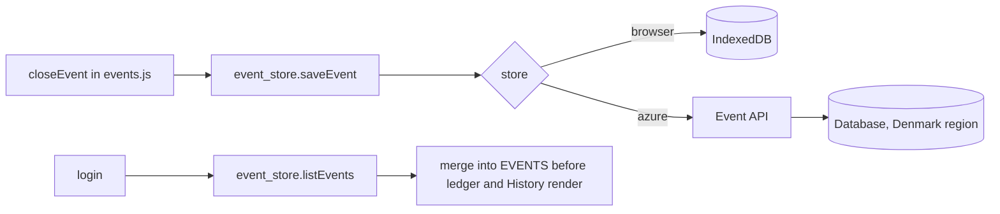

# Event history store: what happens the day the Azure backend exists

Decided with Lucas, 2026-11-16. Not built yet. This is the plan so it can
be executed the moment the backend is set up, without re-deciding it.

## Where it stands today

| | State |
|---|---|
| Who sees which event | Solved. `visibleEvents()` / `_visibleToActor()` in `src/events.js`: an operator sees its own tenant, a receiver sees events it is on, admin sees all |
| Company and site on every event | Solved. `tenantId` is stamped at creation (`tenantForSite`) |
| History content | 7 hardcoded seed events in `src/events.js` (5 Copenhagen Airport, 2 Esbjerg). Other sites start empty |
| Events from a session | Lost on reload. Nothing saves them |
| Flight recordings | Kept in the browser (IndexedDB, `src/recording_store.js`) |

The blocker for real customers is the backend: an operator and its
receivers sit on different machines, so history has to live on a server.

## The seam

One module, `src/event_store.js`, with one contract. The screens never
talk to storage directly.

```
saveEvent(event)            on close, and later on every change of an open event
listEvents()                everything the signed-in actor may see
getEvent(id)                one event, or null when not visible
```

Two implementations behind it, picked by environment:

| Implementation | Where data lives | Who enforces visibility |
|---|---|---|
| `BrowserEventStore` | IndexedDB, same pattern as `recording_store.js` | the client filter (`_visibleToActor`) |
| `AzureEventStore` | the backend database | the server, from the signed-in token. The client filter stays as a second check |

Selection: `VITE_EVENT_STORE=browser|azure`, with `VITE_EVENT_API_URL` for
the Azure one. No env set means today's behaviour.

## Data flow



1. **Write.** `closeEvent()` already builds the full incident record and
   the post-incident report. It calls `saveEvent()` with the serialised
   event (Maps such as `participants` become arrays). Open events are
   saved on change in a second step, so a crash loses nothing.
2. **Read.** After login and before the ledger renders, `listEvents()`
   runs and its result is merged into `EVENTS`. Every screen keeps
   reading through `visibleEvents()`, so nothing else changes.
3. **Recordings** move to blob storage next to the events, keyed by
   event id, with the same seam.

## What the Azure setup must provide

- A database in a Danish or EU region, per the Azure-first rule.
- Sign-in tokens carrying `tenantId`, `kind` (admin, operator,
  receiver), `roleId` and `destinationIds`, so the server can apply the
  same visibility rule as the client.
- An Event API with three calls matching the seam: save, list, get.
- Blob storage for recordings.

## Open decision for Lucas

The starting history per site:

1. seed each site from its own manifest, or
2. drop the seven hardcoded events and let real use fill it.

Either way, the two Esbjerg seed events move to Aarhus, because Esbjerg
never appears externally.

## Done means

- Close an event, reload, sign in again: it is in History, for the right
  accounts only.
- An operator never receives another tenant's events from the server,
  checked by a gate against the API, not only the client filter.
- All gates, the build and a bare-address load pass before main.
