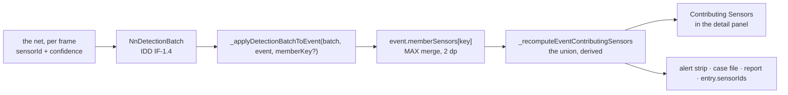

# NN Adapter Layer

**Purpose:** one seam between "how detections arrive" and everything else. Simulations and real hardware live behind the same interface. No downstream code cares which one is running.

Date shipped: 25 August 2026. Files: `src/nn_source.js`, `src/nn_registry.js`. Full contract in `docs/interface-design-document.md` section IF-1.

---

## The one-sentence version

Every site's detections come from an `NnOutputSource`. Two kinds exist today: `MockNnOutputSource` (drives simulations) and `WebSocketNnOutputSource` (consumes real field sensor streams). A per-site registry decides which one owns which site.

---

## What did NOT change

The simulation engine is untouched. Drones, swarm formations, waypoint templates, RF signatures, template scenarios like the CPH swarm — all still work exactly as before. Simulations are a permanent, first-class part of the platform, not a phased-out mock. They will be used for demos, training, and edge-case regression testing forever.

The C2 UI, tick loop, event lifecycle, correlator, agentic summary — none of them changed either. They read from `event.contributingSensors` the same way they always have. (Since 2026-10-16 that field is the DERIVED union of `event.memberSensors`, one bucket per airframe, so the case-level view every consumer reads is unchanged while attribution underneath it is per member. See `docs/swarm-individual-tracking-architecture.md`.)

---

## What DID change

The math that turned "drone is at lat/lon" into "sensor N01 sees the drone at 0.87 confidence" used to be inline in `main.js`, hardcoded to iterate `SITES[siteId].sensors`. Now that math lives inside `MockNnOutputSource`. The tick loop calls `source.ingestPositions([{lat, lon}])` and reads back a detection batch. Same numbers out. Different plumbing.

The plumbing matters because tomorrow, `WebSocketNnOutputSource` will replace that call with real hardware output. Every downstream layer keeps working.

---

## How you switch to real hardware for one site

Open `src/nn_registry.js`. Change the site's entry:

```
Before:
  cph: { source: 'mock' }

After:
  cph: { source: 'websocket', url: 'wss://cph-node-01.field.isr/nn', auth: '<token>' }
```

That is the whole change. Zero downstream code touched. The tick loop, the UI, and the agentic summary all keep working.

---

## How you force everything to mock (for demos)

Before you run the platform, set this in the browser console or in the bootstrap:

```
window.__ISR_FORCE_ALL_MOCK = true
```

Every site now routes to mock regardless of what `SITE_SOURCE_CONFIG` says. Real hardware, if any is wired, is bypassed for the session. Use this for demo recording, sales calls, and any offline training environment.

Remove the line (or set it to `false`) to go back to normal routing.

---

## Four operating modes

| Mode | `FORCE_ALL_MOCK` | Per-site config | What happens |
|---|---|---|---|
| Pure simulation (demo, training) | `true` | ignored | Every site runs mock. Simulation drones flow through mock source. Identical to today's build. |
| Mixed (customer visit, staged rollout) | `false` | some `websocket`, others `mock` | Real sensor sites feed live batches; sim sites keep running scripted scenarios. Both on the same map. |
| Full production | `false` | every site `websocket` | Every site consumes real hardware. Mock code stays in the bundle — available on demand for post-incident replay and sim regressions. |
| Development default | `false` | all undefined | Every site defaults to mock. New sites added to `SITES` work with zero registry config. |

---

## Why this matters

Three concrete gains.

**One: real hardware onboarding is a config edit, not a code change.** When the first Radxa node lands at CPH, we don't refactor the tick loop. We add a line to `nn_registry.js`. Same for every subsequent site.

**Two: simulations are permanent, not a placeholder.** Every scenario that runs today keeps running with real hardware in the field. Trade shows, training environments, and offline regression tests use the exact same C2 build.

**Three: Netcompany and any customer with their own detection stack can plug in.** They write an adapter that maps their output to the `NnDetectionBatch` shape (documented in IDD IF-1.4). Their infrastructure feeds our C2 through the same seam mock uses today.

---

## What is NOT wired yet

`WebSocketNnOutputSource` exists as a class with the full contract (reconnect with backoff, site-scoped delivery, offline batch on disconnect, bearer-token auth). It is not connected to any real endpoint. The wiring happens when the first field node ships.

The first field node is connected by a different, smaller route: `src/live_sensor.js` registers one HackRF node as a sensor and turns the inference bridge's per-frame classifier results into IF-1.4 batches, folded through the same `_applyDetectionBatchToEvent` the mock uses. The node side does not yet emit per-site batches, which is what `WebSocketNnOutputSource` expects. See `docs/live-sensor-integration.md`.

Live Agent B narratives via Scaleway Mistral inference also not wired yet. Same pattern — a single named function is the seam. `event.narrativeCache` already drives every downstream renderer (PDF, closed panel, debrief). When we swap the deterministic fallback for a real Mistral call, everything downstream keeps working.

---

## Filling the sensor panel from the real net

For whoever implements the node-side output. Everything below is the
current state of the code, checked on 2026-10-17, not a plan.

The panel section an operator reads is `Contributing Sensors`: one row per
sensor, a bar, and a number. It is rendered from `event.contributingSensors`,
which C2 derives itself. **Nothing node-side writes that field, and nothing
node-side should.** Emit batches; the field fills.



### What has to be right in the batch

Three fields decide whether a row appears. The rest is optional.

| field | rule | what happens when it is wrong |
|---|---|---|
| `siteId` | must match a key in `SITES` | the batch is routed to no event and is dropped |
| `sensors[].sensorId` | must match a `sensor_id` in that site's manifest (`sites/<site>.yaml`) | **silently dropped. No row, no warning, no error.** `_sensorHealth(undefined)` returns 0 and the loop skips it |
| `sensors[].detections[].confidence` | a number in 0..1, the net's own frame | a value <= 0 after health scaling is skipped |

`status: 'offline'` on a sensor entry skips that sensor for the tick. That is
how a node reports its own loss, and it is the right way to do it: it leaves
the row's peak intact instead of pretending nothing was ever there.

The `sensorId` rule is the one that will cost an afternoon. The manifest uses
`sensor_id`, the batch uses `sensorId`, and CPH's ids are `N01` through `N35`.
A node reporting `node-01` or `cph-N01` produces a panel that looks like the
net is not detecting anything.

### Do not pre-apply what C2 already applies

C2 owns the grid's health and applies it to the net's number, because only C2
knows which modalities on which unit are down. Send the raw reading.

```
rounded = +(rawConfidence * (working modalities / all modalities)).toFixed(2)
```

Worked on the real CPH manifest, for a raw 0.90 from the net:

| sensor | manifest | panel shows |
|---|---|---|
| N24 | 3 modalities, none down | 0.90 |
| N05 | 3 modalities, `degraded_modalities: [Acoustic]` | 0.60 |
| N11 | `status: offline` | no row |
| `node-01` | not in the manifest | no row, no warning |

C2 also owns, and the net must not attempt: the MAX merge across frames inside
a tick, the 1.5 s half-life decay on sensors a batch did not mention, the
geometry floor for a track inside a sensor's cylinder, the prune at 0.08, and
rounding to two decimals. All of it is in IF-1.4a.

One consequence worth expecting on screen: the prune keeps any sensor that ever
recorded a peak, so a row can sit at `0.00` rather than disappearing. That is
deliberate. "This sensor held the target and no longer does" is a different
statement from "this sensor never saw it", and the closed-case summary and the
report both read peak rather than current.

### Per sensor, per event: works today, zero C2 work

A batch with no third argument lands in the `_event` bucket and the union is
rebuilt from it, so the panel fills with per-sensor confidence for the case.
Both live callers already do exactly this:

- `src/live_sensor.js:465` — the HackRF node path, used on port 1574
- `src/main.js:13375` — the `WebSocketNnOutputSource` subscriber, installed at
  boot for every site whose `nn_registry.js` entry says `source: 'websocket'`

Flipping a site to real hardware is still the one-line registry edit described
above. Nothing in the panel changes.

Evidence, not assertion: `scripts/check-member-sensor-attribution.mjs` asserts
"an unattributed batch still reaches the case union" against the real function,
and a live detection pushed through `__isr_liveDetect` renders
`Contributing Sensors · 1 / 1` with the node's own number.

### Per drone, per sensor: two gaps, both in C2

On a formation the panel shows the FOCUSED drone's sensors, not the union,
because a union says yes to any sensor holding any member and carries the best
confidence any of them earned. In simulation that works: the tick passes a
member key per airframe. On live data it does not yet, and the two reasons are
both on the C2 side:

1. **Nobody joins `droneKey` to `memberKey`.** The batch shape already carries
   `detections[].droneKey` (IF-1.4) and `_applyDetectionBatchToEvent` already
   takes a `memberKey`. The live callers pass neither, so every live detection
   lands in `_event`. The fix is to bucket by the detection's own `droneKey`
   rather than by one key for the whole batch.
2. **`_focusedMemberFor` reads `droneState` and `TEMPLATES`,** which are
   simulation-only. A live multi-target event has `memberTracks` instead, so
   the resolver returns null and the panel falls back to the union even if the
   buckets were right.

**What the net should emit so neither gap needs revisiting:** put the edge's
own stable object id in `droneKey`, the same id that `object_id` carries on the
track identity seam, and keep it stable for the life of the track. C2 consumes
that id and never mints its own. If the net cannot separate airframes yet, omit
`droneKey` and the case-level panel is correct and honest; it is the per-drone
view that waits, not the integration.

---

## One-line summary for the team

The C2 platform is now source-agnostic. Simulations keep running. Real hardware plugs in at one file when it ships. Turn everything mock with one boolean when you need a clean demo run.
