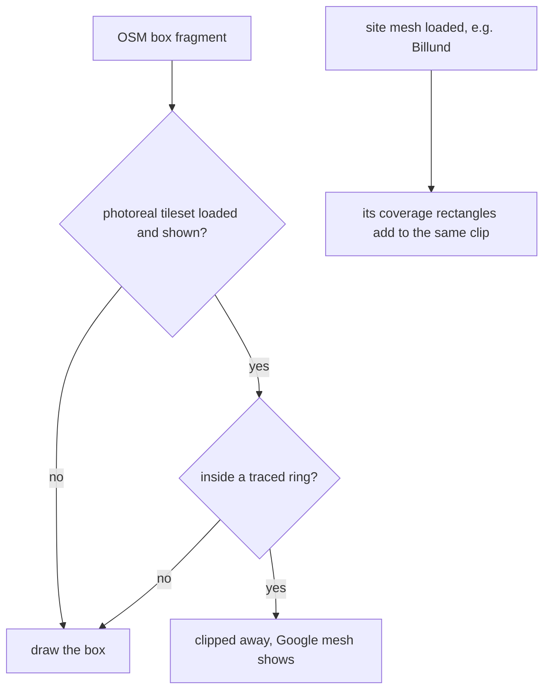

# Photoreal coverage: where the grey boxes stop

2026-10-22. Why inner Copenhagen rendered as grey blocks over a photoreal
city, and what now decides which building layer draws where.

## The two building layers

The map carries two tilesets that both draw buildings:

| layer | source | what it is good for |
|---|---|---|
| Google Photorealistic 3D Tiles | Google, via our own key | real building meshes, but only where Google has flown a city |
| OSM Buildings | Cesium ion asset 96188 | grey extrusions from OpenStreetMap footprints, everywhere OSM has a footprint |

Both have been on together in day mode since the first prototype commit.
The intent was a fallback: boxes where Google has no meshes. The side
effect is that wherever OSM has a footprint, the box sits over the real
building. Inner Copenhagen is mapped wall to wall, so Rundetårn was a
grey cylinder and Christiansborg a grey cross. At the airport few
buildings are mapped, so it never looked wrong there.

Google publishes no list of which cities carry meshes. The edge is
only visible by looking at it.

## What decides it now



- Rings live in `src/data/photoreal_coverage.json`, `[lon, lat]` pairs,
  one per city, dated and attributed. Data, not code. A new city is a
  pasted ring.
- `src/photoreal_coverage.js` owns the clip. It is the one writer of
  `clippingPolygons` on the OSM tileset. The Billund mesh swap in
  `building_footprints.js` routes its polygons through the same owner,
  so a site loading or unloading never wipes the city rings. Before
  this, `clearBuildingSwap` cleared the whole collection.
- The base layer follows the photoreal tileset's `show`. Night mode in
  Live hides photoreal; the boxes come back there automatically, since
  they are the only buildings. Checked once per frame, rebuilt only on a
  flip.
- No key, 403, sovereign profile, no WebGL2: nothing is clipped and the
  map draws exactly as before.

Day mode, night mode and `_updateNightPhotoreal` were not edited. The
gate `check:photoreal-coverage` asserts that no new writer of
`osmBuildings.show` appeared.

## The Copenhagen ring

Traced by Lucas on 1574 by shift-clicking where the 3D buildings turn
flat, Køge north to past Frederikssund. 30 clicks, 2 removed (a 400 m
spike and a misclick), closed across North Zealand and down the Øresund
by hand. 2672 km².

Verified: the west edge, walked by eye. Unverified: the north closure
(Helsinge to Helsingør) and the sea side. The failure inside the ring is
flat ground where Google has no mesh. If a town inside renders flat, the
ring shrinks; it never grows without a look.

## Tracing a ring

On a dev instance, console:

```
__isr_buildings.hide()       see real buildings against flat ground
__isr_coverage.arm()         shift-click adds a vertex at the click
__isr_coverage.show()        draws the line so far
__isr_coverage.undo()        drops the last vertex
__isr_coverage.ring()        prints the ring, paste it into the json
```

Plain clicks still pick entities. Cesium hands a shift-click only to
handlers registered for shift, so the map's own click handling never
sees a tracing click.

A/B without reloading: `__isr_coverage.clipOff()` brings every box back,
`clipOn()` re-applies the rings, `clipState()` says what is on.

## Cost

Cesium builds one signed-distance texture per collection, 4096 px square
at the default quality, on the GPU, once per change. Per frame the cost
is one texture sample per box fragment, the same cost Billund has paid
since its mesh landed. Measured by eye on 1574 with the swarm running;
see the commit for the result.
