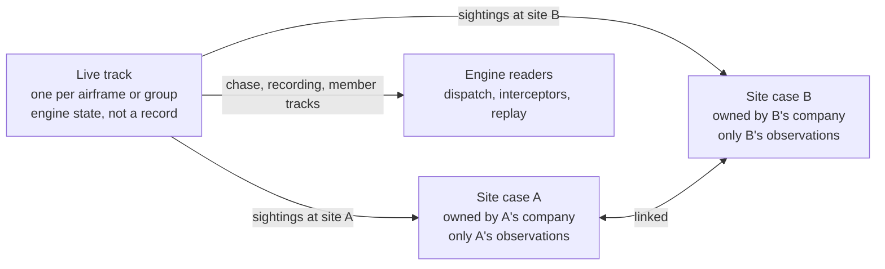

# Track and Site Case Architecture

Status: BUILT 2026-11-05 on branch fix/site-case-own-sightings, from design v2
(the overseer's review of v1 returned build with changes; every change is
folded in below and in the code). Gate: `check:site-case-scope`.
Lucas's rule, verbatim in intent: a site's case keeps only what that
site's own sensors saw. Its end time is the last sighting at that
site. Nothing is written to a closed case.

Companion to `swarm-individual-tracking-architecture.md` (member
tracks), `track-identity-architecture.md` (identity comes from the
edge) and `event-model-edge-cases.md` (the catalogue). This page is
the one to start from for "what is a track, what is a case".

## The problem

One object carried two things. The first site's case (the primary)
was also the live track: `droneState`, the recording, the member
tracks and every dispatch keyed to its id, and the tick wrote the
track's state onto it every frame. So:

- the airport case closed when the swarm left the airport, and kept
  being written to until the whole track ended: end time, exit, last
  position and duration all came from Amager's sensors;
- the airport company's report named Amager's sensors and position,
  which is another company's observation;
- the second site's case copied the first site's member kinematics at
  spawn, the reverse leak;
- the archived report, built at close, held live references and
  changed after close.

An independent overseer inventoried every write (2026-11-05); the
findings above are the confirmed ones. The whole list is in the commit
that introduced this page.

## The model

**A live track** is the engine's object: where the airframe or group
is now, what every site's sensors see of it, its member tracks, its
recording. It is not a record anyone reads as a site's evidence, and
no account owns it. It lives in `src/live_track.js`, keyed by the
track id. In the simulation the track id is the first case's id, so
every existing engine reader that keys on `d.eventId` or
`droneState.get(eventId)` keeps working unchanged. A real feed keys
it by the edge's `object_id` (`track_source.js`); the slot was
designed for that and this page does not change it.

**A site case** is the record. It holds what its site's sensors
observed, from the first sighting at that site to the last, and
nothing after it closes. Fields that describe the observation
(`lastKnownPosition`, `lastPosition`, `exit`, `endTime`, `duration`,
`projectionSnapshot`, `temporaryLoss`, `currentlyInCoverage`,
`subject.kinematics`, crossing rows, out-of-range rows, member
kinematics) are written only from that site's sightings and only while
the case is open. Cases at different sites are linked, and each
company sees its own.

**The rule, enforced in one place.** `src/site_case_scope.js` holds
two pure functions:

- `observationFor(trackId, siteId, position)`: the observation a site
  may record from a track position: the position if that site's
  sensors see it, else nothing.
- `caseAccepts(caseRecord, siteId)`: open and at that site.

Every tick write to a case goes through `writeSiteObservation(...)`,
which applies both. A write that fails them is dropped, not redirected.
There is no second path. `check:site-case-scope` holds it.

## What moves where

| Today on the first case | Now | Why |
|---|---|---|
| `lastPosition` written every visible tick | `track.position` on the live track; each open site case gets `lastPosition` only from its own sensors | the chase reads the track; the case reads its site |
| `lastKnownPosition` with `siteId: bestSid` (any site) | each site case gets its own, only while its sensors see the airframe | the report's "last confirmed" is the site's own |
| `exit` and `closeEvent` at the end of the whole track (the second close) | for every per-site track (multi-site, not missile) the branch keeps everything that ends the TRACK (loss classified onto the track, the grace, `state.closedAt`, `markTrackClosed`, toast, persist) and drops only the two case writes. The missile keeps its one case as the track, by design. The completion gate is re-keyed on the track, not on "case active", so a group route that ends inside a second site still ends | one close per case, and the track still ends; without the track end the teardown never runs and no new scenario can launch |
| `temporaryLoss`, `currentlyInCoverage`, `projectionSnapshot`, `projectedPath` null | on the live track; mirrored to a site case only while open and from its own sightings | track state, not evidence |
| `subject.kinematics` written in place | the track's; a case's `subject` is a copy at close | the archived report must not change after close |
| crossing and out-of-range rows for every site | each row goes to the case of the site it names | a row naming site B is B's observation |
| member tracks copied at spawn with site A's kinematics | copied with `kinematics` nulled and `inCoverage: false`. While site B's case is open, the live track mirrors each member's kinematics, coverage and status to it through `sourceMemberId`, only when B's sensors see that member | the reverse leak, and a linked case that today never learns a member was downed |
| recording samples stamped `site_id: primary.siteId` | the recording is the LIVE TRACK's and stays whole under the track id, as admin's and receivers' whole-encounter replay, the debrief and the linked slices all depend on. Each sample gains `sites_seen: [...]` (a sample in the overlap is seen by two sites, so one `site_id` is wrong by construction). Operators are scoped on read, as today (`scopedTrajectoryFor`, `_scopeRecordingForActiveRole`); the operator's meta and CSV `site_id` column read `sites_seen`. The chain's terminal sample comes from the track's end position | nothing downstream breaks, and the overlap is recorded honestly |
| `lastPosition.rangeToPerim` measured against the track's template site | measured against the case's own site | a linked case's range was to the wrong fence |
| `_reacquiredSites` (sites crossed), `_prevCoverageSite`, `_prevInCoverage`, `_siteAgg`, `_droneCovState`, `_droneInsideState`, `_droneTransitionLog` | on the live track; a case's "sites crossed" is derived from its links | engine bookkeeping that named other sites on the case |
| `_fireReacquisition` escalating the first case to national tiers | the escalation is unchanged; listed under routing (Lucas, 2026-11-05: operator-designed routing, not yet). Only its `_reacquiredSites` write moves, see above | the set is data, the escalation is routing |
| `projectedPath` and `projectionSnapshot` | on the live track; drawn under the track id; an open site case mirrors the snapshot only from its own sightings. The receiver advisory reads the track through the case the receiver is on | a projection is a statement about where the track goes, not a site's observation |
| member status written after close on the first case (jam landing, broken away, lost) with their notes | a kill (interceptor, jam landing) on the case the unit was dispatched on, whatever its state, as the response layer below; and on every other OPEN site case whose sensors saw it go down, through `sourceMemberId`. A breakaway on the open cases whose sensors saw it. A loss, which no sensor sees, on the open cases whose own sensors held the member. The note goes where the status went | a member downed over site B after site A's case closed is B's observation; the kill is the unit's own case's outcome |
| the archived report built at close with live references | built from a deep copy (`structuredClone`; the report holds no Maps). `linkedAfterClose` is still appended to the copy, as today | frozen at close. Known limit, as today: a kill seconds after close is not in the archive, which is built once |

**`track.position`** carries `lat, lon, alt, speed, heading, timestamp,
inCoverage` (any site's sensors see it) and `siteIds` (which do). Every
engine reader of the first case's `lastPosition` or
`currentlyInCoverage` (`_liveTargetPositionFor`, `_tickCounterDispatch`,
`_gapLimitedStep`, `_bestTargetForDispatch`, `_scoreKinematicContinuity`,
the F-35, the friendly missile, `tryNeutralize`, the inbound follow, the
sweeper's single-drone verdict, `_classifyDetectionLoss`) reads it
through one helper, `_trackPositionFor(eventId)`: the live track's
position when the id is a track, resolved through `shadowOfEventId` or
`soloSiteCaseOf` when the id is a linked case, the case's own
`lastPosition` otherwise. `_classifyDetectionLoss` classifies the loss
against the perimeter of the last site that saw the track
(`siteIds` of the last in-coverage position), not the first case's.

**Dispatches stay bound to the case they were sent on.** The dormant
handover in `_tickCounterDispatch` (a closed case with an active linked
case that has a `lastPosition` re-keys the dispatch to the linked case)
is removed. It never fired because linked cases never had a
`lastPosition`; this change gives them one, and the handover would then
re-key every unit to a case with no track state, which is the "mass
RTB past four live drones" failure its own comment records for
breakaways. A unit follows the track through `_trackPositionFor`, and
its case stays the one it was dispatched on.

**Response-layer writes after close are allowed, and are the only
ones.** A dispatch's outcome, kill, wreckage, miss note, last spotted
location, dispatch mirror, cordon escalation and the late-kill
supersede are written to the dispatch's own case whenever they happen,
as today. They are the response's record, not a sensor observation,
and Lucas's rule is about sensors. `check:site-case-scope` names these
writers as the exemption; nothing else may write a closed case.

**Link metadata at spawn** (the domain union, the archived report's
`linkedAfterClose`, the correlator's link and "Threat re-emerged" note
on the earlier case) is intended and stays.

## What a company sees

- An operator's screens, reports, recordings and exports for its case
  carry its site's observations only. There is nothing to filter after
  the fact, because nothing else was ever written to the case.
- Admin sees every site case and the live track.
- A receiver on a case sees that case; the chain rule (fix 3,
  `phase3-tenant-isolation.md`) is unchanged.

## Grace window and routing: not in this change

Lucas's grace rule (same case continues if the track returns within
the window, end time stays at the last sighting) is a lifecycle change
and is designed separately; today a site case closes on the first tick
its sensors lose the group and any return opens a new linked case.
The automatic national escalation on re-acquisition and the blanket
notification of a site's receivers belong to the routing design that
operators will configure at setup. Both are listed, both are untouched
here, so that this change stays the track and case split and nothing
else.

## Entry points, for an engineer plugging in

| You have | You call | It does |
|---|---|---|
| a track identity from the edge (`object_id`, `site_id`, `node_id`) | `publishTrack(provider, track)` in `track_source.js`, unchanged | validates and attaches the identity. Position does NOT travel through it, by design (`_publishSimTrack`'s header): the edge takes over identity before it takes over movement |
| a track position | `observe(trackId, position, sightings)` in `live_track.js`. The simulation calls it from the drone tick; `live_sensor.js` calls it for a live detection (it is the one other writer of `lastPosition` today, and is named in the gate) | the track moves; every open site case among `sightings` records its own observation through `writeSiteObservation` |
| a track that left a site | nothing extra: `_handlePerSiteLifecycle` closes the case once | end time is the last sighting |
| a question "where is track X now" | `trackPosition(trackId)` in `live_track.js` | the engine's answer, never a case's |

## Gate

`check:site-case-scope`:
- every write of an observation field in `main.js` goes through
  `writeSiteObservation`, and none is reachable after `closeEvent` for
  the same case (brace scan, as `check:engine-reads` does it);
- `observationFor` and `caseAccepts` run for: a position seen by site A
  only, by both A and B in the overlap, by neither, and a closed case;
- the archived report is a deep copy: mutate the case after close, the
  archive does not change;
- a group track's second close no longer exists in the source;
- member tracks copied at spawn carry no kinematics.

- `track.position` carries speed, heading, alt, timestamp, inCoverage
  and siteIds, and `_trackPositionFor` resolves a linked case to its
  track;
- the dispatch handover branch is gone from the source;
- every writer allowed after close is one of the named response-layer
  writers;
- `_soloCaseClosed` and `_soloTrackLoss` are gone: `caseAccepts` is
  the one rule for both flows, and `check:single-drone-flow` is
  rewritten to it;
- `subject.kinematics` (a nested write that `check:event-mutations`
  cannot see) is written only on the track.

Plus the pass test: the swarm and the Shahed under admin, both
operators and a receiver, with the airport case's `endTime` equal to
its close note, its `lastKnownPosition.siteId === 'cph'`, Amager's case
carrying no airport kinematics, the airport operator's report naming no
Amager sensor or position, admin's replay still covering the whole
encounter, and a real interceptor takedown across the two sites with
the units still chasing after the airport case closes.

## The overlap, decided

About 200 m of the airport's and Amager's coverage overlap. Today the
case records the globally nearest sensor's site. Under this design both
cases record the same point, each with its own `siteId`, because both
companies observed it. One predicate decides "this site sees this
point" everywhere: `_sensorSeesPoint` with the sensor ceiling. The
swarm's site-membership test, which today drops altitude, moves to it,
so a case can never be open at a site whose sensors do not see the
lead.

The group tail: the lead may leave the airport while a wingman is still
inside. The case stays open until the last member leaves, so the
case-level last known position is the last position of ANY member the
site saw, not the lead's. End time equals last sighting.

## Round 2, the overseer's review of the build

Build with changes became safe with fixes on the code. Folded in:
the impact is recorded only on an open first case; a unit dispatched on
a linked site case follows the track but gets no target to engage, as
on main, until the chase is keyed on the track (listed below); the
missile's single case records the whole track; the first case's member
tracks are written only while open and seen; a site case's exit is its
own OUT OF RANGE row, where the last live drone left its coverage,
with the lead's last sighting as the fallback; the evasion check and the
projection read the track, and the line is drawn under the open site
case whose sensors see it; a return's first DETECTED row lands on the
case the return opened; the live track is kept past the teardown so the
chain debrief, the sweeper and the correlator keep its last sighting;
an open case's duration is sim seconds since its own start.

What a case's fields mean: `lastKnownPosition` is the LEAD's last
position this site's sensors saw (the missile's single case: the site
that saw it); `exit` is where the last live airframe of the group left
this site's coverage; `duration` is sim seconds from the case's own
start to the lead's last sighting at its site (the first case counts
from launch, as on main); `endTime` is the wall clock at its site's
exit. Member kinematics are per member, mirrored only while the site's
sensors see that member; member statuses as in the table above.

Listed, not done: keying the engagement on the track so a receiver may
dispatch a unit on its own site's case and have it engage (today that
unit follows but cannot hit, as on main); `subject.behavior.state` no
longer reads 'approach' from a case's projected path (its only reader
ignores it).

## Round 3, the overseer's follow-ups

The overseer found round 2 safe to merge, with six follow-ups. The ones
that change what a customer sees are done here, with one the overseer
did not list:

- **A kill is the dispatching case's own outcome.** Round 2 wrote a
  member's "neutralised" to the first case only while it was open and
  its sensors saw the kill, so a drone shot down over Amager read
  "tracked" on the airport case that sent the interceptor. Main, and the
  response-layer rule above, put it there. `_setMemberStatusEverywhere`
  now takes the dispatching case (`ownerCaseId`) and writes it there
  whatever its state. Proven live: Rigspolitiet acknowledges and
  dispatches from its own screen, four drones go down over Amager, and
  the airport case reads four "neutralised" on the fix as on main.
- **A loss goes to the open cases that held the member.** Round 2
  checked the lost member's position against the site's sensors, which
  by definition do not see it, so "lost" was never recorded anywhere.
- **A member note goes where its status went.** The breakaway and loss
  notes went to the first case always, also after it closed, so a closed
  airport case gained "lost" in its notes while its roster said
  "broken-away". Main wrote both after close; under this rule neither
  lands on a closed case.
- **The missile's single case names the site that saw it**
  (`bestSid`), as main did. Round 2 named its origin site always.
- A linked case's projection line reads the track under the track id,
  resolved once and not per frame; the return's DETECTED row has the
  detected colour; the teardown comment no longer claims a reset that
  does not exist.

Listed, not done:

- `duration` stops at the lead's last sighting at the site, and the
  case closes when the last member leaves, so a spread-out group's
  duration is a few seconds short of end minus start (1 s in the
  airport-to-Amager swarm).
- The report's course-change figure compares a case's own snapshot
  with its own last heading, both from its own sightings, so it reads
  about 0. On main its non-zero values came from another site's
  heading. The right source is the re-acquisition check, which reads
  the projection from before the gap. This belongs to the report work.
- A single drone's return writes no DETECTED row onto the case it
  opens; the swarm's does.
- A linked case lists every member of the group from its spawn. A
  member its sensors never saw reads "tracked" with no position, as on
  main.

## Stale text corrected in the same change

The 30 s crossed-site wait removed in d4b6df0 (sweeper comment), the
same-case continuation inside one site that the code does not do
(`event-model-edge-cases.md` §1), the closed panel's "duration written
after close" comment, and the report's "sites crossed" read.
